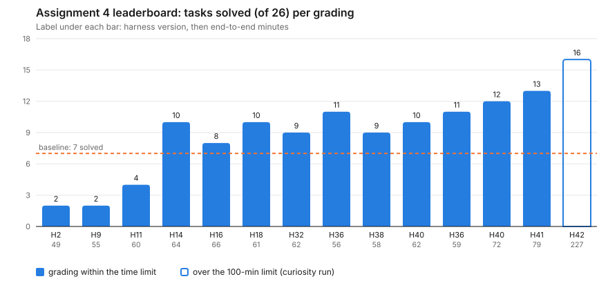

Over Assignments 2–5 I built one coding agent and kept changing it: a single loop on 10 SWE-bench Pro tasks (A2), a multi-model harness with a dollar budget (A3), the same harness running against my own SGLang server on one GPU (A4), and finally a version that also had to handle Terminal-Bench 2.0 (A5). For A4 I tested more than 40 harness versions and 10 engine versions. Here's what I learned, sorted by topic.

A note on naming: I gave every version an id. H-numbers (H2, H14, H41, …) are versions of my **harness**, the agent code that talks to the model and runs the tools. E-numbers (E4, …) are versions of the **engine**, the SGLang server setup that serves the model. Each new version usually changed one thing from the one before it, so H2 is just the second harness version after my starting point (H0, the Assignment 3 agent). The numbering started over in A5, so A5's H4 is a different harness from A4's H4.

## 1. Harness engineering is hard

Solving tasks takes a long time, and the agents are non-deterministic. In A4 I did 74 local runs at 35–60 minutes each, and one leaderboard upload even waited 1 h 49 min in the queue before its hour-long grading even started. A5 allowed two gradings a day. Also, identical code scored 20, 23, 21 and 24 out of 25 across four local runs (H30).

**The noise was an issue in every assignment.** Over seven A2 runs I got 5, 8, 4, 6, 4, 7 and 7 out of 10. I was changing things between runs (run 3, for example, cut the budget), but the swings were bigger than any single change could explain. A3 was worse, as with only 5 local tasks, every version landed between 1/5 and 3/5, so I couldn't tell any of them apart. In A4, one H36 zip was graded twice on the leaderboard and scored 11 both times, but H40 scored 10 and then 12. In A5, my H4 agent solved 32/89 in one local Terminal-Bench run and 30/89 in another (on a slightly different engine), then 28/89 in each of two leaderboard gradings of the same zip. Even when the totals matched, the *set* of solved tasks shifted by 12 to 17 tasks between identical runs. So I started treating one run as one sample: a gain of one or two tasks doesn't mean much until it shows up again.

**Local results don't translate to leaderboard results, so local iteration plateaus.** This was a large obstacle in A4, since it reduced the effectiveness of iterating on new ideas and provided less signal on where to improve. H9 passed 17/25 locally, twice, and then scored **2/26** on the leaderboard. H2 went from 10–12 locally to 2. 

The leaderboard tasks were different, and each turn ran about 1.4× slower there, so the budgets I'd tuned on local timing were cutting tasks off before they could finish. When I later gave H36 roughly 1.5× the turns and 1.4× the time (H41), it went from 11 to **13/26**, and four of those solves finished after H36's whole run would already have been over.

*My A4 leaderboard gradings. The last bar was a run that used the whole 4-hour limit.*

In my A3 write-up I said iteration had been slow and I hadn't kept careful track of what I changed. Since every run was slow and noisy, in A4 I tried to be more careful:

- **Every version got an id and a row in a log** (`H14`, `E4`, …) with its commit, what changed, why, a prediction, and the result. Most versions changed only one thing.
- **I could test ideas offline before submitting them.** One idea was a fresh-context reviewer that checks the patch at the first submit as validation. I replayed it on 207 local recorded submits against a preset threshold. It flagged 28.1% of passing patches (my limit was 25%) and 53.2% of failing ones, so I dropped it. A looser version held up on 95 new submits, but the expected gain (about +0.6 passes per run, for about 2 extra minutes on every first submit) wasn't worth it. Another check showed that warming up Jest would save under 2% of a task's bash time, so I skipped that too.

## 2. Agents are good at ingesting data, but one research agent can get tunnel vision

Agents are really good at ingesting huge amounts of data and making sense of it, but letting a single agent lead research causes tunnel vision. My analyst agent wrote 45 reports in A4, including replays of 207 recorded submits. But after about H21, most new versions were the top pick from the analyst's previous report, and ten of them (H21–H38) tweaked the same retry logic. Three of those (H29–H31) were later reverted because none of their extra attempts converted on the leaderboard, and H37 plus H38 took the leaderboard score from 11 to 9. Meanwhile, the biggest jumps came from ideas outside that loop: keeping Qwen's thinking (H11), moving search rules into the tool (H34) and bigger budgets (H41, 11 → 13 on the leaderboard). Maybe next time I would try having an adversarial agent or an idea-generating agent to prevent this problem.

The best students also came up with higher-level ideas that I don't think my agent's iteration loop would ever have found. My agent's workflow loop only ever added things to the harness; it never took anything away. Some other high-level directions my agent didn't consider due to tunnel vision were:

- **A simpler harness.** One conversation per task that reads, edits, tests and submits on its own beat multi-role plan/do/review pipelines.
- **Prefix-aware scheduling.** Serving requests whose history is already cached first raised one student's cache hits to 89% and cut their replay time from 841 s to 328 s.
- **Removing weights they didn't need.** Dropping the vision encoder and the duplicated speculative-decoding weights grew one student's KV cache from 340K to 444K tokens.
- **Using the speculative decoding head only for coding tasks**, instead of on every request.
- **Giving Qwen the tool definitions it was trained with**, using Qwen Code's exact tool names and parameters.
- **Optimizing at the kernel level**, tuning kernels for the GPU and compiling them before the server reports ready.

For A4 and A5 I ran a "head researcher" agent that planned experiments, an analyst agent that wrote reports, and a scheduled task that watched the leaderboard and uploaded zips marked READY. This let experiments run overnight. The head researcher also tended to keep refining whatever it was already working on instead of stepping back to ask if it was the right thing to work on. The agents push hard in whatever direction you point them, so choosing the direction is crucial.

## 3. The way the model was trained matters

The way LLMs are trained matters a lot. Qwen with thinking on needs to keep thinking tokens from previous turns, instead of dropping them. This is because, when it was trained with thinking on, it kept thinking tokens from previous turns. Dropping previous thinking leads to extremely long loops. Other students also took advantage of this - for instance, one valid strategy is to only provide bash as a tool since the LLM is trained in a bash-only environment, or giving the exact tool names that Qwen code harness would have, since Qwen was trained in the Qwen code harness. One student noticed Qwen kept calling `list_directory`, a tool it was never given, so rebuilding Qwen Code's tools with the same names and parameters let it stop improvising in the shell.

Early in A4, some responses ran all the way to the 8000-token limit without ever calling a tool. They looked like repetition loops, so I first tried the usual sampling fixes:

- **Lower temperature (H3, 0.6):** responses hitting the limit actually went up, from 12 to 23, and took 28% of model time. Passes fell from 11 to 9.
- **Presence penalty 1.5 (H4):** there were fewer loops, but passes fell from 11 to 6 and many more hidden tests failed.
- **Capping the thinking length (E5/E6):** my own logit processor slowed decoding by about 9%, and SGLang's built-in limit lost a task.

None of these fixed the cause. The loops came from my harness dropping the model's thinking from earlier turns. Qwen was trained with that thinking left in, so without it the model was in a situation it had never seen and kept re-deriving its plan from scratch every turn. Once I kept the earlier thinking in the conversation (H11), responses that hit the limit went from 26–31 per run to 0–1, and passes went from 17 to 19 in both runs, without making the runs any longer. Other students hit the same loops. One turned thinking off because of them, and the students who ran without thinking got faster runs but lost solves on harder tasks.

## 4. Independent retries can beat appended ones

After a first grading where half or more of the tests failed, retrying in the same chat converted 4 of 46 tasks, while a fresh start (new chat, reset repo) converted 14 of 40. Appending still wins when the agent was close: when a time limit cut the first attempt off mid-fix, same-chat retries converted 19 of 30.

- **A guaranteed retry after the first failed grading (H9)** took local passes from 12–13 to 17. Before that, only 2 of 31 failed first gradings were ever graded again.
- **Starting over sooner.** I think a long failed conversation keeps the model attached to its first approach. Starting over as soon as half or more of the tests failed (H37) gave 5 passes out of 10 early restarts.
- **An identical resubmission usually means the agent is stuck.** I found 37 duplicate resubmissions across 19 runs, and only 2 of those tasks passed afterwards. In 29 of the 37, the agent didn't edit any source code between the failed grading and the duplicate. It wrote throwaway tests in `/tmp` and described the patch as finished every time. Part of this was my fault, since my retry prompt told it to turn the requirements into tests, which is exactly what it did. Ending the attempt on a duplicate (H38) let 3 of the 4 affected tasks pass after a fresh start, but overall passes stayed at 21–22 locally, and with H37 and H38 together the leaderboard score went from 11 down to 9.
- **Check that the patch builds before the attempt ends.** 13 of the 15 earlier final patches that came back "tests did not run" had build errors. Adding a short build-and-fix window at the end (H18) brought "tests did not run" on the leaderboard from 4 down to 1.

## 5. Impact of sentences in the prompt

**One sentence in my system prompt was losing me tasks.** My early A2 prompt told the agent to "stop as soon as the tests pass." On my own Kaggriculture task (hiring farm hands past capacity), the issue listed three requirements: a `max_hands=1` policy emits one HIRE; a farm with `max_hands=2` and one hand allows exactly one more HIRE, after which HIRE is masked; and projecting a further HIRE spends no money. The agent fixed the first two, saw the tests pass, and stopped. I deleted that sentence and changed `done()` so the first call shows the original requirements again as a checklist and only a second call actually ends the loop. I also made `done()` reject an empty diff. Both of my "unsolved" tasks passed after that, and the harness went from 5/10 to 7–8/10 on the Pro tasks.

**Tell the agent where to look when the wording is ambiguous.** In my TSCD task the issue said to treat small values as "no variance." The agent set them to 0, but an `if` a few lines away showed that this code *skips* zero-variance values. Adding one line, "resolve ambiguous wording by looking at what nearby code already does," fixed it.

**Advice in a prompt mostly gets ignored, so put it in the tool.** In A4, one task spent 754 s on recursive `grep` because it was searching through `node_modules`. I added a prompt rule about narrowing searches and skipping dependency folders (H33). The model followed it in only 0–7% of searches, and passes actually went down slightly (22–23 → 20–21). So I moved the exclusions into the bash tool itself (H34). That broke on images with BusyBox `grep`, which doesn't support `--exclude-dir`, so H35 uses `find` to skip those directories before calling grep. The same search went from 56–59 s to 4–5 s. Since then, if a behaviour really matters, I build it into the tool instead of hoping the model reads the prompt.

## 6. How to optimize the KV cache

Assignment 4 helped me to think about and understand the KV cache in a real system. At the start of A4, the SGLang benchmark showed a median call of 3.3 s, but my agent's calls averaged around 30 s, and about 31% of each call was time spent waiting in the queue. The KV cache was 91% full, yet only 31% of prompt tokens hit the cache, so the server kept re-prefilling the same conversations. The problem wasn't decode speed, but memory.

- **Hierarchical cache (E4)** keeps evicted prefixes in host RAM so they don't have to be recomputed. Cache hits went from 31–34% to **66–73%**, and the average call dropped from about 57–60 s to 42.7 s.
- **Compaction (H14)** was the biggest single win of A4. Even with only 16 tasks open, prompts grew to 55–62k tokens and spilled out of the host cache. Once a conversation passed 42k tokens, I dropped older tool output and old thinking. Cache hits reached **93%**, queueing almost disappeared, runs went from 54–59 min to **38–40 min**, and the leaderboard score went from **4 to 10**.
- **Running more tasks at once made everything slower.** With all 25 tasks open (H9), the mean call time went from 22 s to 117 s at peak. Going from 16 to 20 open tasks (H22) made calls about 21% slower without shortening the run, so I went back to 16.
- **Not every memory idea fit.** A 2.0× host cache couldn't allocate enough RAM to start (E7). Speculative decoding ran out of GPU memory at startup and would have nearly halved KV capacity anyway (E9). Raising GPU memory to 92% (E2) gave me one good run and then an OOM 20 s into the next one.

## 7. The slowest task sets the total time

The leaderboard measures time from the start of the run until the last task finishes, so the slowest task matters much more than the average one.

- In A4, H26 added a second attempt for failed tasks. It gained two passes, but one failing attempt stretched the run to 60.6 min. Stopping second attempts at minute 45 (H28) kept the passes and brought runs back to 38–41 min.
- In A5, my H3 harness gave tasks extra time once every task had been opened. On the leaderboard, one of those tasks ran until the 100-minute cap, so a run that should have taken about an hour took 1 h 39 min (31/89). H4 removed the extension, and its two gradings took 56 and 55 min (28/89 both times). Locally it did 32/89 in 59.5 min.
- I also checked whether opening tasks sooner would help, and it wouldn't have: in 9 of 16 runs, the task that finished last had already been opened in the first wave.
- Out of curiosity, I gave H42 budgets that filled the whole 4-hour limit. It solved 16/26 in 3 h 47 min, which is more solves but far past the 100-minute baseline.

My best A5 leaderboard result was H1 with 33/89 in 71 min. H4 averaged about the same number of solves across its runs and finished about 15 minutes sooner, so I used my last grading on a second run of H4 instead of H1. It came back 28/89 in 55 min. All of my A5 gradings cleared the Fast baseline of 20 tasks in 2 hours.

## Takeaways

1. Treat one run as one sample. Run baselines at least twice and compare against the variance.
2. If a behaviour really matters, enforce it in the tool or the harness, not the prompt.
3. Match the format the model was trained on. For Qwen, keeping its earlier thinking.
4. With one GPU, fix memory and cache hits before decode speed. Compaction helped more than server flags.
5. Start over instead of retrying in the same chat, and treat a duplicate submission as a sign the agent is stuck.
6. The slowest task sets the total time, so cap it.

---

*AI use: iterating on the harness locally, analyzing performance of the harness, blog layout*
