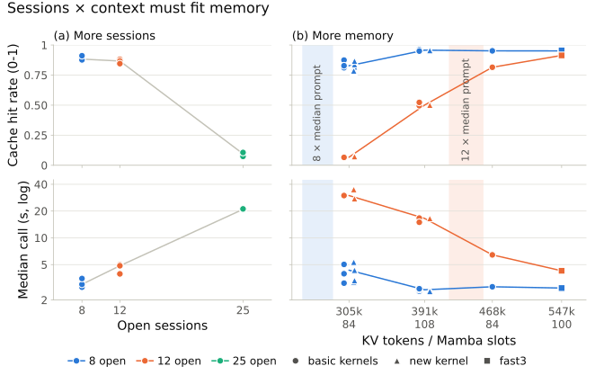

In this post I share four lessons:

- The same agent gets different scores each run, so test a change more than once.
- My harness, not the model, limited my score.
- Running too many tasks at once fills GPU memory and slows every call.
- Test the server with your agent's real calls, not made-up prompts.

## Non-determinism in LLMs leads to flaky scores

LLMs pick each token at random (sampling), so the same code (a zip, which is one submitted version of my harness) makes different choices each run. As a result, many of the tasks on the course leaderboard (the board) were a coin flip. For example, in assignment 5 (A5 in the figures), 31 of the 89 Terminal-Bench 2 (TB2) tasks sometimes passed and sometimes failed with the same code, whereas 19 always passed and 39 never did. In assignment 4 (A4), about 9 such coin-flip tasks explained most of the spread. The lesson from this observation is that to test any change to the harness (like capping the context or increasing the number of retries), multiple runs are required to see if the change improves the solve count or not.

## The harness, not the model, caps agent scores
, other teams solved 16 of 26 by 48 min and 18 by 84 min; my best version needed 165 min to reach 18.")

Across the three assignments combined, I used 68 different versions of the harness, but no version's average score rose above the noise band of my own best zip (the score range of one unchanged zip).
- In assignment 3 (A3), my harness chose which of the three models to call and in what order. I count this routing as part of the harness, and it moved the score the most. Using the starter model alone resulted in 0 solves, whereas using the standard model alone kept the solves at 12 or fewer. Adding the expert model raised the solves to up to 19, but the trade-off is that the expert model is costly.
- In assignment 4, my first harness stayed at 12 solves or fewer. What I understood was that independent tries for every task are better than building on the old failed try. That change raised the solves to 12 to 18.
- In assignment 5, my 13 harness versions scored between 24 and 40.

Comparing my results with other teams' results on the board showed that there was enough room to improve the harness: in assignment 4, all of us used the same model, so the harness made the difference. At first, I tweaked the prompts to get more solves, but later I realized that the changes had to come from first principles, such as changing the structure of the harness and how the retries run.

The takeaway: compare with other teams on the same model to find the ceiling, and change the harness's structure, not its prompts.

## Too many open sessions overflow the KV cache and slow every call

The number of open sessions refers to the number of agent conversations that the server is serving at the same time. For the given GPU, the KV pool (the GPU memory that stores the prompts the server has seen, so it can reuse them) can only hold up to 391k tokens on the default engine.

What I observed was that when 8 sessions were open at once, the hit rate (the share of prompt tokens the server reuses from its cache) was 0.88 to 0.91, and the median call was about 3 seconds. When I increased the number of open sessions to 25, the hit rate fell to 0.11 or less, and the median call time was about 21 seconds.

What happened at 25 open sessions at once was that almost every call had to recompute the prompt that the server had already seen. 25 open at once produced no more tokens per second than 12 open. Why did this happen? This happened mainly because the KV pool was limited to 391k. At 25 open, the sessions' contexts (25 times the median prompt of my first harness, about 16k to 23k tokens each: 407k to 576k tokens in all) no longer fit in the pool, so stored prompts were removed from memory and had to be recomputed.

The lesson learned was that memory sets a cliff, and compute sets the ceiling. Below the cliff, total decode tops out near 500 to 690 tokens per second, no matter how many sessions run. Fit needs room to spare. A 305k pool (engine setups that left less GPU memory for the pool: a smaller memory share, or larger kernel weights) still lost part of its cache at 8 open (hit 0.78 to 0.87, against 0.95 to 0.96 with the 391k pool), even though 8 sessions times the median prompt (252k to 287k) is below it. This test replayed my later harness, whose prompts were longer, about 32k to 36k tokens each.

Using these observations, I tuned the number of open sessions on the engine for assignment 4 and assignment 5. The key takeaway is to size the concurrency to memory first. The lever is fewer or shorter sessions, not faster computation. 

## Synthetic benchmarks mislead serving decisions for agents

Initially, I benchmarked the system using the SGLang serving benchmark, which uses made-up prompts. "Random" uses random tokens, and "shared-start" uses a long common start plus a few new tokens. The replay sends my logged agent calls to the server again, turn by turn. For each, I measured the hit rate and the queue time.

At 8 open sessions, the real and the replay hit rates matched (about 0.97), whereas the shared-start prompts' hit rate was lower, around 0.83. The shared-start prompts also overstated the queue time by 36 to 49 times. At 25 open sessions, the real and replay hit rates were nearly the same, 0.075 and 0.082, whereas the shared-start prompts reached 0.28, which is almost 4 times higher than what I saw in reality. The random prompts gave 0, as expected.

This benchmarking with made-up prompts does not reflect actual agentic serving. The benchmark sends the next request at once, whereas real agents pause for tool calls, which changes how long each session's prompt stays in the cache. Even the replay with 5.7-second pauses missed the real queue time at 25 open. Real pauses vary, and real runs also wait for grading.

Based on this, I retested the engine changes with a second replay: my later harness's logged tries, each with its own logged tool gaps (capped at 60 seconds), and a fresh, empty cache for every run. I ran it at 8 and 12 open only, where its hit rate (0.95 to 0.96 at 8 open) came close to the real runs' 0.97. I did not run it at 25 open, so I do not know whether real tool gaps fix the queue time there. I also chose how many sessions to keep open from real agent runs, not from the synthetic benchmarks.

The takeaway: benchmark by replaying your own agent calls at the real context size and session count, and check the queue time on a real run.

## Conclusion

- The harness was my bottleneck. With the model fixed (assignment 4), other teams did better, and only a change to the harness's structure, independent tries, moved my score.
- Chance moves the score a lot, so test every change more than once before trusting it.
- For speed, the open sessions' contexts must fit in GPU memory, and only replays of your agent's real calls show whether they do.

## AI use

I used Claude Code to pull numbers from my run logs, write the plotting code for the four figures, draft bullet points that I rewrote in my own words, and check and improve the English.
