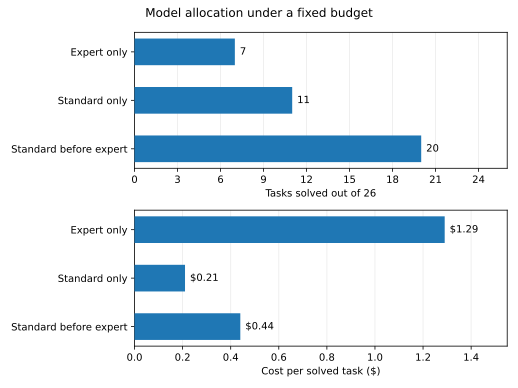
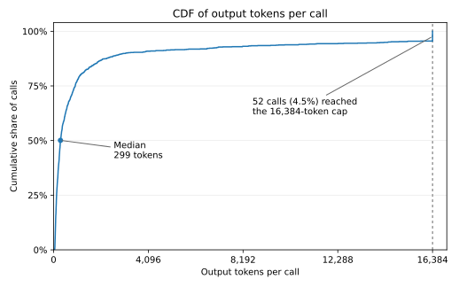
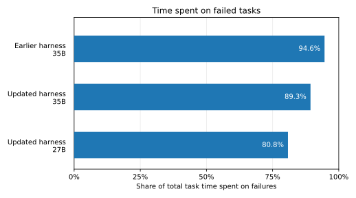
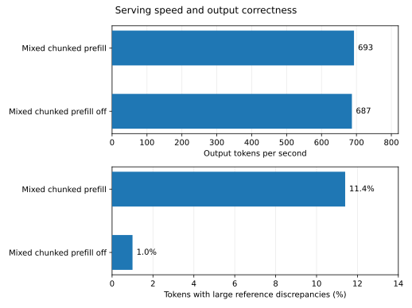
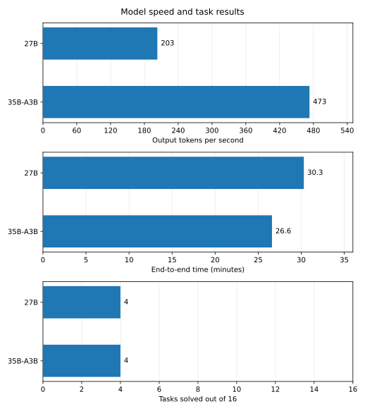
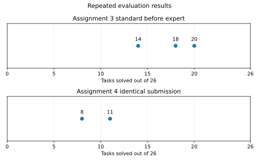

I used a coding agent to help build my own agent across these assignments. It wrote most of the implementation and helped me run experiments and work through the results.

The tests sometimes checked the wrong thing, and bugs in my harness made the model look worse than it was. Reasoning loops used up time as well. I also kept testing on the same tasks and wondered how much I was overfitting the harness to them.

<!--more-->

## A patch the tests couldn’t call

One Go patch supplied a standalone function where the tests expected a method. The test package couldn't even compile against it. I found failures like this while reading through 212 failed gradings from Assignment 4, including 101 where at least three quarters of the hidden tests failed. Seeing the same scores on later attempts made me suspect the agent was repeating a mistake.

I added guidance about matching the expected interface. The next build solved eleven of twenty-six tasks, up from five. The same build scored eight on a rerun, though, so part of that jump was run-to-run variation.

I also looked at five failed tasks from a hard Assignment 3 batch. On four of them, the agent's own scripts passed. Some scripts were calling the wrong function, and in one case the agent changed a correct fix to fit data it had made up for a test. The check inherited the same assumption as the code.

Assignment 5 had environment problems too. A PATH change in the interactive shell could work for the agent and still leave the evaluator unable to find the command. Test commits could be left in the graded repository. There were also claims of speed improvements with no measurement against the reference.

For Assignment 2, I had to check that tests actually ran and that the agent hadn't edited the existing ones.

## Lost reasoning and empty reviews

I kept seeing the model redo its planning in Assignment 3. My harness was dropping its earlier reasoning between calls, so each new call arrived without work the model had already done.

Once I kept that reasoning, output fell from 1,171 to 322 tokens per call in the local test, a 73% drop, and the thirteen turns with no action disappeared. Both versions solved three tasks in the five-task batch, but the cost fell about 34%, from $0.435 to $0.286.

Another bug was in the reviewer. An empty response counted as approval. Six of the nine reviews were empty because the model had used its token allowance for hidden reasoning, so the harness approved patches the reviewer hadn't given a verdict on.

Later, in Assignment 5, I found some continued-call usage being counted twice. That made the context counter stop tasks when they'd used roughly half the context they actually had available.

## The cheaper model and simpler harness won

The expert-only run in Assignment 3 ran out of money with seven tasks still unopened. Starting with the expert model had been getting me seven to eleven solves out of twenty-six, while other leaderboard entries were spending much less. I tried giving the standard model two attempts before escalating so more tasks would get a chance. My best run reached twenty solves.

That run cost about 66% less per solve than expert-only. Clean reruns came back at fourteen and eighteen solves, with costs per solve about 50% and 60% lower. Standard-only was cheapest per solve; I paid for escalation to finish more tasks.

I tried adding a gate and reviewer as well. On one five-task local test they got four right for $1.92, while the simpler harness got all five for $1.78. The simpler version did at least as well in every comparison I recorded, so I went back to it.

## A few long calls ate the budget

About nine minutes of one twelve-minute Assignment 2 task went into replies that got cut off. Thirteen of thirty-two replies hit the 4,096-token output limit. Capping each call had left plenty of room to waste the task budget across repeated calls.

The Assignment 3 reviewer sometimes spent all 8,192 tokens thinking and returned no verdict. In Assignment 5, even the first planning call reached its limit before doing anything. I gave planning a separate budget after that.

In Assignment 4, the long calls were a small part of the distribution.

Only 4.5% of calls accounted for 44.5% of output tokens and 28% of task time. An average call in that group produced about seventeen times as many tokens as an average call outside it.

Some of those calls described a command over and over without sending it to a tool. I replayed eight loops with a 4,096-token cap and an instruction to act afterward, and all eight ran their command. The full capped build made 37% more turns per task-minute and solved four tasks against five for the comparison build.

At 512 tokens, I went too far. Useful reasoning spilled across two to four times as many calls, and mean time per solve rose about 47%, from 14.1 to 20.7 minutes.

## How long to leave an attempt running

Some Assignment 3 retries sent back the exact same patch, byte for byte. Leaving the old diff out of a fresh attempt gave the agent room to try something else. About seven of the twenty solves in my strongest run took at least three attempts.

Finding a useful stopping point took more work. In a local five-task test, a forty-step cap got three solves and a soft hundred-step limit got all five. Early Assignment 4 runs with under roughly twenty-five minutes per task scored zero to three. Later, an eighteen-minute setup solved five but left twelve tasks without a patch, compared with three missing patches in a longer run. The time limit and the rest of the configuration had to work together.

I tried two tasks in four fresh conversations each. Each passed twice, and after several minutes I could recognize attempts that had stalled. That made restarting worth trying. The final setup, with changes to serving and the harness as well as retries, solved twelve of twenty-six in sixty-three minutes.

Twelve of sixteen tasks failed in the updated 35B Assignment 5 run. With equal task durations, those failures would already take 75% of total task time. They took 89%. A failure averaged 759 seconds and a success 272 seconds, so failures took 2.8 times as long.

The 27B run had twelve failures too, averaging 1,033 seconds against 736 seconds for a success. That's a ratio of 1.4. Its smaller failure-time share came partly from successes taking longer.

Repeated patches and unchanged failure scores seem like useful stopping signals, especially when the reasoning has no new observations to work with. The question is how often a successful attempt looks that way before it gets somewhere. Also, these tasks ran concurrently, so adding up failed-task seconds overstates the wall-clock time a stopping rule could save.

## Local benchmarks gave misleading answers

On Assignment 4, my starting setup solved nineteen of twenty-five tasks locally and eight of twenty-six on the leaderboard.

The replay benchmark was friendly to the cache. It put the server's output straight into the next prompt, reusing more text than the agent's actual requests did. In that comparison, it cached 83–92% of prompt tokens against about 62% in a real run. Other experiments had different cache rates.

I checked the fastest engine against a reference server too. That exposed incorrect output from the combination of mixed chunked prefill and multi-token prediction (MTP).

I turned mixed chunked prefill off. That kept 99.1% of the throughput while reducing large reference discrepancies by 10.4 percentage points, though I hadn't explained the remaining 1.0% discrepancy rate.

For Assignment 5, I picked a subset partly because its container images were small and quick to set up. It scored thirteen out of fifteen. With the earlier harness, the hard subset scored three out of sixteen. My convenient local test was giving me a very optimistic view of the agent.

Across these two model and serving configurations, a 2.33-fold difference in token rate translated to about 12% less time for the run. Tool execution, the number of interactions, and long failures also took time.

Each model solved four tasks, but only two were shared, giving six distinct successes across the runs. Routing between the models might recover some of those extra solves within the same budget.

Concurrency affected the deadline too. Adding 50% more active tasks gave me 19% more turns overall, but each conversation slowed down and had room for fewer edits and retries. A timeout chosen at low concurrency could cut those conversations short.

## Engine tuning and harness changes

KV caching let the server reuse work on earlier prompt tokens. I added an 8 GB host cache to keep more conversation prefixes available. When I changed just host caching in the replay, cache hits went from 66.7% to 91.9%, and output went from 561 to 693 tokens per second, about 24% faster. Both runs still had mixed chunked prefill enabled, and that replay favors caching, so a real run would likely gain less. After I disabled it for correctness, the cached engine gave 687 tokens per second. The separate serving benchmark put the final engine at 459 tokens per second against 335 with four concurrent requests, and 604 against 483 with eight. Those are gains of 37% and 25%.

The baseline completed in 221 minutes with eight solves. With MTP and the original agent, I got thirteen in 207 minutes. The final configuration got twelve in 63 minutes after I'd also changed the harness. Grading stayed in the conversation, which saved repeating work. Earlier retries had spent forty or more calls rereading the repository. The full run was 71% shorter, including all the changes to serving, retries, and task budgets.

## Change one thing, then run it again

I changed the agent and engine together in Assignment 4 and got one solve, then zero. I put the original agent back and kept multi-token prediction as the engine change. That got thirteen solves.

Even without a code change, an Assignment 4 submission scored eleven on one run and eight on another. The Assignment 3 strategy had already ranged from fourteen to twenty solves.

For the escalation strategy, six tasks out of twenty-six is about twenty-three percentage points. A small improvement was hard to distinguish from that variation, especially when identical code could move by three tasks.

Claude attributed the higher scores to chance, but the success rates varied considerably by task. Ten Assignment 4 tasks had never passed, while others passed in roughly nine out of ten attempts.

I tried alternating two configurations on five local tasks. One got twelve successes in fifteen trials, the other eight in fifteen, with a reported p-value of 0.12. Repeating just five tasks left the comparison unresolved. For the next experiment, my plan is to fix the tasks, server, and budget, vary one policy, and report all the alternating runs. New tasks would then test whether the gain carried over.

## Why my scores stayed low

I did worse than I wanted on Assignments 4 and 5. My final Assignment 4 submission solved twelve of twenty-six tasks. In Assignment 5, both updated models solved four of sixteen on the hard local subset. I think Assignment 3 went well because I spent so much time getting the harness infrastructure right. For Assignment 4 I stayed with the engine too long, leaving less time for harness bugs and correctness failures. The repeated bad patches and passing self-checks on failed tasks make me think the agent needed better feedback. My local tests were optimistic too, with nineteen of twenty-five local solves becoming eight of twenty-six on the Assignment 4 leaderboard and thirteen of fifteen passing on the easier Assignment 5 subset.

## Fitting the harness to the benchmarks

Designing the harness around these tests made me wonder whether I'd focused too much on SWE-bench Pro and Terminal-Bench. The changes helped on tasks I kept testing, but I'm unsure how well they'd carry over to unfamiliar software engineering tasks.

## AI use

I used Claude Code to write much of the harness and serving code, to help run and analyze experiments, and to publish this post. Claude Code wrote a rough outline for this post, with my help gathering specific statistics from my run records. I wrote the post in my own words, then used Claude Code to review it and make some final edits. Codex plotted the six charts from my recorded measurements.
