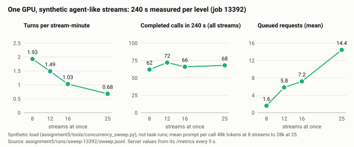
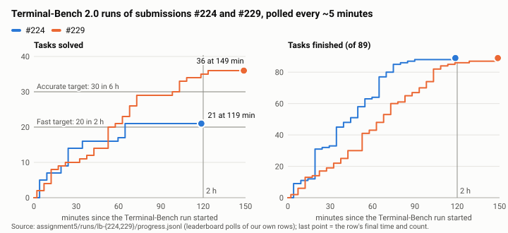
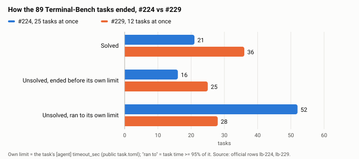
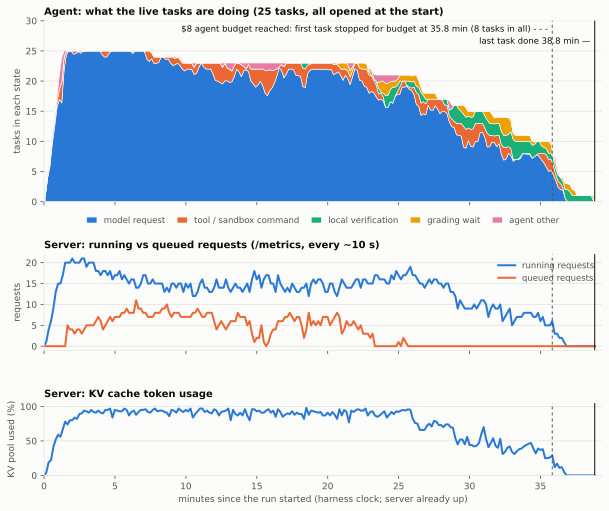

My first valid A5 submission solved 21 of 89 tasks and finished just 77.7 seconds inside the two-hour baseline. In the next submission, I changed the harness from opening up to 25 tasks at once to opening up to 12. It solved 36 tasks in about two and a half hours.

Both runs used one RTX PRO 4500 Blackwell GPU, SGLang 0.5.20, and Qwen3.6-35B-A3B NVFP4. The task set was Terminal-Bench 2.0: 89 tasks carried out in terminal containers, each with its own time limit. These included work beyond repository fixes, such as preparing files and keeping services running.

By this point, the agent had been through four assignments. I built its loop in A2, managed paid API calls in A3, served the model myself in A4, and adapted it to Terminal-Bench in A5. Along the way, an old $8 budget cap stopped an A4 run early, a checking step broke working code, and one agent command replaced `/dev/null`.

## What I saw with 25 tasks at once

The first A5 result left many tasks unsolved. Looking back at their durations using the public task definitions, 54 of the 89 tasks ran to at least 95% of their time limits. This is a later recount; my notes at the time said 55. I wanted to find out whether tasks were spending too much of that time waiting for the model.

I ran short synthetic tests with 8, 12, 16, and 25 streams. At 25 streams, each stream completed 0.68 turns per minute. At 12, it completed 1.49. Mean request latency was 73.3 seconds at 25 streams and 37.0 seconds at 12. Across each four-minute test, the server completed 68 and 72 calls, respectively.

*Figure 1. Four-minute synthetic tests. Prompt lengths also differed across settings; this was not a controlled comparison of concurrency alone.*

I used these measurements to choose 12 tasks at once for the next submission. The change was in how many tasks the harness opened. The separate model-request concurrency setting stayed at 25. The submitted files differed only in `config.py` and `agentic_loop.py`, and both changes were about task slots: `config.py` set the default to 12, and `agentic_loop.py` read the first task's time limit and kept 25 slots only when that limit covered the whole run. So the same submission's run on the 26 A4 tasks still used 25 task slots. Everything else in the two zips was identical, including the prompts, the requirement review and the 60-second command reserve described below, so those were in both runs. The engine and model were unchanged.

I picked 12 rather than 8 because of the total, not the per-stream rate. Eight streams gave each stream the most turns (1.93 per minute), but the server finished only 62 calls in four minutes, against 72 at 12. Real tasks also spend part of their time running commands, so 12 open tasks would put fewer than 12 requests on the server at once. I also checked that 12 would still fit the six-hour window: the first run's task times added up to 101,705 seconds, which over 12 slots is roughly 2.4 hours plus the tail. The run took 2.5 hours.

| Official submission | Maximum tasks at once on TB2 | Tasks solved | Whole-run time |
| --- | ---: | ---: | ---: |
| #224 | 25 | 21/89 | 118.7 min |
| #229 | 12 | 36/89 | 148.8 min |

The version configured for 12 tasks at once solved 15 more tasks and took about 30 minutes longer overall. It met the accuracy baseline of at least 30 solved tasks within six hours. The earlier version had met the fast baseline of at least 20 within two hours.

*Figure 2. Progress in the two official runs, including the two-hour mark and the task-count targets.*

Seventeen tasks passed in both runs, nineteen passed only in #229, and four passed only in #224. The timing distribution changed too. The number of unsolved tasks that ran to at least 95% of their public time limits fell from 52 to 28, while the number of unsolved tasks ending earlier rose from 16 to 25. Counting the two and three solved tasks that also ran that long, the totals were 54 and 31. Among the tasks reaching that threshold, the median recorded rate was 1.72 turns per minute in #224 and 2.75 in #229. The leaderboard's definition of a turn may differ from a model call.

*Figure 3. Task outcomes grouped using the public task definitions and a 95% time threshold. These groups describe results and timing, not the causes of failure.*

That last group still needs investigation. I have the official result labels and durations, but no leaderboard agent traces to explain why those tasks ended early. In the local smoke tests, I could inspect the actual steps, and several failures involved the agent's own checks.

## When checking went wrong

In A2, a qutebrowser trace spent iterations 24–59 on a bare-import error. This helped motivate a verification guide. On the six-task comparison, a 120-iteration configuration solved 3/6. The verification-guided version solved 4/6 in run07, and run10 passed the same four tasks.

I kept working on checking in A4. The first specification-checking version made another edit to a task that had already passed. After the edit, all seven tests failed. In X6 r2, I limited the review to at most three quoted requirement items and reverted a proposed fix if it broke the build. This became my best verified A4 submission: 7/26 in 90.6 minutes.

A5 removed the dispatcher calls used in the earlier repair loop. In A4, `evaluate` returned test-result counts; it did not expose the hidden tests themselves. In A5, the agent had to check its own work before calling `done`.

I added a requirement-by-requirement review, but the local smoke-test summary still recorded four cases where the final state was wrong and the self-check missed it. One other failure was a deliverable left in the scratch directory. I changed the guidance so the agent would put outputs where the task requested them.

An A4 smoke task also left the repository's compiled binary as an untracked file in the repository root. I added a check at `done` to list untracked ELF files or untracked files larger than 1 MB. I tested this only offline; it was not in the final leaderboard submission.

## The budget settings I carried into the next assignment

In A3, every model call drew from a dollar budget. My best submission, time4, reduced the per-task time cap from 38 to 25 minutes and allowed extensions when test results improved. It solved 17/26, at about $0.434 and 7.8 minutes per solved task.

When I ported the agent to A4, I left its $8 budget cap in place. Eight workers hit the cap and stopped. The baseline ended after 38.8 minutes despite having four hours available.

The 87.5% model-time share in my A4 measurements came from this same interrupted baseline. Tools accounted for 6.1%, verification 3.1%, grading 2.1%, and other agent work (setup and patch building) 1.2%. The model occupied most of the recorded task time, but this was also a run whose controller had stopped it early.

*Figure 4. The A4 baseline run on my local 25-task set (not the leaderboard's 26 tasks; it solved 14/25), rebuilt from its traces and the server's /metrics. Most live tasks were waiting on a model request; the dashed line marks the first task stopped by the $8 budget at 35.8 minutes.*

A5 needed a different time policy again. One smoke-test command ran for 288 seconds up to the task deadline. I changed command handling to reserve at least 60 seconds before the deadline, leaving time to inspect output and finish. I also removed the assumption that every task ended with a patch. For a service task, for example, the service had to stay running after `done`.

## What happened when I repeated a run

In A3, submission #14 used exactly the same zip as #10. The score changed from 17/26 to 16/26, with seven tasks flipping pass/fail status.

A local configuration called valF solved 5/5 tasks; its identical repeat, valF2, solved 2/5. One failure in the repeat involved an agent command replacing `/dev/null`. The sandbox then returned HTTP 500 errors, and the task ended without a patch.

I looked into the crashed task. The command, most likely a Go build run as root with its output sent to `/dev/null`, had replaced the container's `/dev/null`, and my sandbox server opened `/dev/null` as the stdin of every command. That made the repeat a harness bug as much as a model result. I changed the sandbox server to recreate `/dev/null` when it was missing and to run commands with a closed stdin, and I made the worker keep its best graded patch when it crashed. Then I compared the two settings on both runs: with and without the failed-attempt summary, each averaged 3.5 of 5. With the solve counts tied, I kept the cheaper one for submission.

I also had to keep the local and official evaluations separate. A4's X4 version scored 21/25 locally and 6/26 officially. X6 r2 scored 18/25 locally and 7/26 officially. The two task sets were different, and the locally strongest version was not my strongest leaderboard submission.

For A5, I still need repeats of both configurations. My next comparison would keep the prompt lengths fixed in the serving sweep and record when each task opened during the actual run.

If I started A2 again, the first thing I would change is how each run stores its records. In A2, a helper script re-ran the evaluation of run10 while run11 was already writing to the same shared output paths, and run10's step-by-step traces were overwritten. The score survived, but the record of how the agent got there did not. By A5, every run wrote to its own folder, with the hashes of the agent and engine files and the task order saved before it started. I would set that up from the first run, and plan a repeat for any comparison I meant to rely on.

## Limits of the comparisons

I have one completed A5 evaluation for each version, run 6.5 hours apart, without the node load or task-opening logs. Twelve was the configured maximum; the timing totals give an average of about nine open tasks in #229.

The synthetic tests used different mean prompts: about 41k tokens at 12 streams and 28k at 25. The task-duration groups also rely on public Terminal-Bench definitions at commit `2fd12b8`, since the leaderboard did not publish its own time limits.

The numbers and figures come from the leaderboard records for my own submissions and my local experiment logs. Official and local results are identified above.

## AI use

I used Claude Code for implementation, experiment execution, log inspection, data checks, figure generation, and publication setup. It also drafted three paragraphs from my experiment records: why I chose 12 rather than 8, what I found after the valF2 repeat, and what I would change in A2. 