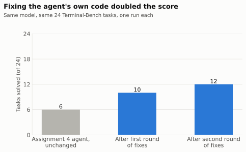
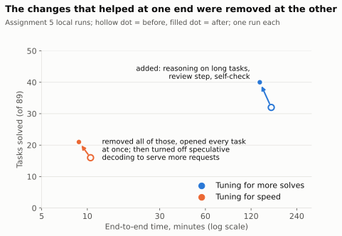
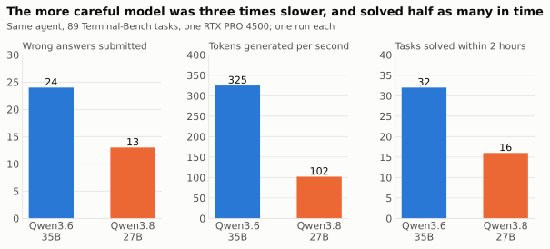

Assignments 2 - 5 has us implement the full stack of a coding agent, from affecting serving through server flags to optimizing the harness through subagents. During this process, students were directed to optimize different parts towards solving tasks and achieving the pareto frontier of speed and accuracy. The lessons above describe my biggest takeaways from this process of optimization; in other words, the advice I wish I had received before starting these assignments and the mistakes that I made that I would avoid in the future.

<!--more-->

## 1. Harness was often the bug, not the model intelligence

When frontier labs release models, they often focus on the performance differences in benchmarks between one model release to another, or their model release to a competitor’s. One important lesson I learned throughout the assignments was that there is a lot of complexity abstracted away when comparing agents in this way; specifically, I found that the agent harness was often the cause of the agent not solving a task, not the model intelligence, and that you could achieve vastly different performances with the same model.

For example, in assignment 2, I had an unbounded command output kill the agent process across many tasks. When a bash command in a repository had infinite output, my initial agent implementation generated a 1.9GB output in 10s and killed the agent harness. As another example, in assignment 3, I had an edit guard roll back the correct fix three times, because it was not correctly designed around the unit tests suitable for the ask. In assignment 5, the same agent harness, taken from my assignment 4 submission, almost doubled performance as I fixed bugs that were revealed from the tasks.

Overall, the lesson here was to focus on optimizing the agent harness as a system and not to overindex on model intelligence. Strong results came, not from trusting the model to solve everything, but rather to build the tools and setup in a way that gets the best out of it.

## 2. Changes that helped at the fast end were often the opposite ones that helped at the accurate end of the pareto frontier.

Another lesson I learned throughout the assignments was that the changes helping to make an agent faster often hurt accuracy, and vice versa. As a result, you need to have a clear goal of the type of agent you want to build from the start; otherwise, alternating between optimizing between one and then another would lead to local optima that were good at neither.

As an example, throughout the tasks, I found that you can add more solves by letting the model reason on tasks, add a review step, and give each task more time. For speed, I found that you can cut the time by switching all of these off, opening every task at once, and changing the server settings to hold more simultaneous requests. You can see the results of these levers in the graphic below, and how each is often a tradeoff of one axis over the another.

While this seem obvious at first glance, this affected by development process significantly. At the beginning, I attempted to “just improve my agent” and to make changes that would yield both more speed and more accuracy. I found quickly, though, that these are often counterproductive measures. As a result, I came to a strange optima, with a hodgepodge of changes optimized for both speed and accuracy, that was at the frontier for neither. For example, in assignment 4, this came from an agent that opens all the tasks at once, which optimizes for speed, while giving tasks more time when harder, which optimizes for accuracy. The issue here was that now we had two levers designed for different things, and these would cut into the effectiveness of each other. The lesson here was to determine quickly what my goal is and align the full system towards this.

## 3. In our settings, limiting the intelligence of a model often solved more tasks

Before beginning assignment 5, I looked at model cards across the potential options that might fit in our single GPU and fit our time constraints. Many of these model cards recommended the setting of reasoning before every reply, and many of these model cards also cited scores on other benchmarks that gave a sense of capability. However, when I began testing these models under the actual assignment constraints, I found that limiting the intelligence of a model often solved more tasks, not less.

For example, a more capable model like Qwen 3.8 made half as many wrong submissions as Qwen 3.6 but generated text about six times slower, and therefore solved fewer tasks in the same time. Similarly, reasoning before every reply solved fewer tasks than the baseline on the same task set, because each reply took about four times as long.

I came across a similar issue with assignment 2, where I found that I could actually achieve the pareto frontier by only allowing the agent to solve the simplest tasks. The hardest tasks had variable results and took too long - turning up the settings to attempt these tasks was not worth it, at least with respect to the pareto frontier.

My learning here was that it’s actually very important for an agent to be able to understand if it can solve the task or not. Otherwise, it will waste a lot of resources and, holistically, it would be better if the agent did not attempt it.

## 4. Left to itself, Claude Code will produce the cheapest step that looks somewhat like an answer.

Claude Code was an instrumental part of the workflow for this class, both for myself and for my other classmates. As a result, my lessons would not be complete without an important learning about the best way to utilize Claude Code.

Across the assignments, I ran into a number of cases where Claude Code “answer”, but not with genuine effort. The following are some examples:

- When I asked for a model that might fit on our GPU for assignment 5, it initially did not include Ornith or other fine-tuned models in its assessment.
- The pareto frontier for these assignments was defined by both classmates’ best and past submissions. Claude did not read the page and did not factor this in for several weeks.
- Research answers often came with unsubstantiated numbers (e.g. this has a 20% chance of succeeding).
- A run lasting two hours failed because of an API error, which it did not catch until after the run was completed.
- Leadership submissions were not submitted for a day because Claude wanted to keep asking me to confirm.
- Configurations that were tested previously were constantly retested because Claude forgot to check whether it had tested them before.

A lesson that I had to constantly relearn through these experiences is that Claude is a great research assistant, but you cannot trust it to make good decisions on its own. Autoresearch by itself, for example, often lead to endless loops and misguided decisions. A well-defined goal was not enough - it was important often to still steer Claude to make the right decisions. Tools that helped this included:

- Making sure that Claude audits itself with subagents
- Having Claude maintain and revisit its own logs
- Having Claude create artifacts for me to read
- Creating an objective function, not only based on the result such as the leaderboard rank, but also smaller priorities like SGLang replays

In the future, I would spend a lot more time getting this setup to work and revisiting Claude, rather than trusting it to work on its own.

## AI use

I used Claude Code to generate / ideate for the leaderboard portion of this assignment. I also used it to generate evidence for the blog post and video. The writing here is solely my own.
