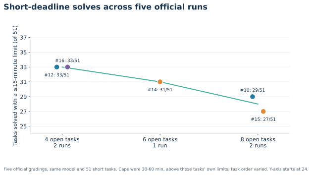
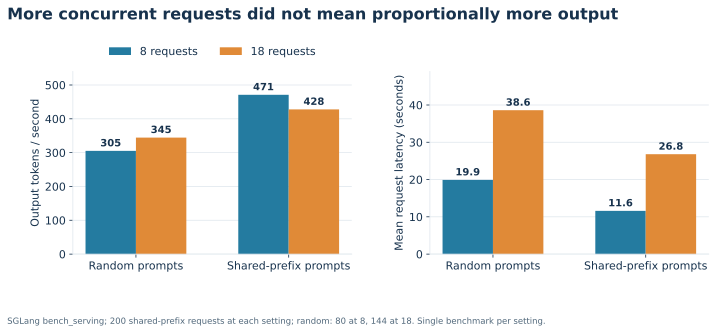
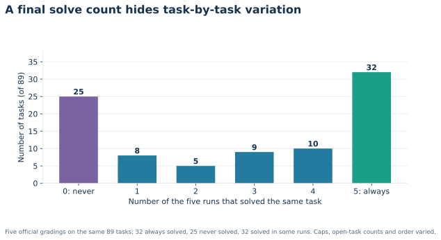

My biggest lesson was that the agent and the server both had to be measured, and that the harness often mattered more than the serving stack. At first I was young and adventurous. Every failure made me want another agent, another retry, or a longer conversation. It was a simple instinct to add more complexity, but all premature optimization is faulty. I had to spend some time to remind myself of the fundementals. A few runs and some scar tissue later, I found myself removing more than I added because most of the additions were by Claude. Another lesson was to not abuse your coding agent, never let it iterate by itself or do work overnight without a goal and rules you set. It will make assumptions that will compound into a mess. Autoresearch seems to also work, but for these assignemnts it felt like using a canon to hit a fly. Could work but why.

<!--more-->

## Simple rules were easier to follow

I thought more help would make the agent better at understanding a repository. I tried four scouts that inspected different parts of the code, an Expert model that planned repairs, and a Standard model that edited and tested. The scouts found useful context, but the back and forth was slow and expensive. I even added an approximately $9.25 guard on Expert calls so one task could not consume too much of the budget. What helped was a short repair brief with changed files, tests run, failures, and remaining work. Without it, the Expert had to reconstruct the task from a long trace. I cut most of the back and forth and kept the handoff. This was mostly motivated by not really understanding the mess a coding agent was adding. It constructed this elaborate way of scouts understanding the codebase and letting a smart agent decide exactly what to do. All of it sounded plausible, but none of it was working.

In later assignments since they built upon this harness, I just redesigned the harness entirely. The complexity was killing the performance of the harness and the serving stack just could not support it enough. I kept a small tool set inspired by Quen Code naming conventions designed specifically for the model we were using, and an addition of a scheduler, and one conversation per task. Adding grep and glob tools helped the agent search and make surgical edits. I also made the rules for stopping and shortening context clearer. After those changes, one local run solved 22 of 25 repository tasks in 91 minutes, while an official run solved 17 of 26. I changed several things together, so those scores do not isolate the effect of simpler delegation but I do beleive it contributed the most. Still, the system was easier for me to inspect and easier for the model to follow as well. The same basic tools and scheduler carried over to more varied tasks without another layer of agents.

The broader lesson for me was to fit the harness to the model capabilities. Its rules need to be easy to find, and its tools cannot give contradictory instructions to follow.

## Context had to earn its place

When a conversation grew too long, I removed old reasoning before actions and tool results. That kept a record of what the agent had actually done.
Context also had a serving cost. With 25 long conversations open, cached prompt share fell to about 5–6%. Later, with eight open tasks and older context masked, it was about 93%. I let context grow to roughly 40,000 tokens and then masked older material down to about 20,000. Summarizing the old material took more time and did not show a clear benefit in the final submission.

The number of open tasks mattered even more when each task had its own clock. In five official runs on the same 89 Terminal-Bench tasks, 51 had a 15-minute limit. The two runs with four open tasks each solved 33 of those short tasks. The run with six open tasks solved 31. The two runs with eight open tasks solved 29 and 27. This is because of context.

*Fewer open tasks went with more short-task solves. Other settings also changed across these runs, so task count alone does not explain the pattern.*

A good lesson is to reduce the number of concurrent tasks. For example, with fewer tasks open you get more context, you get more tokens/s per task, so maybe each task can be solved a slight bit faster, each one had more chances to use the model before its deadline, but the full run took longer because of the decreased task concurrency. I had to balance context and turns for each task against giving all 89 tasks a fair try.

## Measure the whole path

In one local run with the super complex scout and expert setup, the agent solved 12 of 25 tasks in 53.7 minutes. I logged time waiting for a request slot, time on the GPU, tool time, and grading time. Summed over all tasks, about 50% was spent waiting for one of eight request slots and about 30% on the GPU. The server allowed 18 concurrent requests but ran at most 9, and its own queue held at most one. The harness was leaving server capacity unused in the beginning before making needed changes.

I then tested what would happen if the server received more long requests. At 8 and 18 concurrent requests, random-prompt throughput went from 305 to 345 output tokens per second, while mean latency went from 19.9 to 38.6 seconds. With shared-prefix prompts, throughput fell from 471 to 428 tokens per second and latency rose from 11.6 to 26.8 seconds. This informed the concurrency I was using for my tasks.

*More concurrency made each request slower. With shared prefixes, it also reduced total throughput.*

At 18 requests, KV-cache usage approached 100%. The serving benchmark used fixed prompt and output sizes, while real agent calls varied in length and paused for tools. The first run showed that the harness request cap was too restrictive for that workload. The benchmark showed that simply raising concurrency could create a new bottleneck in tokens/s per task which I was optimizing for in my design. I needed both measurements before deciding what to change.

## Faster parts did not always mean more solved tasks

I tested serving changes because a faster model call might give tasks more useful time. I set a rule to keep a change only if it saved at least 3% of model time without taking away capacity the agent needed. FlashInfer saved about 4%, so I kept it. Marlin slowed prefill, and MTP left too little KV-cache capacity. An isolated speed gain was not useful if it made the full workload harder to run.

Model choice mattered too. With the serving settings held steady, I switched from Qwen to Ornith. In small local checks, solves went from 7 to 11 out of 20 Terminal-Bench tasks and from 14 to 18 out of 25 repository tasks. My best full results were 50/89 on Terminal-Bench and 17/26 on SWE-bench Pro. The model, the harness, and the serving capacity had to work together.

## More time and retries had diminishing returns

When a task failed, I tried giving the agent more attempts and more information from the previous attempt. Allowing four attempts still solved 17/26 repository tasks, the same as before. Adding retry notes and another check before resubmission produced 15/26. A staged run that gave remaining tasks more context reached 19/26 once, but several settings changed together and later runs of the same code scored 16/26 and 17/26.

I also compared how long to keep Terminal-Bench tasks open. Eight slots with a 30-minute cap solved 49/89 tasks in 2 hours 55 minutes. Six slots with a one-hour cap solved 50/89 in 4 hours 17 minutes. In those runs, the longer setting took 82 more minutes for one more solve.

The traces showed smaller ways to avoid wasted time. I capped reasoning at 8,000 tokens, and the few replies that reached that limit in the traces I inspected still did not solve their tasks. I also let long terminal commands run in the background so the agent could keep working.

## One good run was weak evidence

I sometimes reached a high local score after testing repeatedly on the same small task set. At one point I reached 24/25 locally, but that cohort was no longer a reliable estimate of official performance because it exausted how informative the local run was. I also saw a summary change look promising locally and do worse in an official run.

The same code scored 19/26, then 16/26 and 17/26 on later runs. On five full runs over the same 89 Terminal-Bench tasks, 32 tasks were solved every time, 25 were never solved, and the other 32 varied from run to run. Those five runs used different settings, so the figure includes design changes as well as run-to-run variation.

*Only 32 tasks were solved in every run. One total score hid a lot of variation across tasks.*

If I did this again, I would make one change at a time and repeat the full run before believing a gain or a loss, maybe even a few times. If you are running things overnight, this might be a good set of rules to impose on your agent. Still I did very well in later assignments with these design decisions. I would keep the simple tools and spend less time adding rules the model might ignore. Find the actual bottleneck, keep the context that helps the model get solves.
