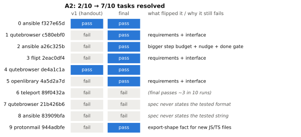
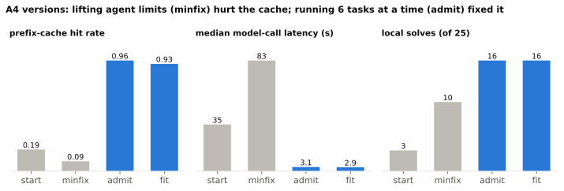
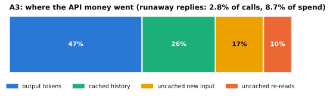
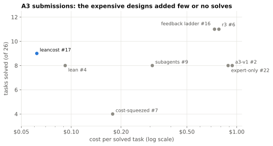
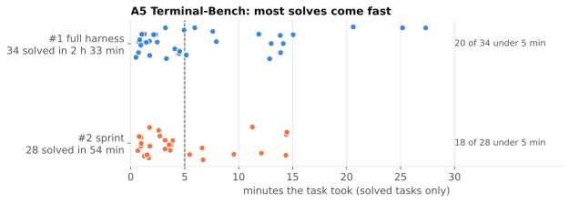
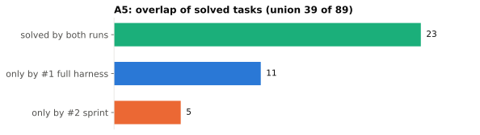
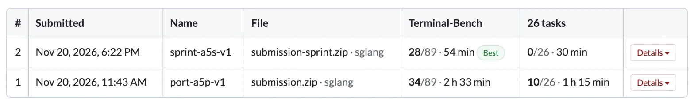
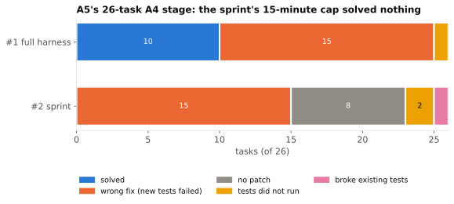

*I moved one coding agent across Assignments 2–5, from SWE-bench Pro to a black-box API, then to my own model server and Terminal-Bench 2.0. The changes that helped gave the model checkable facts or fixed a limit I had measured, while advice, extra stages and guesses mostly did not.*

In A2 my agent solved SWE-bench Pro tasks. In A3 I tuned it for solves, cost and time against a black box API. In A4 it ran on my own Qwen3.6-35B-A3B server on one 32 GB GPU and in A5 I ported it to Terminal-Bench 2.0. Most of my score came from a few changes I could measure, and most of my wasted time went into changes I couldn't.

The post is organized by lesson, not by assignment, since the same lessons came up more than once. Table 1 has the start and end result for each assignment.

**Table 1. Headline results.**

| | Start | Final |
|---|---|---|
| A2 | 2/10 | 7/10 |
| A3 | 8/26 at $0.092/solve | 9/26 at $0.062/solve |
| A4 | 2/26 | 10/26 |
| A5 | n/a | 34/89 in 2 h 33 min, 28/89 in 54 min |

*Data: my A2–A4 write-ups and the A5 leaderboard history.*

## Give the model facts it can check rather than advice

The handout design (v1) solved 2/10 A2 tasks. The biggest change was passing the agent the requirements and interface fields, not just the problem statement. This flipped tasks 1, 3 and 5. On task 5, v1 invented a method called `get_property_values`, but the test called `get_statement_values`, a name that appears only in those two fields. The agent could not have gotten it from the problem statement.

Other changes that worked:

- **Nudge instead of stopping, and a step cap of 100 instead of 60.** Finding the bug in the markdown test task took 75–90 steps. One run made its first edit at step 88, past v1's cap.
- **Done gate with a checklist** ("run the existing tests"). The icalendar task went from 0/7 to 5/7 because passing runs caught their own regression mid-run.
- **Existing tests protected.** Before this, 3/10 patches rewrote tests to match their own output. After, none did.
- **Export shape hint for new JS/TS files.** Task 9 went from 0/6 to 5/5.
- **Future git history hidden.** The agent found the upstream fix in git history in 5 runs, which is not the same as solving the task.

*Figure 1. A2 results by task, v1 vs final. Each row shows the change that flipped it or why it still fails. Advice-only changes flipped no tasks.*

Tried and dropped: a spec recap, convention advice, a boundary note and alternate sampling had no effect. Changes that gave the model information or checkable facts changed outcomes, and advice alone did not. Over repeat runs of the final harness, tasks 0–5 passed 18/18 and task 9 passed 3/3, so the gains held up.

Tasks 7 and 8 still fail. Both require exact strings or formats the spec never states. To rule out the environment, I scored the real upstream fixes for all 8 tasks v1 failed, including 7 and 8, with the official evaluator, and all 8 passed.

The same lesson showed up in A4 from the other side. Hiding context to save tokens backfired. History compaction solved 1/4 tasks vs 3/4 without it and a 9K character cap on file views added 15% more steps. In both cases the agent re-read what it had lost. In A5, the additions that helped were also facts: an environment snapshot in the first message and a prompt line saying the work is graded by automated tests.

**Takeaway:** before adding advice to a prompt, check whether the agent is missing a fact, and give it the fact.

## Measure before you optimize

My A4 starting run solved 3/25 practice tasks locally. The two ideas I had before reading the logs were an fp8 KV cache and a higher request cap. Neither changed anything. fp8 was already the default, and request slots were not the limit.

To find the real limit, I polled SGLang's `/metrics` every 10 s across the whole run, logged every model call, and compared the share of each prompt that could be served from cache with the share that actually was. What it showed:

- With 25 tasks open at once, KV demand was about 558K tokens against 391K of capacity, and usage hit 0.97.
- Each prompt reused 89% of the previous one, but the cache hit rate was only 0.19.
- Waiting on the model took 95.9% of task time.

The server was thrashing. It evicted each task's history to fit another task's, then re-processed history it had just thrown out.

*Figure 2. KV cache usage (top) and prefix-cache hit rate (bottom) in the local A4 starting run with 25 tasks open. Usage stays near full for most of the run, and the hit rate stays far below the 89% of each prompt that was reusable.*

The fix was admission control: run only 6 tasks at a time. Locally, solves went from 10 to 16/25, hit rate from 0.086 to 0.961, and median model latency from 83 s to 3.1 s. To confirm the cause was the serving setup and not the agent code, I replayed the same traffic through SGLang's `bench_serving`, and it showed the same thrashing.

*Figure 3. A4 versions: start, minfix (agent limits lifted), admit (6 tasks at a time) and fit. Panels show prefix-cache hit rate, median model-call latency and local solves on the 25 practice tasks.*

On the leaderboard, A4 went 2 → 6 → 10/26. The final run took 82 minutes, meeting the baseline of 7 solves in 100 minutes.

**Takeaway:** measure first. Two guesses cost time and changed nothing, and polling `/metrics` every 10 s through one run found the real limit.

## Tune the agent and the server together

In minfix I lifted the agent's own limits so tasks could run longer. Solves went from 3 to 10, but the cache hit rate fell from 0.188 to 0.086 because longer tasks put more pressure on a cache that was already full. Only admission control on the server side fixed it.

The server stayed unchanged through all of A5, so some harness choices were really server-throughput decisions. In the A5 sprint, thinking was on only for planning and checking turns, and 16 tasks ran at a time. Those choices set how much load the server carried.

**Takeaway:** when the agent and the model server share a GPU, change one and measure the other.

## Measure cost before cutting it

A3 ranked submissions on solves, cost and time through a black-box API. A standard attempt cost about $0.03 and an expert attempt about $0.35, roughly 25× more. Before cutting anything, I split spend by category (Figure 4).

*Figure 4. A3 API spend by token category. Output was close to half. Runaway replies were a small share of calls but a much larger share of spend.*

Output was 47% of spend. Runaways, replies that hit the output cap without a tool call, were 2.8% of calls but 8.7% of spend. A cache-safe re-ask cut their re-read cost by 73–80%.

I also made the opposite mistake. In #7 I tried to cut cost by squeezing outputs and pushing early submits. Total cost stayed flat ($0.71 vs $0.74) and solves fell from 8 to 4.

My best result was leancost (#17): 9/26 at $0.062 and 6:47 per solve, which was also my best-ranked submission. The expensive designs added few solves (Figure 5). Expert-for-everything (#22) got 8, one fewer, at 14× the cost per solve. The subagent investigator and the checker both stayed at 8. r3 reached 11, but its 3 extra solves cost about $2.60 each.

*Figure 5. A3 submissions, tasks solved vs cost per solved task (log scale). Leancost (#17) had the lowest cost per solve and my best rank.*

**Takeaway:** split spend by category before cutting it, and remove waste like runaways and uncached re-reads before squeezing useful output.

## Checking the work is the bottleneck

Once the mechanical failures were fixed, almost every remaining failure was a wrong fix: a patch that applied and ran but failed the new tests. In every A3 run wrong fixes were 13–16 of the failures. In A4 (Figure 6), missing patches, unrun tests and broken tests went away across my leaderboard runs while wrong fixes grew from 11 to 15. On the final run, 15 of 16 failures were wrong fixes.

*Figure 6. Outcomes on the 26 hidden A4 tasks for my three leaderboard runs. As solves rose from 2 to 10, the mechanical failures went away and almost every remaining failure was a wrong fix.*

The extra stages in A3, an investigator subagent and a checker, did not change this. What helped was smaller and more specific: A2's done gate, where the checklist made passing runs catch their own regression.

In A5 there is no `evaluate()`, so the agent's own check is the main defense against a wrong answer. I added an "are you sure?" confirmation before finishing, taken from Terminus 2, Terminal-Bench's reference agent. I didn't measure how often it made the agent keep going instead of finishing.

**Takeaway:** put effort into how the agent checks a fix, not into more stages that generate fixes.

## Breadth beats depth when you only need N

Porting to Terminal-Bench 2.0 (89 tasks) took seven changes. Tasks come in through `instruction` instead of an issue. There is no `evaluate()`, so the agent decides when it's done. Grading looks at the final container state, so services have to be started detached and left running. Commands are clamped at 870 s, with long jobs run in the background. The agent can read and write any path, each task has its own time budget, and the model name comes from the environment.

I took several ideas from existing agents and research:

- **Terminus 2:** the "are you sure?" check before finishing, polling instead of blocking, and a clearer timeout message.
- **Meta-Harness:** the environment snapshot in the first message.
- **LangChain deepagents:** the "graded by automated tests" line and loop detection.
- **Task-CoEvolve:** a reference score, not code. It reports this same model at about 35% with Terminus 2 on Terminal-Bench 2.1 (my runs used 2.0), and speed per turn is the main lever.

The full harness (#1) scored 34/89 in 2 h 33 min, which met the accurate target. 20 of its 34 solves took under 5 minutes, and many took under 2 (fix-git 0:43, log-summary 0:29). That led to a second design, the sprint (#2):

- thinking only on planning and checking turns
- 16 tasks at a time, with a 15-minute cap per task
- a probe of 5 turns or 3 minutes, then a status checkpoint, then drop or continue by fixed rules

It scored 28/89 in 54 minutes, which met the fast target (≥20 within 2 hours) on the first try.

*Figure 7. Time per solved Terminal-Bench task in the two A5 runs. The dashed line is 5 minutes: 20 of 34 solves in #1 and 18 of 28 in the sprint came in under it.*

Comparing the two runs (Figure 8), 23 tasks were solved by both, so there is a stable easy set. 11 were solved only by #1, including fix-ocaml-gc, distribution-search and mcmc-sampling-stan. The sprint dropped these early or cut them short. 5 were solved only by the sprint (crack-7z-hash, kv-store-grpc, mailman, qemu-alpine-ssh and regex-log), so time budgets and luck also matter. 13 of the sprint's tasks ended after about 5 turns. Across both runs, 39/89 tasks were solved at least once.

*Figure 8. Solved tasks shared between the two A5 runs. #1 solved 11 tasks the sprint dropped, and the sprint solved 5 that #1 missed.*

*A5 leaderboard history. The full harness (#1, bottom row) scored 34/89 in 2 h 33 min and 10/26 on the A4 stage. The sprint (#2, top row) scored 28/89 in 54 min and 0/26.*

Net, the sprint configuration as a whole (the drop rules, thinking only on some turns, and 16 tasks at a time with a 15-minute cap) cost 6 solves (11 lost, 5 gained) and saved 1 h 39 min.

**Takeaway:** when the goal is N solves in a fixed time, find the easy set fast and stop spending on the long tail.

## Inherited settings bite later

Each assignment built on the last one, including its caps. A3's step cap of 80 was there to control cost. In A4 it was still cutting off tasks at 75–80 turns. Raising it to 120 let one task solve at turn 115.

The sprint repeated this on a bigger scale. On the 26-task A4 repo stage, the full harness scored 10/26 and the sprint scored 0/26 (Figure 9). 9 of the 10 tasks #1 solved there needed more than 15 minutes, so the sprint's cap ended them early. The tenth took 9:40, inside the cap, and the sprint still missed it, which suggests the thinking-off turns also cost solves. A harness tuned to one benchmark collapsed on another.

*Figure 9. The 26-task A4 stage inside A5. The full harness solved 10 and the sprint solved none, failing mostly on wrong fixes and missing patches.*

**Takeaway:** when moving a harness to a new task set, list every cap and timeout and why it exists. If the reason came from the old benchmark, test it again.

## Single runs are noisy, and practice sets overstate

In A3, the same zip solved anywhere from 5 to 10 depending on the time of day. In the evenings, cache hits fell from about 95% to 2–15%. My best run was at 6 AM. In A4, scores moved about ±3 tasks run to run, and the version that solved 16/25 on practice tasks scored 6/26 on the leaderboard. In A5, I never ran the same configuration twice, so I have no clean repeat; my two runs used different harnesses.

Some of my improvements were probably noise, and so were some regressions. I didn't run enough repeats to tell for every change.

**Takeaway:** treat a 2–3 solve difference as unconfirmed until it repeats, log time of day and cache hit rate with every run, and expect hidden tasks to score below practice ones.

## Working with coding agents

Some lessons were about process, not the harness.

**Plan B for infrastructure.** In A3 a full disk killed Docker, so I built a Docker-free local bench, which did not always predict the leaderboard. In A5 the Harvard VPN would not connect off campus, so there was no live testing and the leaderboard became my test.

**Check the numbers in coordinator briefs.** Claude acted as coordinator and wrote the briefs, and two Claude Code sessions worked in parallel from them. In A4, some numbers in those briefs were wrong. I didn't check them, the sessions built on them, and the mistakes carried downstream. An agent treats a number in its brief as a fact, so briefs need the same review as code.

**Tests without the model.** The 100+ no-model tests caught real bugs. One test against real tmux caught a bug the fake missed: input over about 1 KB was silently dropped.

**Traceable builds.** Build in your own folder, tag every zip and verify hashes before uploading.

## Summary

The workflow I would use now:

- Give the agent checkable facts, not advice.
- Instrument the agent and the server before changing either.
- Split cost by category before cutting it.
- Put effort into verification, since wrong fixes are what's left.
- When the target is a count, find the easy set fast.
- Review every inherited cap when the benchmark changes.
- Repeat runs before trusting a 2–3 task difference.

---

## AI use

Claude made the figures from my data, reviewed this post, checked the numbers and corrected some factual errors in my draft; Claude Code wrote the harness code and tests from my briefs.
