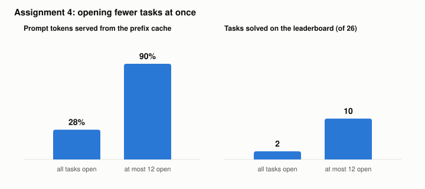
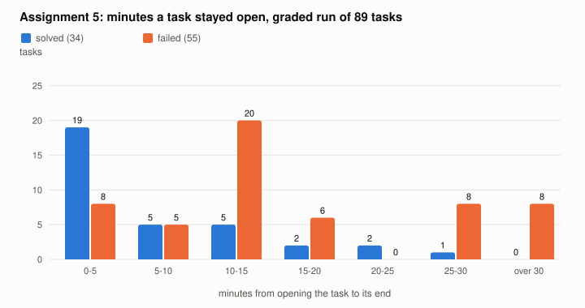
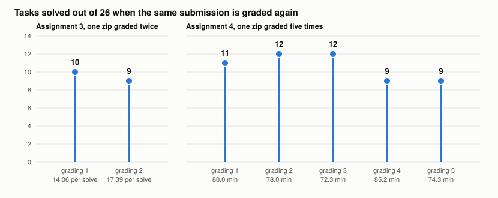

Over the last two months I built a coding agent and kept changing it as the assignments changed around it. This post is the story of what I learned along the way, including the parts where I was wrong for days before I noticed.

<!--more-->

## What are the four assignments

There are four assignments in total. The assignments went from a simple harness that calls a model API to serving a model myself and competing with other students on a leaderboard. The whole course provided me an opportunity to practice real LLM serving and harness design.

Assignment 2 is the first minimum working version of the harness. The agent was given a real code repository and a description of a bug or a missing feature, and it had to change the code until a set of hidden tests passed. I paid for the model by the token through an API of the course.

Assignment 3 kept the same kind of task and added a leaderboard. There were 26 hidden tasks (from SWE-bench), and students' submissions were ranked on how many tasks the harness solved, how many dollars each solve cost, and how long each solve took. I could also choose between a cheaper model and a stronger, more expensive one.

In Assignment 4, I had to serve an open model myself on a single GPU and run the same agent against it. Now nobody charged me per token, but I have to manage well between the tasks, since I only have one single GPU and my work was ranked by the efficiency of solving all the tasks.

Assignment 5 changed the tasks. The agent was pointed at 89 general terminal tasks, things like building a piece of software, setting up a service or writing a small program to a specification. Each task had its own time limit. The biggest change was that the agent no longer got told whether its answer passed. It had one chance to say that it was done, and it was graded on whatever it left behind. The leaderboard also ran the 26 repository tasks from the earlier assignments next to the 89 terminal tasks. The Assignment 5 numbers in this post are for the 89 terminal tasks.

## What I learned

When we design an agent, it is very easy to run out of something. Sometimes it is tokens. Sometimes it is money. Sometimes it is memory on the GPU, and sometimes it is simply time. I knew this in theory before the class started. What I did not expect was how often it would happen to me, and it's a different thing that runs out every time. In each assignment I started by tuning the wrong thing, and the real progress came after I measured where the agent was actually stuck.

The second lesson is that my own harness was wrong more often than the model was. Several times I thought that the model was not smart enough for a task, and then I read what my code had actually told it and found that I had given it false information.

The third lesson is about what a harness can and cannot do. A harness can easily lose tasks that the model is able to solve, so fixing the harness is always worth it. However, a harness cannot make the model more capable than it is. When I added more machinery around the model to push past that point, it rarely paid for itself, and a stronger model did.

The last lesson is about variance. The same harness does not solve exactly the same tasks every time. The variance is not large, but it exists, and it is worth knowing its size before comparing two versions.

The rest of this post goes through these one at a time.

## Something unexpected always ran out

In Assignment 2, I assumed the long conversations were my problem. An agent sends its whole history back to the model on every step, so the context keeps growing and I spent a while worrying about how to shrink it. However, when I finally looked at the logs, about 98% of every prompt was being served from the provider's cache. Cached tokens are not free, but the server does not have to compute them again, so the long history was not what made my runs slow. What actually took the time was the number of steps the agent took and how long the model reasoned inside each step. I had spent too much time trimming the part that was already cached.

In Assignment 3, I thought the thing to save was time on the tasks I solved, but the leaderboard showed me that the time went to the tasks I didn't solve. On one of my builds, which solved 10 of the 26 tasks, a solved task took 16.8 minutes on average, and a failed task took 29.0 minutes. A task that is going to fail does not stop early. It keeps going until some limit stops it, and that time still counts. So about three quarters of the task time in that run went to the 16 failures, and making the successful tasks faster hardly changed it.

Assignment 4 is the best example I have. I was serving the model myself, and my first run had all 25 practice tasks open at the same time, because that is how I had always run it against the API. The run was painfully slow. When I added it up, 88% of the time in every task was spent waiting for the model to answer.

I only realized the reason after looking at the server log. A model server keeps the part of a conversation it has already read in a cache on the GPU, so that on the next turn it only has to read the new text at the end. That matters a lot for an agent because an agent only ever adds to the end of its conversation. In my run only 28% of the prompt text was coming from that cache. The GPU could hold roughly a dozen of my conversations, and I had 25 open. Every conversation was being pushed out before its next turn came around, and the server had to read the whole thing again from the start.

The fix was not in the server at all. I told the agent to keep at most 12 tasks open at once. By doing this, cache reuse went from 28% to 90%, and my leaderboard score went from 2 solved tasks out of 26 to 10.

After that I spent a lot of time on the server itself. I tried six different changes to the serving engine, and none of them beat the engine I had been handed at the start. The one change that mattered was the agent learning to stay within what the GPU could remember.

In Assignment 5 the thing that ran out was plain wall time. Every task had its own limit, and for more than half of them that limit was between ten and fifteen minutes. When I looked at one of my graded runs, the pattern was very clear. Of the 34 tasks it solved, 19 were finished within five minutes, but the failures looked completely different. Most of them ran all the way to their limit.

My first reaction was to give the slow tasks more room. I ran a version with half as many tasks open at once, so that each one would get faster answers from the model. It solved about the same number of tasks and took 70 minutes longer. A task that is going to pass usually passes early, and a task that is still struggling after fifteen minutes is rarely saved by another fifteen.

## My harness misled the model before the model failed

Whenever a task failed, my instinct was to think the model was not capable enough. That was sometimes true. But again and again, when I opened the record of what had actually happened, the first thing that went wrong was something my own code had done.

The earliest case was in Assignment 2. Half of the tasks were reaching the agent with the line breaks in the task description turned into the two literal characters `\n`. The agent was reading a wall of text with stray symbols in it, and I had been judging its answers without knowing that.

In the same assignment, the model would sometimes think for so long that its reply was cut off at the length limit before it reached the part where it calls a tool. My harness read that as the model choosing to do nothing, and it went ahead and submitted an empty answer. The model had not given up. I had cut it off and then blamed it.

Assignment 5 had the most of these, and they were the changes in that assignment that I am most confident helped.

In the earlier assignments the container never had internet access. Assignment 5 was the first time that some tasks did, because the agent was allowed to install packages. So before each task, my harness checked whether the container had internet access and told the agent the result. The check used python, curl or wget. However, in containers where none of those happened to be installed, the check failed, and my harness told the agent that there was no network. The agent then tried to solve the task with only what was already there. This happened in 20 of the 89 tasks. The general point is that when the harness describes the environment to the model, the model will believe it, so a wrong description is worse than no description.

My harness was also running every command through the basic `sh` shell and not through bash. Ordinary bash syntax failed with confusing errors, and the agent burned turns working out why.

The worst one was a timeout. Any command that ran longer than three minutes was killed. That sounds reasonable until the command is a package installation. Killing an install half way through can leave the system's package manager in a broken state, and then nothing else can be installed either. In some tasks the grader's own setup step failed because of the mess my timeout had left behind, so the task was marked as failed no matter what the agent had done.

The last one I only found on the final night. To save space, my harness shortens old tool calls in the conversation history and leaves a small placeholder where the full call used to be. The model saw those placeholders, took them for the correct way to call a tool, and started writing new calls in the same shortened form.

None of these fixes knows anything about a particular task. They are all places where the harness gave the model a false picture of its environment. I now think this is the first thing to look for when an agent fails, before deciding that the model is the problem.

## Asking the model to check its work is not the same as making it check

In Assignment 2 my agent had a tool called `done`, and the description of that tool politely asked the model to verify its work before calling it. However, at one point a task was accepted with half of the work missing. The model had read the request to verify and had simply decided that it was finished.

So I moved the check out of the instructions and into the code. The harness now refused `done` unless there was an actual change to the repository and the tests had been run after the last edit. One task that had passed only once in five runs passed every time after that. I changed two other things in the same step, so I cannot give the check all of the credit, but the direction was clear to me. A rule that lives in a prompt is a suggestion, and a rule that lives in code is a rule.

Assignment 5 took that tool away from me. There were no tests the agent could run to confirm its answer, so the only checker left was the agent itself. When I went through the tasks where it had said it was done and was wrong, the most common reason was that it had tested something easier than what was asked. It would try its own simple input and not the hard case, or it would confirm that the output had the right format without confirming that the content was right.

I tried the obvious fix. I rewrote the final check to demand fresh evidence for every requirement in the task. The agent did what I asked, and it produced noticeably more evidence than before. It did not turn a single failing task into a passing one.

I do not have a solution for this yet, and I think it is worth saying so. When the model checks itself, the check is only as good as its understanding of the task, and that understanding is exactly what was wrong in the first place.

## A harness cannot replace a stronger model

The previous two sections say that the harness was often the problem. This section says something that may sound like the opposite, so I want to be careful about how the two fit together.

A model has some set of tasks that it is able to solve. A harness with bugs loses part of that set, because the model is working from wrong information or is being cut off. Fixing the harness gives those tasks back. However, once the harness is giving the model correct information and enough room to work, the harness has done its job. Adding more steps around the model does not make the model more capable.

I learned this in Assignment 3. I became convinced that a more elaborate harness would be a better one. I built a version with a planner that wrote a plan first, a second step that wrote tests, a reviewer that read the result, and a retry on the stronger model when things went badly. It solved 13 tasks. However, it cost $0.77 for every task it solved, and it ran into the spending limit before it had finished the run. A much simpler version of the same harness solved 10 tasks at $0.145 each. This comparison is not a clean one, because the elaborate version also used the stronger model for its retries. So the extra solves and the extra cost cannot be put on the machinery alone.

The figure shows both halves of the lesson. I spent days tuning the versions that used only the cheaper model, and not one of them ever solved more than 12 tasks. That was the limit of what that model could do with my harness. Every run that reached 16 used the stronger model for part of the work, and it cost two to three times as much per solved task.

So the two lessons do not contradict each other. When an agent fails, the harness is the first place to look, because a harness bug is cheap to fix and it is hiding tasks the model can already solve. But when the harness is clean and the agent still fails, more machinery is usually not the answer. At that point the choice is between accepting the result and paying for a stronger model.

I saw the same thing again later in smaller ways. In Assignment 4 I switched my reviewer step off entirely, and the agent solved the same number of tasks in 14% less time. In Assignment 2, removing a separate verifier agent cut the average run time by a third. In Assignment 5 I turned on the model's extended thinking, expecting better answers, and 50 of the 89 tasks ran out of time.

## Variance exists and is worth measuring

An agent does not give the same result every time, even when nothing in the harness has changed. I measured this in three assignments by submitting exactly the same harness more than once.

In Assignment 3 the same harness solved 10 tasks and then 9. In Assignment 4 I ran one harness five times, and it solved 11, 12, 12, 9 and 9 tasks out of 26. In Assignment 5 the same harness solved 34 tasks out of 89 and then 30.

This variance is not large. The total moves by a few tasks, and a real improvement such as the change from 2 solved tasks to 10 in Assignment 4 is far outside it. So I do not think variance should stop anyone from trusting a big result.

However, the variance is about the same size as a small improvement. If a change to the harness is worth one or two tasks, a single run before and a single run after cannot show it. For changes of that size I had to either run each version several times or accept that I did not know.

There is also a useful side to the variance. The total stays about the same, but the tasks behind the total are not the same tasks. The two Assignment 5 runs of the same harness solved 34 and 30 tasks. Only 25 tasks were solved in both. Nine were solved only in the first run and five only in the second, so together the two runs solved 39 different tasks. This means that a second attempt on a failed task has a real chance of solving it. Where the setting allows a retry, a fresh attempt is one of the simplest ways to solve more tasks.

## Closing

If I had to give one piece of advice to someone building an agent, it would be to measure before changing anything. Find out what the agent is actually running out of. Read what the harness actually told the model. Run the same version more than once so that you know the variance. Most of my wasted time in this course came from changing things before I had done these three.

## AI use

Claude Code was used to gather information from the assignments logs, summarize ideas, plotting, refining paragraphs and checking claims against evidence. 
