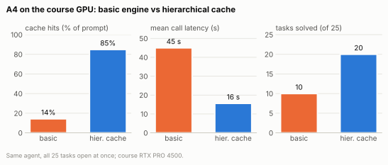
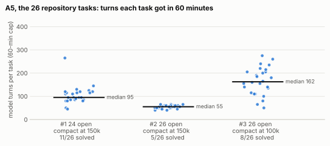
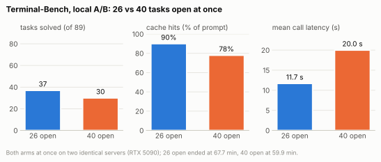
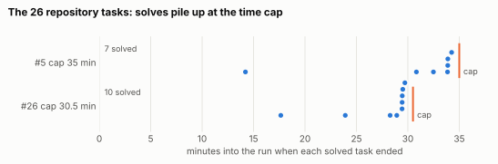
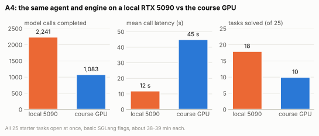

For most of this semester I worked on a coding agent that runs against a model served on a single GPU. I spent a lot of time tuning it and submitting it to the leaderboard. Here are the things I learned along the way. My biggest slowdowns were due to memory. I tried to use an AI agent to analyze metrics from failed runs to iterate on my code, as the leaderboard scoring was too unreliable and stochastic.

<!--more-->

## Memory doesn't run out gradually

The biggest single improvement I made in Assignment 4 was on the engine side. With the basic serving setup, almost none of each prompt was being served from the prefix cache, so every model call re-processed a long conversation from scratch and calls were too slow. Turning on the hierarchical cache made a huge change. Most of each prompt came from cache, calls got several times faster, and the agent solved about twice as many starter tasks with exactly the same prompts and logic (Figure 1). On the leaderboard it was the difference between solving almost nothing (1 of 26 tasks) and meeting the baseline (8 of 26).

What surprised me more was how sharp the edge is. In Assignment 5 I went from running 24 tasks at once to all 26. Once the working set no longer fit, cached prefixes started getting evicted, and each task got roughly half as many turns in the same hour (median 95 to 55). Solves fell from 11 to 5, but that is one run of each setting, so the turn count is the firmer evidence. Compacting the conversation earlier reduced each task's footprint enough to get back under the edge, and turns per task went up past where they had started (median 162, Figure 2). Solves did not follow: that run got 8, still below the 11 I started from.

Terminal-Bench showed the same thing when I tested it locally on two identical servers side by side. Opening more tasks at once finished the whole run a little sooner, which looks like a win but the cache hit rate dropped, and thus calls got much slower, and the agent solved noticeably fewer tasks (Figure 3).

Average throughput didn't make this problem obvious. The cache hit rate and the number of turns each task got were more useful.

A side lesson that I learned was that SGLang holds back a considerable chunk of host RAM: a fixed 10 GiB, on top of the host cache itself. One of my early submissions used a 14 GB host cache that worked on my local machine, but on the grading node the engine failed to start with SGLang's "not enough host memory available" error. After realizing that, I always ran the exact launch command on the real hardware before submitting any engine change.

## Look at how it failed, not just how often

For a while my Terminal-Bench score was stuck and I kept trying ideas without really knowing why tasks were failing. Then, I finally went through the logs task by task. A handful of tasks were dying after only a few model calls. In every one of them, the model had started thinking and never stopped. Each reply ran all the way to the output limit without ever calling a tool. Since we use a shared GPU this is quite harmful for other tasks, because minutes of pointless decoding slow down every other task running alongside.

The fix didn't need any knowledge of the tasks. I lowered the output cap, and when a reply hit the cap without a tool call I asked again with thinking turned off, leaving it off once that had happened twice. It didn't solve the affected tasks, but the runaway replies mostly disappeared, and on the leaderboard the tasks that used to die early stopped doing this (Figure 4).

 and was resubmitted as 18.")

I also looked at the tasks the agent said it had finished. About a quarter of them still failed. Analyzing them with Claude Code, the most common story was that the agent had quietly checked a narrower version of what was asked and declared victory. Others didn't take a name, path or required tool literally. A couple were destructive, and one of those was my fault. My own prompt told the agent to clean up scratch files, and it deleted build outputs the tests needed (Figure 5).

These tasks also tended to finish early, with lots of time left on the clock. I had added a double-confirm step before `finish`, hoping it would catch exactly this, but it didn't change anything as the second check just re-ran whatever had already passed the first time.

So I wrote a checklist based on these failures and added it to the prompt. It didn't help either. If anything, more tasks ran out the clock instead of finishing. I could see what was going wrong, but putting it in the prompt wasn't enough to fix it.

## A single run tells you almost nothing

The same agent, submitted repeatedly, produced Terminal-Bench scores spread over a wide range. My best result seems to have been mostly a lucky draw (Figure 6). In Assignment 4 the exact same zip, submitted twice, lost a few tasks between runs.

 and was resubmitted as 18.")

The clearest example was the repository rules I added to the prompt. Comparing one run with them against one without, they looked like they cost me a big chunk of tasks. With three runs of each, the gap was smaller. Once I had all the runs in, there was no difference at all. If I had trusted the first comparison I would have thrown away a change that was fine, and I suspect I made that kind of decision more than once earlier in the semester without noticing.

The scoring rules mattered almost as much as the agent. The leaderboard ranks each student by their best point in terms of tasks solved and time, so it pays to submit specialised versions. One tuned for speed on Terminal-Bench, another for the repository tasks. Tasks are also graded on whatever state they're in when time runs out, so solves pile up right at the deadline (Figure 7). Giving the agent much more time didn't buy many extra solves, though. With a 200-minute cap (submission 19), the run ended at 79 minutes with 9 of 26 solved, because the tasks simply stopped on their own.

Because of all this noise I ended up submitting on a schedule, twice a day for about two weeks. The scheduler itself needed babysitting. It died once and missed a slot, so I added a watcher for that.

## The GPU that grades you is the one that matters

I did a lot of my early experiments on my own RTX 5090, which is a much faster card than the course's RTX PRO 4500 and draws a lot more power. Running the same agent and engine on both for the same amount of time, the local card made about twice as many model calls, each one far quicker, and solved quite a few more tasks (Figure 8).

My local solve counts were consistently too optimistic. In Assignment 4 part of that was the starter tasks themselves: most of them don't test existing behaviour, so an agent can break things without anyone noticing locally, while the graded tasks do notice. In Assignment 5 the gap was smaller but still there.

Some things did carry over. The relative speed of two configurations, the memory behaviour (both cards have 32 GB, so the cliff from earlier showed up in the same place), and the ways the agent failed all transferred well. Absolute scores and timings did not. Speculative decoding was the clearest case. It looked promising on my card, but on the course GPU the extra verification work cost more than it saved, and a replay on the course hardware actually got slower.

For Assignment 5 I changed how I worked. I ran the model server on a course node and the agent harness on my own machine through a tunnel, so experiments ran on the hardware that would actually grade me. That's how I tested turning thinking off entirely, which turned out to make no real difference.

## What the hidden tests were worth

Assignment 4 let the agent run the hidden tests in the middle of a task, and my harness grew around that feedback until it was a fairly large piece of software: background gradings, retries, an arbiter between attempts, a build gate, memory carried across attempts. Assignment 5 took the tests away. The agent I wrote for it is a small fraction of the size (one lane per task, its own checks before `finish`, a time budget per task), and it cleared the baseline on its first submission.

On the same 26 repository tasks with the same engine, having the tests was worth a few tasks per run, not most of them (Figure 9). The two agents differ in plenty of other ways, so I treat this as a rough comparison, but it was a lot less than I expected given how much code I had built around the tests.

The tricks from Assignment 4 only partly survived. The name map, which at the start of a task lists where the names the task mentions are defined and used in the repository, gave a small gain on the repository tasks, small enough to sit inside the noise, and did nothing on Terminal-Bench. The call-shape check, which before `finish` checks that the functions the hidden tests call exist in the form they call them (function or method, exported, the right arguments), showed no clear gain at all. Looking back, even in Assignment 4 the name map's local win never clearly showed up on the leaderboard, which is really the noise and hardware lessons again.

And without the tests, none of my generic self-checks closed the gap. The double-confirm and the audit checklist both looked sensible on paper and both did nothing measurable.

## Looking back

If I started over, I would spend less time inventing agent tricks and more time on measurements. Watching cache hits and turns per task, reading failed runs one at a time, running every comparison more than once, and doing all of it on the hardware that grades the result. Most of my real gains came from the serving side and from removing failure modes I could actually see in the logs, not from clever prompting.

## AI use

As the [course policy](https://cs2680.com/policy.html#ai-policy) requires, I am disclosing that I used Claude Code to build and run the agent, the serving setup and the experiments, and it ran the scheduled leaderboard submissions. For this post it made the figures, from my leaderboard and run data, and wrote the alt texts. I wrote the text entirely and used Claude code to commit and create pull request. Finally, I used Claude code for fixing the typos that were identified after my initial request.
