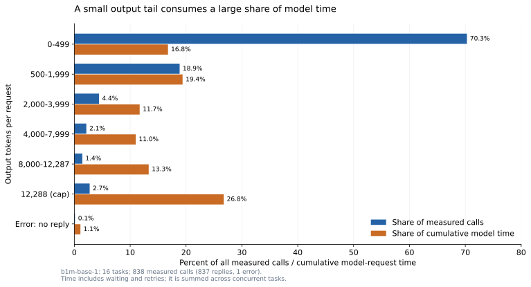
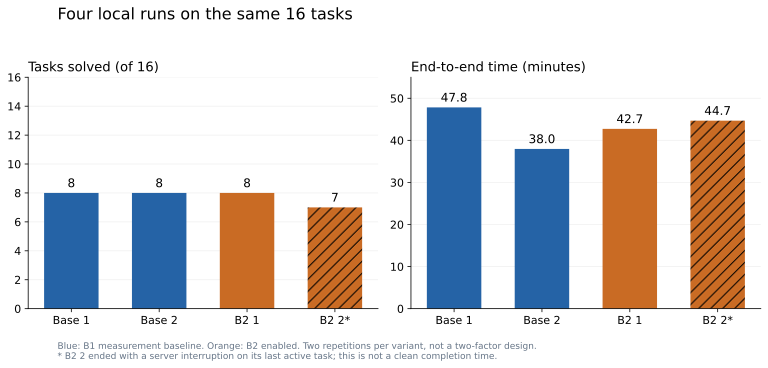

My best A5 submission solved 33/89 Terminal-Bench 2.0 tasks in 1:40:32, meeting the course baseline. Its core was 525 lines, with one loop and three tools. A later attempt to control long outputs did not show a repeatable benefit, so I left it out.

## What carried over from A2 to A4

In A2, I initially passed only the problem statement. Adding the public requirements and interface fields, with corresponding prompt changes, took one comparison from 3/10 to 6/10. Some hung requests were rerun, so this was not a clean ablation. Still, the missing input was a concrete problem to fix.

In A3, a five-task comparison gave standard-first 3/5 solves for $0.1686 and expert-first 2/5 for $2.1466. These were single runs with estimated costs. They did not establish which model was stronger, but they did not justify moving every request to the expensive tier.

A4 added another distinction: serving throughput versus actual progress. A benchmark produced 414.21 output tok/s; agent output divided by total elapsed time was 187 tok/s. These used different workloads and denominators. Tools, grading waits, and the tail of the run affected the second number. Optimizing the server meant checking the whole run.

## Replacing assumptions with a small loop

My A4 agent assumed a repository, a patch, and feedback from `evaluate`. A5 also included services, compilation, data processing, and training. Hidden tests ran only after `done`. The old agent's twenty files contained 314 references related to repositories, patches, and tests. Adapting it would mean revisiting those assumptions throughout the code.

I replaced it with a loop using `exec`, `write_file`, and `finish`. Sixteen workers used each task's supplied time limit. The system prompt and tool definitions stayed fixed; history only grew. Across four runs of sixteen tasks, reported cache reuse was **95.9–96.8%**, calculated as cached prompt tokens divided by all prompt tokens.

The submitted B1 core was 525 lines, including comments and blank lines, excluding the course sandbox files. This made the implementation easier to inspect; it did not prove that shorter code solved more tasks.

Design references included [mini-SWE-agent](https://mini-swe-agent.com/latest/), [Terminus-2](https://harborframework.com/docs/agents/terminus-2), and [KIRA](https://github.com/krafton-ai/KIRA).

I also tested three NVFP4 models on the same 32 GB RTX PRO 4500. At concurrency eight, Qwen3.6-35B-A3B, Qwen3.8-27B, and Ornith-1.5-35B-A3B produced 416, 90, and 417 tok/s. Qwen3.8's low measured throughput and an MTP configuration that would not fit ruled it out for my submission. Its nine-request serving limit was a separate capacity concern for the sixteen-worker agent; it does not explain the concurrency-eight throughput result.

I chose Ornith after it passed the launch and tool checks. It shared the default model's architecture and delivered similar throughput in this benchmark. I did not compare their solve counts under the same agent, so I cannot claim Ornith was better at solving tasks.

I found no evidence in the material I reviewed that Ornith had been trained on these evaluation tasks, but its [model card](https://huggingface.co/ornith-ai/Ornith-1.5-35B-A3B-NVFP4) did not provide a decontamination statement.

## B0 missed the baseline by six seconds

The [baseline](https://cs2680.com/assignments/assignment5) required either twenty solves within two hours or thirty within six.

| Submission | TB2 solved | Elapsed time |
| --- | ---: | ---: |
| B0, no run clock | 29/89 | 2:00:06 |
| B1, 100-minute clock | 33/89 | 1:40:32 |
| B1c85, 85-minute clock | 28/89 | 1:25:51 |

B0 missed both baseline targets: it was six seconds beyond the two-hour fast limit and one solve below the thirty-task accurate target. By minute 79, it had already solved 28 tasks. The remaining forty minutes added only one solve. That was the reason for adding a fixed run clock.

B1 met the baseline, but I do not count its four extra solves as a clock benefit. At minute 79 it already had 32 solves, before the stopping point. Nor were the inputs necessarily identical earlier: taking the smaller of task and run deadlines could change remaining-time hints. These runs did not isolate the effect on solve count.

B1c85 was another single run, so its lower score does not establish that cutting fifteen minutes cost five solves. The [final leaderboard](https://leaderboard.cs2680.com/a5/), checked November 26, showed that my best submission earned **full baseline credit (50/50 leaderboard points)** and finished at **rank #50**.

## B2: the second baseline changed the interpretation

I instrumented the loop before changing its behavior. In `b1m-base-1`, there were **838 measured calls: 837 replies and one failed request**.

Twenty-three calls reached the 12,288-token cap. They were 2.7% of measurements but consumed 26.8% of cumulative model-request time; twenty-one contained only reasoning. Calls with at least 4,000 output tokens consumed about half that time. These totals add concurrent requests together, including waits and retries; they are not elapsed time or GPU utilization.

*Sixteen tasks, 838 measurements. The failed request is shown separately.*

B2 capped the first reply at 4,096 tokens. If truncated and time remained, it discarded the reply and retried the same messages once with thinking disabled and the full 12,288-token allowance. This also discarded truncated replies containing tool calls.

I ran each configuration twice on the same sixteen tasks:

| Run | Solved | Minutes | Cumulative model-request s | Requests ≥100 s |
| --- | ---: | ---: | ---: | ---: |
| Baseline 1 | 8/16 | 47.8 | 13,252.24 | 34 |
| Baseline 2 | 8/16 | 38.0 | 8,132.99 | 18 |
| B2 1 | 8/16 | 42.7 | 10,503.64 | 3 |
| B2 2 | 7/16 | 44.7* | 9,992.06 | 1 |

*A server interruption ended the last active task in B2 2. Its solve count and time need that qualification.*

*Two runs per configuration. The second baseline finished in 38.0 minutes, faster than either B2 run; the interrupted run is marked with hatching.*

After the first pair, B2 looked useful: 8/16 in 42.7 minutes versus 47.8, with about 21% less cumulative model time. The second baseline changed that interpretation. It finished in 38.0 minutes with the same 8/16 score, faster than either B2 run. Even the two baselines disagreed on four tasks. With that much variation, the first pair was not enough to attribute a gain to B2.

B2 reduced requests lasting at least 100 seconds, but the truncation counts use different caps. In B2 1 and B2 2, respectively, 57 and 58 initial replies hit 4,096 tokens. Of the 55 and 56 rescue attempts, one in each run still hit 12,288 tokens. These give 58 and 59 capped replies in total, not a direct comparison with the baselines' 23 and 12 replies capped at 12,288. The capped replies consumed 2,986.76 and 3,163.55 cumulative model-request seconds.

I had evidence that the mechanism changed, without a stable improvement in time or solves. I kept the implementation and its temporary tag, disabled it by default, and made no B2 leaderboard submission. This small experiment, with one interrupted run, cannot establish zero effect.

## Unfinished work

B1 solved only 4/26 of the A4 tasks; seven were never opened. A scheduling change, B3, remained a design. A finish check and an editing tool were also unfinished. The local B2 results cover a fixed sixteen-task subset.

## AI use

Claude Code supported measurement, B2 implementation and repeated runs, and B1c85. Cowork supported setup, model trials, and analysis. **B0 and B1 were written in Cowork and are absent from the Claude Code session records.** Claude prepared the original outline. Codex helped identify model candidates that were not tested, verify the evidence, and prepare the figures.
