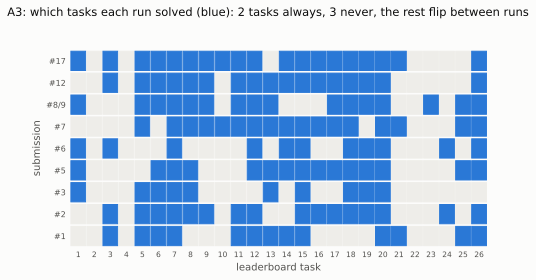
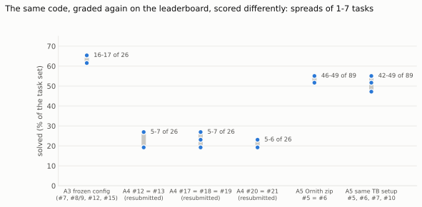
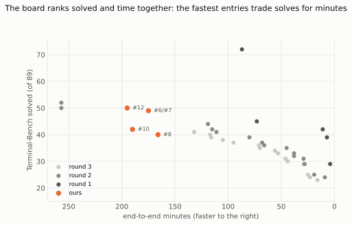
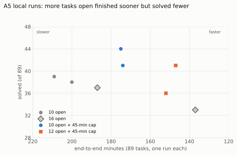
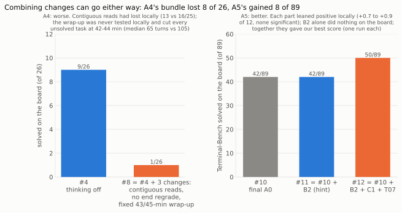
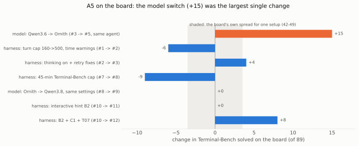

Four lessons from Assignments 2-5: measure the noise before trusting a change, tune for the throughput of the whole run rather than the speed of one request, test combined changes as carefully as single ones, and choose the model first.

<!--more-->

This course teaches not only how AI systems and agents work, but also how to work with AI efficiently. Even if you know the basics of building agents, the assignments still require clear and efficient communication with Claude. To solve the actual problems, you need experiments that show whether an idea is heading in the right direction. Here are the lessons I learned from Assignments 2-5.

## Run-to-run noise is as big as most changes

 ranged from 2 to 7 of 12 tasks across its runs.")

Starting with Assignment 3, run-to-run noise began to affect submission results. The exact same build scored differently on the leaderboard from one submission to the next. In A3, 21 of the 26 tasks flipped between solved and unsolved across nine board runs. So in theory, the best submission could reach 21 tasks solved. A3 allowed generous retries, so I could submit one build many times and see its best performance. In A4 and A5, submissions per day were limited, so whether a submission caught the agent at its best was partly luck. That makes a reliable local test set essential for improving the agent. And for every proposed change to the agent, it is important to run enough repeats before drawing a conclusion.

## Throughput vs. latency

MTP (multi-token prediction) speculative decoding speeds up a single request. However, MTP itself costs GPU memory, which lowers the throughput of the whole run when many tasks are open at once. In A5, MTP made Ornith 68% faster for one request (from 160 to 268 tok/s) but 5% slower with our 10 tasks open (from 837 to 782 tok/s in total). Opening 16 tasks instead of 10 made the opposite trade: +32% total throughput but -18% per task, and fewer tasks solved locally. What counts is the speed of the whole run, not of one request.

## Combining changes can make things better or worse

When no single small change shows a significant improvement, one option is to combine several of them. However, depending on which changes are combined, the result can be better or even worse. In A4, when I combined three changes at once, the agent did worse than the baseline: 1/26 against 9/26. In A5, the combination added up and reached 50/89, our best score, against 42/89 without it. The difference was that in A5, each change had been tested on its own without a loss, while the A4 bundle included one change that had already lost locally and one that was never tested locally. This also means you should not drop a change just because it brought no significant improvement on its own. It may only need the right combination.

## The model outweighed every harness change in A5

 because it ran 2.6x slower with 10 tasks open.")

The A5 results show that the most important part of an agent is the LLM it uses. The harness is built around the model and tunes how it is used. Model cards on Hugging Face list each model's Terminal-Bench score, which gives a list of candidates to start from. Switching from Qwen3.6-35B-A3B to Ornith-1.5-35B-A3B raised our board score by 15 tasks with the same harness, more than any harness change. A vendor score online is only a starting point, though: Qwen3.8-27B scored higher than Ornith on Terminal-Bench but only tied it on our board, because it was much slower and the tasks are time-limited. It is probably because the hardware used in the assignment is limited, while the vendor scores don't consider that. When you change the serving model, you also need to retune the harness for it to get the best performance.

## Conclusion

AI is very powerful, but it still needs human input to guide how it thinks and decides. I also found the course's "How I used Claude" material very helpful: it made me rethink how I work with AI and how to communicate with it efficiently and accurately.

## AI use

I used Claude (Claude Code) to help build my assignment solutions and to draw the figures in this post from my experiment logs. I wrote the post myself; Claude checked the grammar and word choice.
