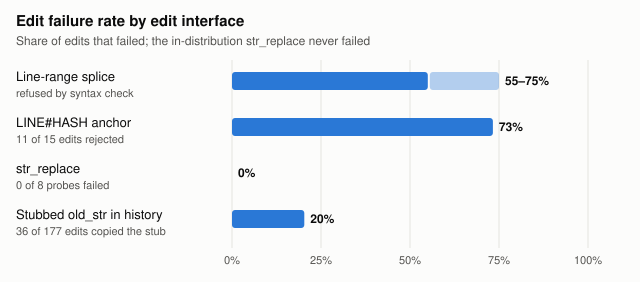
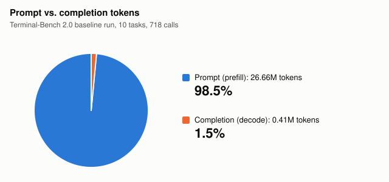

Throughout all 4 iterations of the development of this agent, both on the harness engineering side and the serving system, there are a number of optimisation points that provide significant performance gains for the agent. These points tend to dovetail into a few key principles for harness engineering in the small-model regime, and this blogpost aims to highlight the different intricacies and engineering tricks that were introduced in optimising the agent overall. 

## Constraints and objectives
We begin by introducing the objectives of the overall optimisation task that we build on top of. Firstly, the objectives: all of our agents and harnesses were built on top of the Qwen 3.6 35B-A3B model at various levels of quantisation. The agent harnesses were evaluated on software engineering tasks from SWE-Bench Pro or Terminal-Bench 2.0, using the standard sandbox- and patch-based deployments that come with the benchmarks. Inference servers were handled through a custom SGLang fork served on a single RTX PRO 4500 GPU on the class cluster. Finally, the overall objective for optimisation here is to create a Pareto-optimal setup where we minimise both the wall-clock time and the token cost per task solved.

We also highlight the development constraints: though at the end of the task there were no major constraints and all models, including fine-tuned models, were allowed, the work on the agent stack overall proceeded in accordance with the class assignments, first focussing on the harness itself, then on the inference server and finally to the model. Furthermore, in the first major harness design phase, only 3 anonymous models (most likely MiniCPM, Qwen 3.6 35B, and DeepSeek-V4) were provided at different cost shelves.

## Harness engineering
We begin with a couple key insights into small-model harness engineering; more specifically, small models tend to struggle dealing with too many different instructions or too much different context, leading to the choices we detail below to maintain performance as much as possible.

### Small models follow context, not instructions
The first problem we run into is that the Qwen 3.6 model we use, because of its size, will often forget rules in its system prompt or injected state machine-style prompts while focussing more on its own context and reasoning. More specifically, across assignments 2 and 3, almost every procedural prompt was ignored, even when the harness re-injected it mid-trajectory (see table below):

| Instruction | Delivered as | Adherence |
|---|---|---|
| Enumerate every option before each call (TDD-v1) | prompt + required tool arguments | fields on 98% of calls, but 1.1-1.6 options on average |
| Write tests before editing source (TDD-v1) | prompt | 2 of 5 tasks |
| Reason minimally (A2 v2.1) | prompt | completion unchanged at ~600-2,700 tokens/call |
| Write a new test after a failed hidden grade (G6m) | mid-run harness message | 0 of 35 |
| Follow the injected checklist (G6m) | mid-run harness message | 5 of 37 |

Even on deterministic constraints, it is still difficult to enforce the agent's behaviour completely, and the model will often find ways to circumvent partial or non-rigorous constraints. For example, in the Guard-v1 ablation, a state machine (plan/test/fix phases, a write matrix, frozen tests, per-edit compile and interface gates) was introduced in order to combat the lack of robustness from the prompt. However, the gates themselves became the failure mode: the per-edit Go compile gate deadlocked on Go's unused-import rule 11 times in one task, frozen tests plus a cheap amend turned into a test-fighting loop, and 4 of 5 tasks hit the iteration cap, solving 0/5 on the local task set (down from 1/5). Generally, it seems most mechanical enforcement helps only when each rule is atomic and unambiguous such as in syntax-check or compile-check situations; the later G6m line, with five rules each enforced by exactly one check, reached 4/5.

In a similar vein, multi-agent setups and more complex prompted protocols also failed, each for a concrete reason. When attempting to use decentralised methods in particular, such as [CoAct](https://openreview.net/pdf?id=AvxJqQW1X5) or [DeLM](https://arxiv.org/abs/2606.10662), the small models lacked the context and capability to be able to analyse code and edits and either create plans or check the proposals of other agents, meaning that the methods often collapsed to individual parallel execution of the tasks. For example, the DeLM agents issued only 12 board commands across all 5 tasks (all reads), and CoAct's majority vote approved edits that were never validated against the tree, so 14 of 22 voted edits failed on execution; CoAct scored 1/5 (0/5 with voting) and DeLM 0/5, against 4/5 for a single agent.

### Anticipating context usage
Given the above, it makes sense that the harness should focus on engineering the context the model sees as the vector to focus the model's behaviour as opposed to relying on the model to obey provided guidelines and explore efficiently. More specifically, we see that across 29 traces of the soft-gate harness, the agent made 387 bash searches, most of which were predictable (caller greps, test-file reads, and empty greps for names the task introduces). Precomputing these into the starting context helped directly: tree-sitter slices of each requirement's named functions produced the lean agent's first solve, and a precomputed usage index, test-file outlines and directory listings (softPM) cut openlibrary to 60 steps for at most $0.24.

We find that the converse is also true: once given, context should never be taken away lest the model try to find it again (for example, 75% of re-reads in TDD-v1 came directly after a context compaction, and keeping only the last 6 tool outputs tripled re-reads on openlibrary, as detailed in the below table).

| | Last 6 outputs | All outputs |
|---|---|---|
| Exploration calls | 77 | 26 |
| Re-reads | 24 | 8 |
| Step of first source write | 27 | 13 |

### Deterministic tool outputs
In a similar vein, the tools themselves should be engineered and selected to be on-policy to the overall training of the model itself in order to ensure that the behaviour of the model is in-distribution.

Generally, the deterministic changes that helped were the ones that removed decisions from the model entirely, such as showing the whole edited function after every edit (3/5 → 4/5) or undoing shell writes so that files only change through the checked edit tool.

### Test-driven deployment needs verifiable reward
The final major failure mode that we highlight here is verification. Most of the tests written by the agent are often a moving target and furthermore, because the model is weak, do not encompass enough of the correct behaviour to be close enough to the gold-label hidden tests: in slice3, all of the agent's own tests passed while 2 of 8 hidden tests failed. In contrast, feeding back the hidden suite's failing count and resuming the trajectory (softPR) took 1/3 to 3/3, the largest single gain in A3. Terminal-Bench 2.0 removes this signal entirely (`done()` reports no result), which makes the harness's own verification the binding constraint.

## Inference server
The same theme of context carries directly over to the serving side, where context length rather than decode speed turns out to be the main bottleneck.

### Prefill dominates decode
The biggest note here is that most agentic workloads are primarily focussed on context and the prompt such that the prefill and KV cache load will dominate the server.

On the SGLang benchmark established in assignment 4, median TTFT was 56.1 s on the baseline server (course flags) while median TPOT was only 0.41 s, on random prompts of ~36k tokens on average (up to 47k) with ~74-token outputs at 25 concurrent requests. Though kernel tuning and speculative decoding showed isolated gains (FlashInfer decode raised throughput from 109 to 171 tok/s, and EAGLE cut 25-way parallel latency from 37.9 s to 25.5 s), the speculative-decoding recipe solved 7/25 against 9/25 on the course flags, and the primary target on the server side was still a matter of context management, very similar to what we discussed above in the harness engineering segment. As a result, most of the serving performance improvements came from harness concision improvements, notably using concise tool output and spec-first context from A4 (which took the same server from 7/25 to 13/25 on the 25 local SWE-Bench Pro tasks).

### KV cache balancing
Again similarly to the prefill vs. decode balance, because of the ~44k-token contexts, the memory-constrained single-GPU KV pool (208-245k tokens) only held around 5 tasks at once, requiring all other context to be evicted and thus to go through prefill again. Under an LRU eviction strategy, as discussed in assignment 4's writeup, having more tasks than capacity on the server will cause each task's KV cache to be evicted just before its next turn, collapsing the cache and causing significant latency on re-prefilling tokens; as an example, with 25 open tasks, only 3% of prompt tokens stayed cached, against 90% with 13. Thus, the fixes that worked all kept the working set inside the cache, and more workers past this point only hurt (raising the leaderboard run from 6 to 13 workers dropped it from 12/26 to 5/26):

| Change (A4) | Call p50 | Prompt cached | Solved |
|---|---|---|---|
| Course flags, 25 workers | 54.9 s | 34% | — |
| Evict finished tasks first (session radix cache) | 1.1 s | 90% | 10/26 leaderboard |
| Trim context past 48k tokens, 6 workers | 1.1 s | 96% | 12/26 leaderboard |

## Conclusions
Overall, nearly every gain across both the harness and the inference server traces back to the same constraint: context. On the harness side, the small model follows its context rather than its instructions, so the gains came from anticipating the context it needs, never taking it away, keeping tools on-policy, and grounding verification in an external signal. On the serving side, that same context dominates the load, so prefill and KV cache capacity, rather than decode speed, set the throughput. The two dovetail directly: the largest gain in solves (+6) came from trimming context to relieve KV pressure, and the best leaderboard result came from running fewer workers rather than faster kernels.
