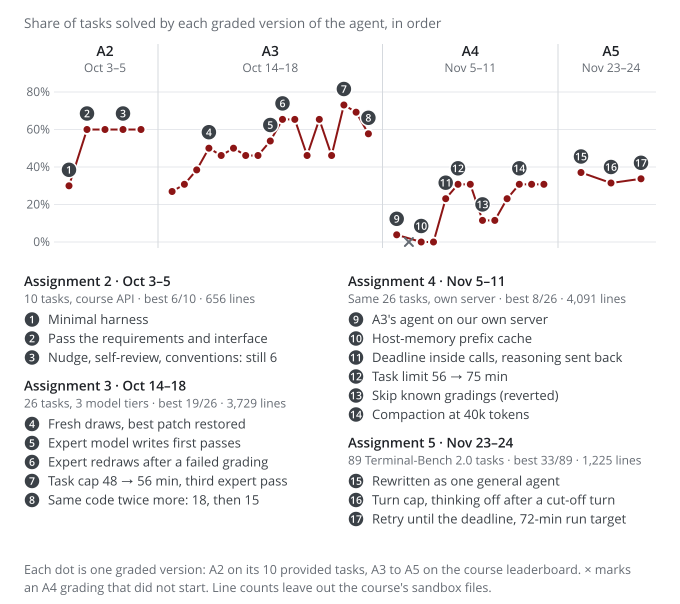
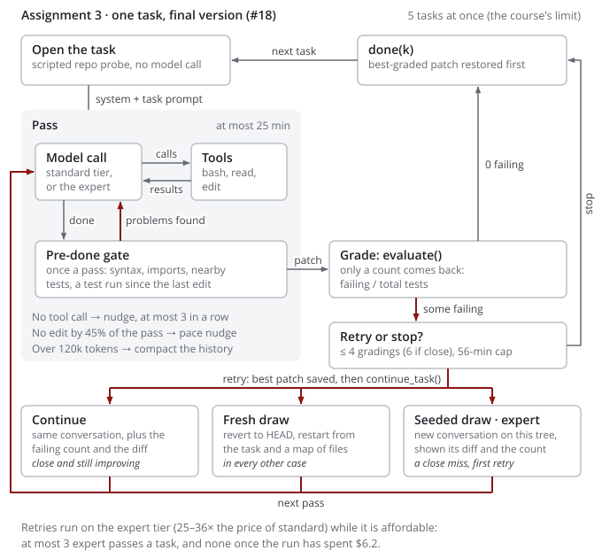
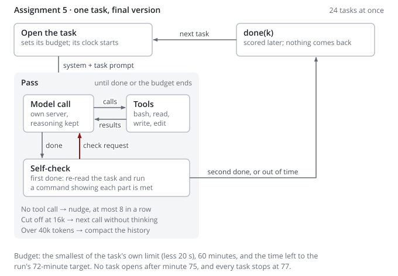
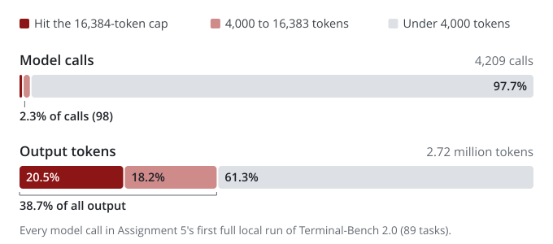
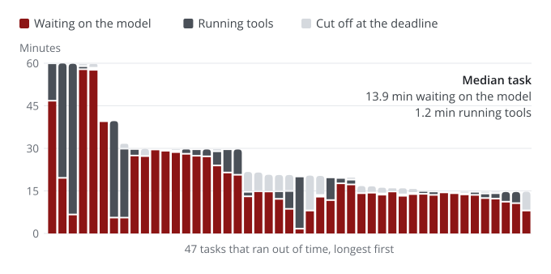
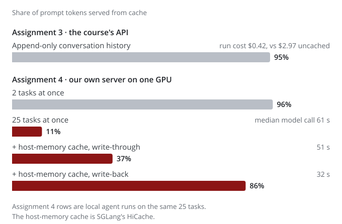
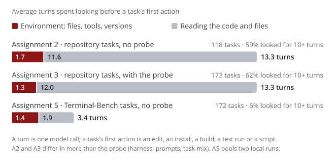

This post tracks the agent designs for Assignment 3, 4, and 5. The lessons focus on
analyzing the way the agents used their time, caching, and some thoughts on hard-coding
aspects of the harness.

<!--more-->

## General Arc of Agent Design

Assignment 3 is where I wrote the agent design that would essentially become the base for
the agent designs of assignment 4 and 5. Most of the changes were actually simplifying from
assignment 3's designs, rather than additions. Because assignment 3 had the different tiers of
models, figuring out how to best utilize them was key to the success that I achieved. The work
done for assignment 3 then really laid the groundwork for everything that came after it.

## Output Length

One realization in Assignment 3 that carried to 4 and 5 was output length was costing a lot.
These were largely long turns that mostly ended without doing anything; there are only a
handful where there was some large write to a file. This means a lot of this was thinking
that ate up time. The worst one was in assignment 3 where there was a call that took
95,268 tokens almost 23 minutes. In Assignment 5, 2.3% of the calls were 39% of output.
About a third of the 98 long calls (4k+ tokens) Assignment 5 were ended mid-call. There were
34 (35%) were cut off at the 16k cap. Those 34 alone produced 20.5% of all output.
The other 64 long calls finished on their own. Not all 34 were the agent's working turns.
Five were the agent summarizing its own history when the conversation got too long,
and those summaries ran to the cap too. This shows that there is a lot of work that can be done
for the agent to work with concision. It would be interesting to explore the agent first making
a general plan-of-attack for a task and splitting into different chunks.

## Tasks Running Out of Time

In Assignment 5, 47 of 89 tasks ran out of time. Those tasks spent 13.9 min waiting on the model against 1.2 min in tools.
Using the traces from local testing, for the tasks that ran out of time, ~60% was spent thinking, ~30% was writing commands
and to files, and ~10% was queueing and reading the prompt. This bolsters that cutting down on the model thinking so
that it can spend more time actually doing may lead to better results given the amount of time it was spending on thinking.

## Importance of Caching

Caching was key to saving time. In Assignment 3, 4,800 of 4,862 tokens were cached (98.7%)
with a cache-hit of 95%. This led to an 86% reduction in cost. In Assignment 4, I layered caching
between the Hi-Cache and KV cache. This is really where I learned about the importance of how to
manage a cache. In Assignment 4, because I was managing 25 tasks at-once, the KV cache on the GPU
filled up very quickly across all the tasks. The key for them was the text itself, meaning that
prompts (like the system prompt) would be shared. 

The write-through vs. write-back decision was key. Write-through means that a second copy is just
stored on the host. Write-back means that the host only stores what is about to be evicted by the GPU.
This expands the total cache to be the GPU (which can store 391K tokens) and the host (515K token) combined,
which is about 906K tokens total. 

## Hard-Coding Aspects of the Harness

In Assignment 3, I added a probe that was fixed shell script the harness ran in each task's sandbox before the model's first turn.
It was not a model call. Its findings about the repository were then pasted into the model's first message so the model wouldn't spend turns finding them itself. It would give the model:
- The programming language
- Other programming languages present, marked "not where the fix belongs"
- The likely test command, marked "verify it before relying on it"
- The build files found
- The top-level listing
- The tool versions
- The HEAD commit

This was an attempt to cut down on the amount of calls made at the start of a task to orient the model. However,
based on the comparison to Assignment 2, it did not really cut down on the amount of probing through model calls.
An interesting note is that for Assignment 2, passing the requirements and interface to the model improved it from
solving 3/10 tasks to 6/10. That was information the model couldn't easily find on its own. 
The probe gave it things it would have found in one or two turns. That suggests the harness adds 
the most when it supplies what the model can't easily look up, not what it would look up anyway. Therefore, this is
an area I would like to explore more.

## Conclusion
Overall, these assignments taught me a lot about agent harness design and gives me a lot more to dig deeper into, especially
for my final project.

## AI use

The SVG diagrams were made with AI.
