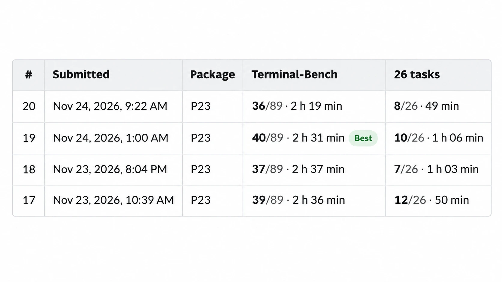

CS2680 was a great journey for me. When I look back at what I experienced through the assignments in this class, I realize I learned a lot. In this review, I will discuss what I did, what I found, and what I learned, especially from Assignments 2 to 5.

<!--more-->

Assignment 1 was still useful because it gave me a good starting point to learn what an agent is. It was the first time that I learned about the term "trajectory," where I could see what happened inside a coding agent. Instead of only looking at the prompt and the output, I followed the intermediate steps from reasoning to tool calls. I also saw the traces of failures and sub-agents.

Assignment 2 was my first time designing a coding agent harness on my own. I had to decide on the prompt, tools, state, workflow, and verification, and I learned how to track what the agent was doing throughout the process.

While Assignment 3 made the harness handle multiple tasks and limited resources at the same time, I started to recognize the trade-offs among solve count, runtime, and cost for harness design. I did many experiments with parallel tasks, different model types, restarts, sub-agents, and different limits on time, turns, and cost. This was also the first time that I participated in a leaderboard competition on AI agent benchmark.

Instead of calling model APIs, Assignment 4 connected agent harness directly to the SGLang server. Here, I deployed the Qwen3.6-35B-A3B-FP4 model on an RTX PRO 4500 GPU and worked with server settings such as KV cache, queuing, time to first token, prefill, decode, and concurrency, trying to balance my harness performance with server behavior.

Finally, in Assignment 5, I made my harness as general as possible and ensured it can solve tasks beyond the coding tasks of Assignment 4. After a few days of work, I ended up with a harness that is able to handle a wide variety of tasks (SWE, systems, security, machine learning, etc.). I'm quite proud of what I've achieved.

I put a tremendous amount of effort into all of these assignments, and I definitely learned a lot from them. I've summarised what I learned below in two broad categories. The first is more on the technical side, and the second is more personal (huge thanks to the "[How I Used Claude](https://how-i-used-claude.cs2680.com/)" website, a website built by the CS2680 teaching staff that summarizes the AI-agent conversations submitted by each student for each assignment, provides feedback on their usage behavior and how their behaviors compare with their classmates, and points out pitfalls when they collaborate with AI for each assignment.)

## On the Technical Side:

### Keep the Prompt General

One lesson I learned from these assignments was that the prompt should be specific about how the agent should work, but general about how it should solve the task.

I started with a very general prompt in Assignment 2 and gradually refined it in Assignment 3. After listening to the student sharing for Assignment 3, I tried adding a structured micro-plan to my prompt in Assignment 4 to make my agent be crystal clear about what it was doing, but that version solved only 5/25 local tasks, while the previous version solved 19/25 and 20/25 tasks in two runs with the same setup. (Even though I know one run was not enough to draw a final conclusion, the drop was so large that I did not do another run under this setting.) This showed me that more detailed instructions are not always better. I also tried language-specific routines, but their effect was unclear on my harness. Therefore, I did not keep these directions in my final harness.

Assignment 5 pushed me to generalize my prompt further. One early pitfall that I observed was that my old prompt told the agent to delete new test or scratch files before finishing, which worked well in the SWE-Bench. However, in Terminal-Bench, a new file could actually be part of the required result. Therefore, in that experiment, the agent ended up deleting 2 files that included either real task inputs or results. I then removed the rule and refined my prompt to stop carrying this repository-specific assumption. In the end, my Assignment 5 harness prompt was complete and generalized, with the agent's role and environment, tool behavior, workflow, constraints, time budget, done criteria, verification expectations, and general reliability rules.

### Matching Tools to Model Habits While Handling Tool-Call Failures

The second lesson, and also one of the most interesting things I learned, is that an agent harness should consider what model it is building with and whether the model has any specific behavior. During student sharing in Assignment 4, one student pointed out that the Qwen model may be more familiar with the tool names that Qwen Code uses, as those tools are developed by the same company. That immediately took me back to something I'd just seen in my own runs. In my previous agent trajectory, at various points my Qwen model made tool calls with undefined tool names in my harness (for example, in three Assignment 5 experiment runs, I found 6, 5, and 4 undefined tool calls). That was the moment I realized those tool names might be picked up during the training phase of Qwen3.6-35B-A3B-FP4. So I aligned my tool names and parameters with the Qwen Code naming convention, while still keeping the old names as aliases. From that on, my subsequent Assignment 5 runs had absolutely zero undefined tool calls.

### Restart Only When It Actually Helps

When I submitted my harness to the leaderboard, I noticed that for some tasks they were solved almost every time, for some they were never solved, and for some they were solved only occasionally (like a coin flip). Since solve count mattered (a lot) on the leaderboard, I thought a few more attempts on some of the coin-flip tasks might be worthwhile.

Thus, in Assignment 3, I added a restart feature. Most of the time, it was just a completely fresh restart from scratch, so the performance wasn't great. Worse, sometimes the agent just kept going down the same failed path, taking up more runtime and more cost.

In Assignment 4, I spent some time improving this restart feature in two ways. First, I added bounded factual restart memory, so that a new attempt would carry forward a small set of useful information from the previous attempt. Second, I made the restarts conditional on the evaluation result and the remaining time. Thus, a near miss would get another attempt, but a task still far from passing would just stop rather than waste more time and resources.

I removed fresh restarts in Assignment 5. In Assignment 4, a fresh restart could reset the working tree. This was a problem for Terminal-Bench because it could remove changes that would be graded as part of the final container state.

### Better Verification Instead of More Verification

In Assignment 2, I first learned that simply running a test wasn't sufficient. Sometimes the agent only tested a small part of the required behavior. Sometimes, it ignored earlier test failures after a few other tests passed. I therefore let my harness write small behavior checks based on the task requirements.

After learning more about verification from the student sharing in Assignment 3, I wanted to add more verification to my harness for Assignment 4. However, more verification could actually hurt. In one experiment, I built a contract test writer, but it did not solve any additional tasks, and only 3 out of 43 generated tests were judged as effective. Worse, many generated tests had problems, especially in Go, where all six contract tests failed to compile. After a root cause analysis, I found the problem was that my verification generator itself was not properly validated. A wrong test gave the agent wrong signals and could even make the solution worse. I therefore dropped this direction.

### Using Task-Level Time Limits Rather Than One Global Stop

In Assignment 4, I noticed that many students finished their leaderboard run much faster than I did, so I also wanted to try strategies to reduce my runtime. I first considered adding a global stop for the whole run, but that was a bad idea. Before the hard stop, my harness solved 9/26 tasks in 96 minutes. After adding a 55-minute hard stop, the run only solved 2 of the 26 tasks. 6 tasks never even started, and 7 just finished with no patch. So a global stop isn't optimal because it rudely ends every task as time approaches.

In Assignment 5, I started to set a time limit for each task. Since all the Terminal-Bench tasks already had their own time limits, if the task limit was 30 minutes or less, I kept it. If it was more than 30 minutes, I capped it at 30 minutes. The effect was clear. Before adding this cap, my harness solved 38/89 and 33/89 tasks in two leaderboard runs, taking 175 and 215 minutes separately. With this cap, the average runtime dropped to about 151 minutes across 4 runs, while the solve count stayed roughly the same. I kept this version as my final Assignment 5 harness, and the results of its four leaderboard runs are shown in the table under the [Running Experiments More Carefully Before Trusting the Result](#running-experiments-more-carefully-before-trusting-the-result) section.

### Tuning the Harness and Server Together

More concurrency isn't always better. At first, in Assignment 4, I opened all 25 local tasks at once, and only 9/25 local tasks were solved. Based on the SGLang metrics, the average KV cache use hit 83%, and many model calls waited in the queue for a long time. When I reduced the task concurrency from 25 to 5 and the API concurrency from 25 to 8 (as in Assignment 3), the number of solved tasks went up to 17/25 and 18/25 tasks in two runs, and the average KV cache dropped to around 37%.

I spent a lot of time playing with different SGLang settings in Assignment 4. Small decode CUDA graph buckets made a single leaderboard run 29 minutes faster and solved one more task (though I did not repeat this experiment). FP4 KV was another useful tweak, increasing the KV pool from 358K to 540K tokens and reducing the number of lost prefix tokens from 12.0M to 7.4M.

In Assignment 5, I ran into some different issues with longer prefills in Terminal-Bench tasks (also, I enabled the Qwen model to preserve thinking, so some context became longer). In one SGLang performance test, a new request with a fairly long prompt (around 190K tokens) caused the seven requests that were already decoding to pause for 44-47 seconds. To solve this issue, I enabled the server to run decoding steps between the long prompt's prefill batches and set `prefill-decode-interval` to 2, which dramatically reduced the longest pause to about 1.8 seconds (a great success!). The trade-off was that the new request's time to first token (TTFT) increased by about 3% (acceptable!).

In another Terminal-Bench experiment, I ran into a situation that my harness was processing a request with about 225K tokens of cached prefix and 1.8K tokens of new input. Since the server used FP4 KV cache, processing the new input required dequantizing the previously cached KV data and needed another 112 MiB of GPU memory for temporary calculation. However, at that time only 109 MiB was available, leading to a CUDA out-of-memory error and crashing the server. To investigate this problem, I ran two 170-minute stress tests, one with and one without PyTorch's `expandable_segments` (which allows memory segments to grow as needed and helps reduce memory fragmentation). The result is obvious, without it, the server had 24 near-OOM warnings, although it did not crash during the test. With `expandable_segments`, these warnings dropped to zero, and the minimum free GPU memory increased from 33 MiB to 395 MiB. Therefore, I enabled `expandable_segments` in my SGLang server and did not encounter any other CUDA out-of-memory crashes in my future runs.

Though tuning SGLang can help the harness solve tasks faster, I still believe that if the harness cannot solve many tasks, uses too many tokens in its prompts, or doesn't manage its memory well, a faster server alone won't make much difference to the leaderboard result.

## On my personal side:

### Learning How to Work Better With Coding Agents

In the beginning, I trusted my coding agent, Claude Code, a lot. When it suggested the next step, I usually just approved it, even if it didn't explain why. I also mostly believed it when it said it had done something. But the more I worked with coding agents, the more I realized they aren't always right. They can misread the scope of the work, make changes that weren't requested at all, or just treat their own assumptions as facts. In Assignment 2, one of Claude Code's mistakes remained in my harness for a week before I eventually tracked it down and fixed it (according to the pitfalls section from my "[How I Used Claude](https://how-i-used-claude.cs2680.com/)" website).

I also learned from others in the class. One important change is that I now ask the coding agent to explain what it changed and why these changes make sense. When I'm unsure, I ask for the before-and-after comparison. I also tuned the Claude Code reporting behavior, a lot. Instead of long paragraphs, I now ask for short explanations with tables and plots. I started writing these rules into `CLAUDE.md` so I can reuse them in future projects.

### Questioning the Coding Agent When Its Reasoning Narrows the Scope Too Much

This lesson is different from the first one. In Assignment 3, after several experiments that didn't work well, my coding agent kept recommending that I use the Standard model and build a simple agent harness. All the evidence it presented was individually reasonable: the Expert model was expensive, the sub-agents took more time and hadn't really improved the agent's performance, and the agent had found papers online suggesting that a simple architecture worked quite well for Qwen on SWE-bench. I ended up trusting my coding agent without actually checking whether it was getting me to the right result. In the end, I wasn't happy with my rank on the Assignment 3 leaderboard.

Later, during the Assignment 3 student sharing, I noticed that many of the top students' submissions still used sub-agents and Expert models, but they used them in smarter ways. In the Assignment 4 student sharing, I still remember one student saying something like we should guide the coding agent and insist on the directions that we believe are worth trying. This was a very important lesson for me. In the future, even when my coding agent gives a reasonable explanation, I still want to question whether its conclusion is too strong. I also need to be more confident in my own ideas and test them before letting the agent narrow the design space too early.

### Running Experiments More Carefully Before Trusting the Result

I learned three lessons about running experiments. The first was to change only one thing at a time. Early in Assignment 3, I was greedy and changed several features at once. I remember in one experiment, I used a leaner prompt, set to only the Standard model, reduced the turn limit to 35, allowed only one evaluation, and removed restarts, and harness performance dropped from 12/26 tasks in the previous version to only 3/26. But I couldn't tell which change caused the problem, so I later had to test them one by one (which took me more time…).

The second lesson is that one run is not enough to draw a solid conclusion about the harness performance. Because of randomness in LLM token generation, even with the same harness and the same setup, the result on leaderboard still varied across submissions. The table below shows the four leaderboard submissions of my final Assignment 5 harness. I submitted exactly the same package all four times.

(Note: This table was redrawn from the leaderboard screenshot. All numbers were verified by me against the original leaderboard.)

Third, local results didn't always match the leaderboard performance. So, repeated experiments are necessary. When time allowed, I resubmitted the same harness package to the leaderboard at least 2 times before coming to a conclusion.

### Learning Better Strategies for the Leaderboard

I had some experience with Kaggle competitions, but Assignments 3, 4, and 5 were the first real leaderboard competitions that I have ever experienced for coding agents. From the student sharing sessions, I learned a lot of tricks and strategies for the agent leaderboard. In Assignment 3, I was quite surprised to see a number of students choose a small number of easier (faster) tasks and focus their harness on them, skipping the much harder (or unsolvable) tasks. At that point, I just let my harness go through every task, which made the run time per task much longer. I also learned that students look for gaps on the leaderboard and target a particular position rather than simply trying to maximize the number of tasks solved or minimize total run time. That was refreshing to me and completely changed the way I thought about leaderboard competition.

## AI Acknowledgement

For the coding parts of the assignments, I worked with Claude Code and Codex. For this blog post, I developed all the ideas and wrote it myself. I used a translator and Grammarly to help improve my English grammar and wording. The table image in this post was generated with ChatGPT based on a leaderboard screenshot that I provided. I asked it to remove unnecessary details, such as the submission name and exact file name, while keeping the original table structure. I also used Claude Code to help with the formatting and layout of the blog post.
