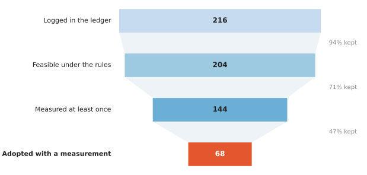

Each assignment taught me something different, and two lessons shaped my approach to A5. In A3, my harness solved 18 of 26 tasks and ranked first. The same code scored only 13 in two later runs, so much of that result came from randomness. This made me realize that online grading is very noisy. In A4, I let a coding agent optimize the system on its own. I gave it only a general goal, and it got stuck in local optima. The main lesson I wrote in my A4 report was to "do enough analysis before optimizing."

In A5, I applied both lessons. I organized the search around the idea of "broad then deep," and I accounted for noise when evaluating each result. My best A5 results were 26 of 89 TB2 tasks solved in 19.4 minutes and 11 of 26 repository tasks solved in 28.7 minutes. These two results earned 4 of the 5 bonus points.

<!--more-->

For the same result, there are usually many different ways to optimize. The specific optimizations are important, but how to arrive at a better pipeline is an equally good question. I will therefore discuss two perspectives below. The first is the broad-then-deep optimization process, and the second is the changes that brought the largest gains in my experiments.

## 1. The broad-then-deep optimization process

### The basic idea

Broad then deep is a search strategy that I developed through practice. I needed such a strategy because our experimental resources were very limited in A3, A4 and A5. Specifically, in A4 and A5 we had only one GPU, a limited number of online gradings per day, and a limited total number of offline tests. The question therefore became how to find the best solution faster and more accurately within limited time and resources.

To explain this strategy, we can use gradient descent as an analogy. We can view the space of all possible designs as a loss landscape with many local optima and one global optimum. Under this analogy, a wishful prompt such as "make the agent better" is much like starting gradient descent from one random point (Figure 1a). Therefore, the search converges to the local optimum nearest to the starting point. I used exactly this approach in A4, so the final optimized result was not good.

In contrast to this kind of wishful programming, I think a good approach is a broad-then-deep search. Broad then deep samples first and then descends. Specifically, it first samples many points across the whole landscape and evaluates each one coarsely. It then keeps the best few points and starts gradient descent from the best one (Figure 1b). Successive halving and Hyperband [1, 2] also use the same structure. This is also my abstract understanding of what "enough analysis before optimizing" means.

 Gradient descent from one random start ends in the nearest local optimum. (b) Sampling the whole landscape first finds the region of the global optimum.")

### The three stages in A5

Specifically, in my A5 system, broad then deep is implemented as a three-stage funnel. The first stage defines the region to sample, the second evaluates the samples coarsely, and the third continues to optimize from the most promising ones. As the stages progress, fewer candidates remain, and each candidate receives more resources.

First, the goal of the first stage was to define the search space. To do this, I asked the agent to survey the field before changing any code. It wrote 27 research documents covering serving, caching, speculative decoding and agent design. I then organized these documents into 54 directions in 11 groups.

With the directions defined, the goal of the second stage was to evaluate each direction coarsely at a low cost. For each direction, I ran only the cheapest experiment that could show whether it was promising, so these tests were much smaller than a full run. For example, to choose the batch size, I only measured how the cache hit rate changed with the batch size and used the result to find a reasonable range. The result of such a test is coarse, but it is enough to show which region is worth exploring. Directions that were clearly worse were therefore dropped at this stage.

After these two rounds of filtering, the goal of the third stage was to evaluate the changes that only full runs can judge. At this point, the remaining ideas focused mainly on the harness, such as when the model should think and how model calls are shared among tasks. Because these changes interact with the rest of the system, a small isolated test cannot predict their effect. For example, thinking on more turns can improve each step, but it also makes each call slower, so a task gets fewer turns within its time limit. So, for the remaining methods that had to be implemented before they could be evaluated, I implemented them directly and ran full evaluations. In the end, across the three stages, I logged 216 ideas, tested 144 and adopted 81, 68 of them with a measurement (Figure 2).

In addition, the evaluation in the third stage had the same noise problem as A3. I think this problem can be addressed in two ways. On the one hand, when resources allow, we can evaluate the same setting several times. On the other hand, we can analyze the trace of each sample to find the patterns of success and failure.

## 2. Where the largest gains came from

Across A2 to A5, most of my improvement came from four kinds of changes.

- **Checking before submitting (A2, A3, A5).** In A2, model self-review almost always found no issues, while deterministic checks were more effective. In A3, about two thirds of the failed attempts ended in a wrong done, so I added a set of deterministic checks before done. In A5, the harness kept quick checks of the required paths, ports and interfaces.
- **Spending the budget where it pays off (A3, A5).** In A3, I first ran one expert attempt, and only when enough time remained did I let a cheaper attempt take over in the same workspace. In A5, the vast majority of TB2 solves happened within the first 10 minutes, while most task time went to tasks that were never solved, so I limited the time per task and submitted tasks with long time limits early. These changes earned my first TB2 bonus point and later brought the TB2 run under 20 minutes (Figure 3).
- **Keeping the cache effective (A4, A5).** In A4, with more than 20 agents running at once, the cache hit rate dropped to around 10%. After I changed the engine configuration based on a cache analysis, the replay ran nearly three times faster, and the hit rate rose from about 30% to about 90%. In A5, a few tasks used most of the turns while tasks that started late had to wait, so fairer admission and a larger KV cache, combined with key-turn thinking, raised the best repository score by about two tasks (Figure 3).
- **Making each call faster (A5).** Adding two-step MTP speculative decoding cut TB2 wall time by nearly a fifth (Figure 3), and repository solves also improved clearly. In addition, thinking only on key turns kept calls fast. Under a tight time budget, it solved about 30% more local tasks than thinking on every turn.

## Takeaways

- Before optimizing, sample the design space broadly with cheap tests, and save full runs for the most promising directions.
- A single online score is very noisy, so confirm results with repeated evaluations or per-sample trace analysis.
- Before changing the agent, find out where the time and the cache capacity actually go.

## AI use

Across A2 to A5, I mainly used Anthropic's Claude and OpenAI's Codex to write harness and serving code, run experiments, and analyze logs and traces. For this post, I used AI to draw the figures from my experimental data. The engine is SGLang [3].

**References**

1. K. Jamieson, A. Talwalkar. "Non-stochastic Best Arm Identification and Hyperparameter Optimization." AISTATS 2016.
2. L. Li et al. "Hyperband: A Novel Bandit-Based Approach to Hyperparameter Optimization." JMLR 2018.
3. L. Zheng et al. "SGLang: Efficient Execution of Structured Language Model Programs." NeurIPS 2024.
