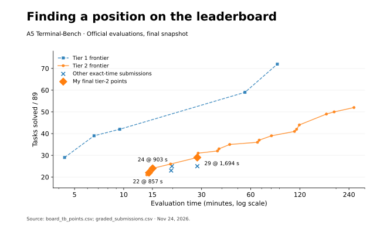
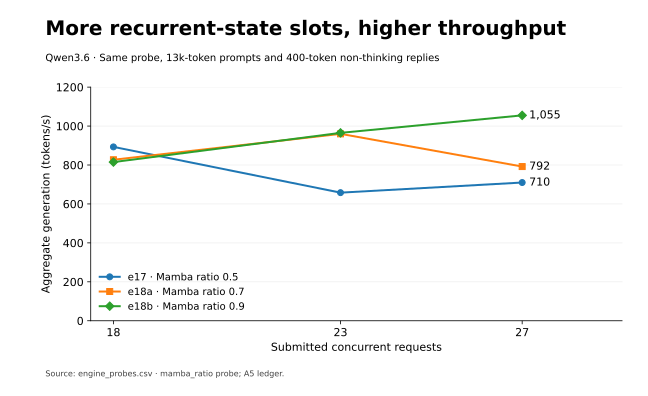
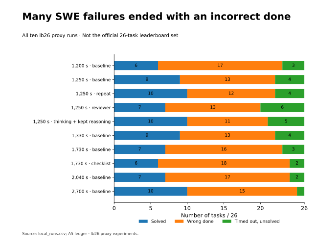

Across four assignments, my focus shifted from building agents to optimizing the systems that run them. A2 was a minimal SWE agent called `madsLoop`. A3 introduced a multi-role framework using the course API. A4 moved inference onto a single RTX PRO 4500 running Qwen3.6-35B-A3B NVFP4. A5 extended the system to 89 Terminal-Bench tasks and 26 SWE tasks on the same GPU.

<!--more-->

| Assignment | Result |
|---|---|
| A3 | 1st place, 14/26, $0.2233 per solve |
| A4 | Best result: 14/26 |
| A5 | Full baseline credit + 3 bonus points |

## 1. A Simpler Agent, a More Complicated Scheduler

A3 and A4 used separate roles for planning, implementation, and review. This made sense in A3, where models had different prices and capabilities. In A4, all roles used the same local model.

For A5, I removed the SWE-specific mechanisms and kept five tools: `bash`, `read_file`, `write_file`, `edit_file`, and `done`. I retained the streaming client, request deadlines, retries, conversation compaction, and verification before submission.

The first complete run solved 31/89 tasks in 94 minutes, meeting the baseline.

Time management had been a recurring problem since A2, where individual requests stalled for 964–2,054 seconds. In A4, my first submission exceeded the 90-minute limit because ongoing model requests were not interrupted correctly.

In A5, introducing a 900-second per-task cap produced another run with 31 solves in just 41 minutes, although the two runs solved different subsets of tasks.

I later added a global deadline, task prefetching, and dynamic task caps. Once no tasks remained in the queue, the additional per-task cap was removed. I also staggered the completion of the final batch because the evaluation dispatcher processed `done` requests sequentially.

The final fast submission, `sub38`, solved 29/89 tasks in 28 minutes.

## 2. Where the Computation Goes

In A3, I discovered that 16% of standard-model requests experienced complete cache misses but accounted for 86% of uncached input tokens. The framework was rewriting earlier messages, invalidating previously cached prefixes.

I switched to append-only conversation management and changed failure diagnosis to use summaries. The solve count increased from 11 to 13, while the cost per solve fell from $0.3335 to $0.2303.

In A4, enabling HiCache and longest-prefix-match scheduling increased the cache hit rate from 18.5% to 95.9% and reduced the time to first token from 36.5 to 5.4 seconds.

A5 required a different memory allocation. Qwen3.6 uses both full attention and Gated DeltaNet linear attention. SGLang divides GPU memory between the attention KV cache and a Mamba cache pool that stores recurrent states.

A4 needed more KV capacity because SWE tasks produced long contexts. Terminal-Bench generally had shorter contexts, making recurrent state capacity a more important constraint.

Enabling `extra_buffer_lazy` reduced the number of state slots required per request from five to four. Increasing the Mamba cache ratio from 0.5 to 0.9 then raised the maximum number of running requests from 18 to 27.

At 27 submitted requests, aggregate generation throughput increased from 881 to 1,313 tokens/s in a serving benchmark with short prompts.

The improvement in actual twenty-minute agent runs was much smaller: an average of 21.5 solves versus 18.5 with earlier engines, within the observed experimental variation. The KV cache had become the new bottleneck. One run averaged 16.9 running requests and 7.7 waiting requests, with median KV utilization reaching 90%.

Speculative decoding presented a similar trade-off. MTP accelerated individual requests but consumed additional GPU memory, reducing concurrent capacity. I rejected it in both A4 and A5.

## 3. Keeping the Model's Reasoning

I initially disabled thinking because it consumed too much of the time budget. In A5, I revisited this decision with 16 open tasks and a per-task cap of 1,800 seconds.

The first thinking-mode experiment, `x6`, solved only 28 tasks, compared with 34 without thinking. Its main problem was excessive reasoning: 165 responses reached the 6,000-token reasoning cap, consuming 44% of accumulated request time.

Qwen3.6 was trained to use reasoning traces from previous turns, but my agent discarded those traces after normal responses. I introduced `keep_reasoning`, which preserved them in the assistant messages.

This was the only configuration change between `x6` and `x7`.

| Metric | x6 | x7 |
|---|---:|---:|
| Tasks solved | 28 | 37 |
| Runtime | 5,848 s | 5,359 s |
| Generated tokens/request | 927 | 628 |
| Median reasoning tokens | 64 | 39 |
| Reasoning cuts | 165 | 86 |
| Time spent on cut reasoning | 44% | 26% |

Keeping more information in the conversation resulted in less generated reasoning.

However, the nine-task improvement came from comparing two individual runs. Ten later measurements, including `x7`, placed the retained-reasoning configuration family at approximately 34 solves. Another run without retained reasoning achieved 32 solves after changing the cutoff mechanism. I therefore expect the improvement to be smaller than nine tasks, probably around three to six, although the experiments do not establish an exact effect.

The corresponding official submission, `sub12`, solved 34/89 Terminal-Bench tasks and 12/26 SWE tasks.

Thinking remained unsuitable for short execution windows. Some later thinking runs solved only 16–17 tasks within thirty minutes. I therefore maintained two configurations: a fast non-thinking configuration with 32 open tasks, and a thinking configuration with 16.

 The x6-to-x7 single-change comparison yields 28 versus 37 solves in individual runs. The retained-reasoning configuration family's level is approximately 34 (per-task rate sum 33.6 across ten runs, excluding verifier timeouts); x8b also changes the cutoff mechanism and is not a pure retention control. (B) Representative randomized-order local runs, with four grading timeouts each, show the different time–solve trade-offs of the fast and thinking configurations. Panel B is not a thinking-only ablation.")

## 4. Trying a Stronger Model

I also tried Qwen3.8-27B NVFP4. Its published benchmark results looked promising, and its weights occupied slightly less GPU memory.

However, its KV cache required 32 KiB per token, compared with 10 KiB for Qwen3.6. During a full SGLang run, the server averaged only five running requests.

I tested both SGLang and vLLM in twenty-minute runs:

| Model / Engine | Concurrency | Opened | Solved |
|---|---:|---:|---:|
| Qwen3.6 / SGLang | 32 | 61 | 18 |
| Qwen3.8 / vLLM | 16 | 44 | 15 |
| Qwen3.8 / SGLang | 14 | 35 | 8 |

I deliberately reduced concurrency for Qwen3.8 because of its larger cache requirements.

After adjusting for the historical solve rates of the tasks opened in each run, both models achieved similar results relative to the expected solve count. Qwen3.8 sometimes required fewer tokens per solve, but generated 2.5–4 times fewer tokens per second under the tested workloads.

I switched back to Qwen3.6. The newer model could use its tokens efficiently, but my GPU could not generate enough of them within the available time.

## 5. Understanding What Actually Failed

Many unsuccessful SWE tasks were not interrupted by deadlines. The agent called `done`, but its solution failed evaluation.

In A4, only three of twelve failed tasks in one late-stage evaluation were still working at their time limits. In A5's local 26-task proxy experiments, 11–18 tasks per run ended with an incorrect `done`.

Increasing the per-task cap from 1,200 to 2,700 seconds produced results ranging from six to ten solves, without a consistent upward trend. Additional reviewers and more elaborate verification checklists did not reliably improve the results.

Experimental variance also made optimization difficult. Fifteen runs from the `sub22/23/24` configuration family produced between 18 and 27 solves, with a standard deviation of 2.5 tasks.

Several experiments illustrate the difficulty of interpreting individual results:

- Lower scheduling conservativeness produced 26 solves, but the control also produced 26.
- Adding working habits to the prompt appeared to reduce performance, but the unchanged baseline also dropped because of slow network downloads.
- Selective thinking introduced a conversation-formatting bug that caused premature termination.
- Terminating tasks after two truncated responses saved time but did not reach the desired leaderboard window.

Infrastructure introduced additional uncertainty. Rootless Podman networking, inotify limits, failed sandbox creation, and slow package downloads all affected measurements. Keeping a complete experiment ledger helped me distinguish agent regressions from infrastructure problems and ordinary experimental variation.

## 6. Optimizing for the Leaderboard

In A3, I earned first place by targeting an efficient 14-task operating point rather than pursuing the highest solve count.

I applied the same strategy in A5. The leaderboard constructed successive Pareto frontiers based on solve count and execution time, removing selected students' submissions after each round.

My final competitive Terminal-Bench submissions covered three different time windows:

- 22 tasks in 857 seconds.
- 24 tasks in 903 seconds.
- 29 tasks in 1,694 seconds.

The longer thinking configuration separately secured 12/26 on the SWE leaderboard.

I initially misunderstood the Terminal-Bench bonus rules and prepared `sub30` as an insurance submission for the third tier. The actual scoring implementation awarded no bonus for that tier.

## What I Would Do Differently

I would investigate verification quality earlier, establish repeated baseline measurements before making changes, and read the scoring implementation before choosing an optimization strategy.

Using an AI coding agent made it possible to run many more experiments, but it also made experimental discipline more important. I needed to maintain a reliable ledger, check whether comparisons were valid, and ensure that improvements did not encode task-specific knowledge.

A5 eventually produced two useful configurations rather than one universal solution. The fast configuration optimized throughput and scheduling, while the thinking configuration used more time to achieve a higher solve count.

For my next experiment, I would spend less time tuning inference parameters and more time investigating how the agent determines whether its work is actually complete.

## AI Use Disclosure

I used Claude Code to implement the agent, run experiments, and analyze execution logs. For this blog post, Claude helped organize the outline, verify experimental facts, and prepare CSV data for visualization. The figures were generated using Python and Matplotlib. I reviewed the experimental results and technical conclusions.
