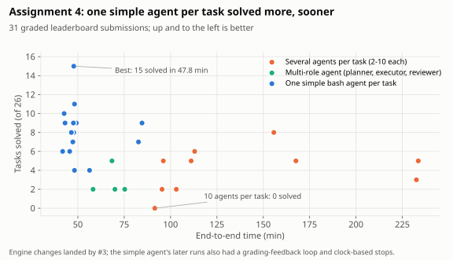
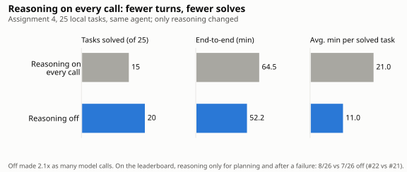
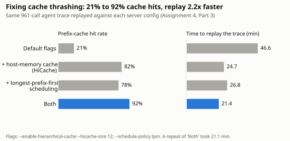
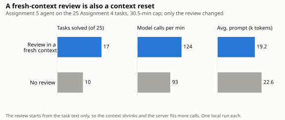
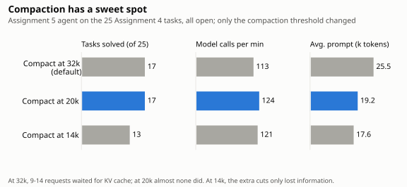
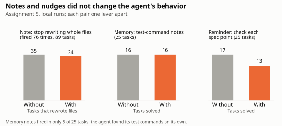
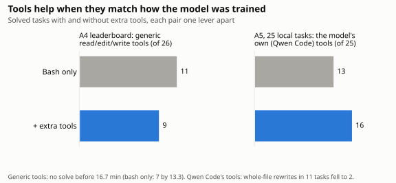
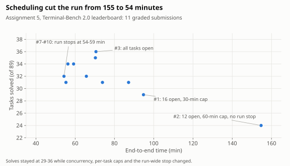

When I came into this class, I didn’t know what to expect. I had very little systems background besides an undergraduate course in computer architecture (which I did love!) and was fundamentally bleary-eyed about what went on behind the scenes of the powerful new tool tearing its way through our workflows: Claude Code.

I had just come off a product-based summer fellowship where I was hook, line, and sinker for our new friend (and apologies to those against anthropomorphisation; I am afraid I am in too deep). I haphazardly structured my often very underspecified prompts, never verified what it was doing, asked for analyses and repeated the slop to my manager. This class—starting from Assignment 1—transformed my understanding of what a coding agent actually *is* and generated a completely different interaction scheme that I now follow in my projects.

First: the Claude Code de-idolization. We were taught never to put anyone on a pedestal, but perhaps in the year 2026 we have to modify our common psychological mandates to include agents as well. Over the summer, I deeply believed that Claude Code was just a one-stop-shop *better than me* tool, which, for whatever it’s worth, is not entirely unfounded. But while the belief might be reasonable, beliefs have consequences—mine being the aforementioned blind trust. Claude Code can work miraculously well autonomously as long as you give it the right infrastructure, and it took me until the last week on Assignment 4 to learn this lesson and put it to good use. If I made a pipeline for doing individual case studies to make sure certain fixes and adjustments were implemented *correctly* instead of crossing my fingers and hoping Claude was telepathic, I could set it free.

But enough waxing poetic about Claude&Me—let’s dive into some system specifics.

**What I learned across the assignments**:

1. Simple is usually best. My results always turned out better when I started from a single agent in a simple loop with just bash tools.

   

2. Conditional reasoning works well. Switching reasoning on/off as a binary choice is not the best way to use the reasoning capability. Switch reasoning on (and cap the number of tokens) for certain tasks like planning and after a failure, and use non-thinking sampling everywhere else.

   

3. Thrashing is the main engine level failure. With pretty simple fixes to the KV cache and eviction policies, you can get a 90%+ cache hit rate, and this is one of the simplest levers to change.

   

4. Use feedback selectively. Sometimes grading feedback is very helpful (near miss or not), and sometimes it isn’t. In the case where it’s not helpful, always use a fresh context to keep context short.

   

5. The main bottleneck is GPU turns per minute. On one GPU, the whole system has a fixed number of model turns a minute. The design only decides how they are shared. All my experiments with more than one agent per task running parallel only made each agent slower and eventually time out. You should spend your turns on fewer, shorter conversations.

6. Compacting is an optimization problem. Compact too often, and you start losing solves. Compact too meagerly, and the turns get slow.

   

7. Setting optimal cap times per task is a really useful way to have control over the clock, though there is an element of leaderboard-maxxing here.

8. Giving my agent little note-nudges was ineffective. You need to change the structure of the agent (tools, calls, runtime) to have any effect, because most of the time the agent didn’t change its behavior based on the notes (so stubborn!). I call this one treat your agent like a toddler: time outs, naptime, no sugar after 3pm.

   

9. Customize the tools to match what the model was trained on, and look at what the agent actually needs before giving them too big of a toolset. Ever heard of too many cooks in the kitchen? This one is called too many tools for the agent :/ It gets overwhelmed and spends more time using complicated tools rather than the bare minimum it needs to get a task done.

   

10. Memory, the way I implemented it, never helped. Logically, this was the most confusing to me, but I believe I just genuinely didn’t optimally implement the right kind of memory saving and retrieval. The agents were usually able to figure out what they needed from the task and repo alone without notes, and saving and retrieving the notes always cost time.

11. If you want to optimize for time, don’t tune the agent first. Schedule everything down to the T (how many tasks open at once, how much time each task gets, when the whole run stops). Again, a bit leaderboard-maxxing, but this is what ended up being most successful from a purely metrics-based standpoint. You optimize how your agent works within the context of the schedule.

    

12. Related to the above, don’t optimize over all metrics at once. This should be obvious, but for some reason the maximalist nature of Claude Code made this easy to ignore, and I kept trying to push performance in all directions (get more solves, decrease time, decrease cost). Meta-lesson: don’t let the omnipotence of Claude Code undermine you! Absolute power corrupts absolutely, as my 3rd grade teacher Mr. Lopez made us continuously chant. Who knew this is where his indoctrination would surface?

13. One lever at a time! One lever at a time! One lever at a time!

My workflow became much easier (and I became a 100x programmer, as Juncheng had promised in the nascent days of our class) once I human-in-the-looped pipelines for verification, case studies, and testing levers. Of course, manually testing one lever at a time was extremely inefficient, so the breakthrough came from doing /goal (praise be!) optimize for certain metrics. Running that overnight usually gave me reasonable results in the morning, which I would go back and interpret.

Final thoughts: I really enjoyed this class and learned a lot from it. Strangely, it helped me de-center Claude Code in my life and learn how to make it work for *me*, rather than my being its fleshy workhorse. I’ve been using what I’ve learned extensively in other classes, and I’m immensely grateful to the teaching team for creating thoughtful assignments in this rapidly evolving time.

## AI use

Claude was used to make the figures from my run logs.
