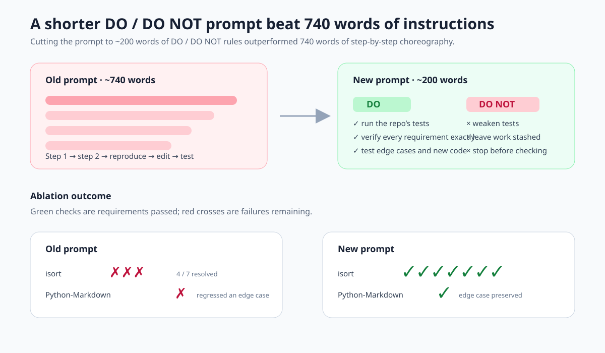
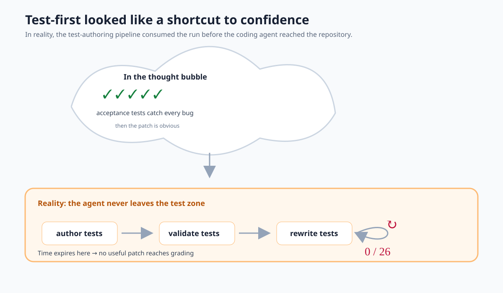
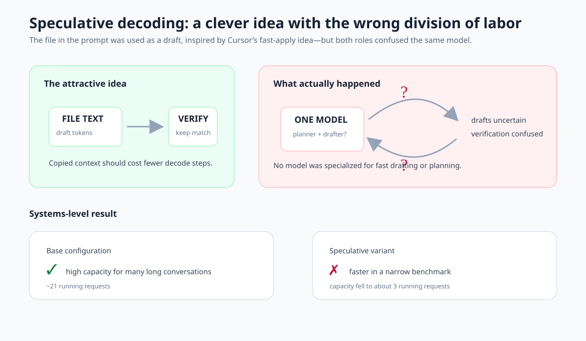

In [the bitter lesson](http://www.incompleteideas.net/IncIdeas/BitterLesson.html), Rich Sutton writes about the oft-quoted notion that general-purpose methods tend to outperform highly specialized efforts, mostly as an artifact of Moore's law improving the ability of general-purpose compute and how this tends to improve search and learning. While the analogy does not exactly transfer to agent harness engineering, the spirit of it holds true, as I consistently found that efforts to introduce innovative tricks were generally subpar relative to systems-level improvements that prioritized elegance and simplicity.

Staying within the band of problems that these very language models are well-trained on likely takes the best advantage of the fact that models are also constantly in flux, and are chasing increased performance with widely popular harnesses as our own harnesses chase improved performance with widely popular models. Jediah Katz, from SpaceXAI, [spoke about this exact problem in a speaker event](https://www.youtube.com/watch?v=7Y4sbZgBdnc), which is analogous to the [Red Queen Hypothesis](https://en.wikipedia.org/wiki/Red_Queen_hypothesis), a concept from evolutionary biology to which I find many parallels. We now find ourselves trying to create value in a world that is not, and will never be, in homeostasis, as all elements are chasing ever-increasing performance relative to each other.

### Keep it Short

In Assignment 2, I had tried asking AI to generate a prompt for the agent harness itself, and asked it to continue iterating on the prompt as we kept attempting the tests. The AI kept adding more and more instructions to the prompt, and I quickly found myself with over 740 words. I saw the performance was abysmal, and decided to take a look and was dumbfounded by how massive the system prompt had become.

I recalled from lecture that the most effective system prompt instructions usually involve telling agents what NOT to do, so I removed almost all of the prompt and switched it to a series of DO and DO NOT statements focused mostly on what makes this coding-agent environment unique.

In my ablation, on `isort` the shorter prompt went from 4/7 to 7/7 requirements passing (and preserved the Python-Markdown edge case). Allowing agents to act in their best interests helped them resolve situations within the band of how they were trained, and in ways that may be more efficient than the heuristics we might define. I learned that an overly elaborate system prompt may put agents in situations that are seriously out of band with the training information on which they were fine-tuned.

### Enforce Ownership

In Assignment 3, one issue I had was that, in trying to design a multi-model harness using powerful and standard models, I found myself running out of money from using the powerful model too much, or running out of time because the standard model never succeeded in solving the problem. When I took a look at what was happening, the issue was that either the standard model never felt like it needed to hand off the problem to the expert model, or the expert model never felt like it ought to hand the problem back to the standard model.

Instead, I switched simply to using the standard model for everything, and using a better harness instead to augment the core model intelligence. This cut runtime and cost roughly 3×—finishing in about 7 minutes down from 21 minutes, and 7 cents down from 20 cents per solved task—while in a single run on the 26 Assignment 3 tasks it solved 8/26 without any handoff logic, versus 5/26 for the handoff harness.

, while a standard-only loop solved 8/26 (7 min, 7¢/solved).")

I learned here that while we humans may have an intuitive sense of when to hand off work, agents may not, even if explicitly prompted to do so. What was rather interesting was that students who were able to implement such a system, according to the student sharing sessions for assignment 3, relied on explicit turn limits to force handoffs, which highlights how AI models, if left to their own devices, are fairly overconfident in their own abilities.

### Avoid Bureaucracy

In Assignment 4, I was getting frustrated with how often the models would spend hours on a test only to fail when new hidden tests were added. Even if the model felt sure that it had solved the problem, it probably forgot about a few key requirements in the beginning. To address this, I tried having the model write tests at the very beginning, while the requirements were fresh, before beginning the problem and clouding its judgment with too many context tokens.

This was a mistake, however, as the agent could spend an indefinite amount of time just writing tests, and so I actually dropped to 0/26 Assignment 4 tasks passing. If test writing was interrupted, we would end up with tests that could never pass, effectively dooming the run. After several attempts to determine how to allow test writing at the start, I realized that until the model actually tries to get started with the codebase, it will not develop enough intuition to understand what reasonable tests might be. This was another example of how agents work differently from humans: although software engineers are often instructed to embrace [test-driven development](https://en.wikipedia.org/wiki/Test-driven_development), this is not necessarily the case for AI agent harnesses.

### Don't be too fancy

Finally, in Assignment 5, I was also blindly trying to use speculative decoding from the lectures when in reality it may not have been a good fit for coding agents on a wide variety of tasks. I took a look at the [Cursor implementation](https://cursor.com/blog/instant-apply) and used SGLang's n-gram flag to enable using the existing code as the draft upon which the target model could act as a verifier.

However, this backfired: enabling n-gram speculative decoding cut our concurrent capacity from ~21 running requests down to ~3, wiping out any potential speedups. Because our agent made targeted edits rather than whole-file replacements, the generated output was too novel and position-sensitive to get good n-gram reuse from the existing code, so the verification tax outweighed any drafting gains. At the same time, the extra per-request memory and verification state likely reduced available KV-cache capacity (or speculative mode imposed tighter CUDA-graph / running-request caps), crippling parallel throughput.

## Conclusion

This course demonstrated that building an agent harness is far from intuitive. Some of the lessons from fellow students truly gave great insights into how to think about agents as systems that require large amounts of parallelization and capacity utilization. Still, the course has also highlighted through the assignments that there should always be a voice inside your head that warns you when you might have gone a bit too far. Did we really need to make this so complex? Might there be a simpler way? What are the requirements again?

Ultimately, collaboration and brainstorming are where learning really shines. Being social creatures is one of humanity's superpowers, and we would be foolish to forego one of the most critical, powerful, and fun parts of the human experience.

## AI use

I wrote this post myself, but I did use AI to help with spelling mistakes and grammatical errors. The diagrams here were also generated with AI.
