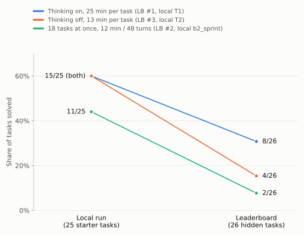

Over Assignments 2 to 5 (A2-A5 above), I built an agent that fixes a single SWE-bench Pro issue, a harness that runs it through 26 tasks on a fixed budget, my own model server on one GPU, and finally a general agent for Terminal-Bench 2.0. My three biggest lessons were that the plumbing broke long before the model did, that memory rather than compute limited the server, and that a single local run rarely meant what I thought it meant.

<!--more-->

## Plumbing failed before the model did

In A2 I ran ten workers against a course proxy that accepts at most eight concurrent requests. The extra requests came back as `Too many concurrent requests (limit: 8)`, and my retry logic counted each refusal as a normal error, so nine rejections in a row ended a run. `pyparsing-332` died after two iterations and ten retries, and `tomlkit-543` after sixteen retries. Across 19 traces the logs record 128 retries. The fix was to count throttling separately and let it wait up to 1,200 seconds. A3 had a similar problem. A stalled API held requests for fourteen minutes until I added a 300-second timeout.

In an agent harness, the first thing to break is usually everything around the model, not the model itself. Now I build the retry and timeout layer first, and decide for each kind of failure whether to wait, retry, or stop.

## Cheap checks first, the expensive model only where it pays

Version 2 of my A3 harness added cheap safeguards: a compile gate, a requirements checklist, narrow test runs, and budgets. These raised the local score from 2/5 to 3/5. The compile gate mattered because a compile error fails every hidden test at once. What counts as cheap depends on the machine, though. `go vet` took over ten minutes on one CPU, so I switched to `go build` on the changed packages.

I then added an expert tier, a stronger model that takes over when the standard one falls short. It raised the score to 4/5 at $2.68 per run, or $0.67 per solved task, but the expert was 94% of that cost. In the final version it is only called on near misses (at most half the hidden tests failing), and each run is capped at $3.50.

So my rule is to run the cheapest check that can catch an error as early as possible, and to only pay for the expensive model when it is likely to turn a near miss into a pass.

## The bottleneck was KV-cache memory, and the fix was in the agent

My first A4 run started all 25 agents at once against my own model server with basic flags. To see what the server was doing, I polled its `/metrics` endpoint every ten seconds and grouped the samples into one-minute windows. Figure 1 compares that run with the fix described below. In the hit-rate panel, the all-at-once line collapses within minutes while admission control stays between 86% and 98%. In the recompute panel, the same line climbs steeply.

 against admission control (runs/a1_check, a 9-minute check run).")

The prefix-cache hit rate fell from 62% to 12% and then to 5-7%, prompt tokens recomputed per request went from 5.4k to 39.5k, and 7 to 15 requests waited in the queue. Only two tasks were solved in 38 minutes. The math explains it. 25 agents at about 30k tokens each need around 750k tokens of KV cache, and the server had 391k. Each agent's prefix got evicted before its next turn and had to be computed again.

The fix was admission control in the agent. A new task only starts while the combined context of the running tasks fits in a token budget, at first 280k across at most ten tasks. The hit rate went up to 86-98%, mostly above 93%, recomputation dropped to about 1.5k tokens per request, the queue emptied, and my first leaderboard submission (LB #1) met the baseline at 8/26. The budget still needed tuning. At 280k only six to nine tasks ran at once. After the engine sweep below, I switched to flags that gave the server 497k tokens of KV cache instead of 391k. With that cache, budgets of 420k and above dropped the hit rate again, so I ended up at 360k.

I also benchmarked the server directly and swept its engine settings. A shared-prefix benchmark looked fine at ten concurrent requests (404 tokens/s, 1.4 s to the first token) but fell to 224 tokens/s and about a minute to the first token at 25. Random 30k-token prompts at 25 gave 25 s to the first token, which was the closest match to the agent runs. In the engine sweep, multi-token prediction got 16.5-23.6 ms per token (17.8-18.6 ms without it) but shrank the cache to 208-257k, ran only five to eight requests at a time, and lost about 40% of throughput at ten, so I dropped it.

Memory was the limit, not compute. Since the agents create the load, the best fix was to shape that load instead of tuning the engine. A benchmark is only useful if it matches the workload's prompt lengths, concurrency, and prefix reuse. When many agents share one GPU, trading memory for per-token speed is a bad deal.

## Local results don't predict the leaderboard

Before each submission I tested changes on the 25 local starter tasks and scored the run with `score_run.py`. Figure 2 shows the closest local run next to each of three A4 submissions. Every line goes down, and the thinking-off setting drops the most.

With thinking, calls averaged 615-621 generated tokens, compared to 183 without. Locally, turning thinking off cost nothing. Both settings solved 15 of 25 tasks, including 3 of the 11 hard ones, and the run without thinking was 2.3 times faster (25.7 vs 60.1 minutes). On the leaderboard it scored 4/26 against 8/26. That comparison is confounded, though. The biggest difference was probably the time per task. The thinking-off submission gave each task 13 minutes instead of 25, and the leaderboard tasks needed 70 to 120 turns (more on that below). It also ran 18 tasks at once within 420k instead of 10 within 280k, used the engine with the larger cache, finished in 33 minutes instead of 92, and cut LB #1's context settings (`MAX_RESULT_CHARS` from 20k to 10k, `COMPACT_AT` from 64k to 40k, `MAX_OUTPUT_TOKENS` from 10k to 6k). I only noticed this later when I diffed the submission zips. Now I change one thing per submission and diff every zip against the previous one before uploading. Local retries gave a clearer signal. With thinking they solved 4 of 10 tasks, and without it 1 of 11 and 1 of 7.

The b2_sprint setting solved 11 of 25 locally but only 2 of 26 as LB #2. The leaderboard tasks needed 70 to 120 turns while my turn cap was 48, and the starter tasks had no way of showing that. In A3 the gap was about scale, with five local tasks against 26 on the leaderboard. A5 fixed this because the local Terminal-Bench set is the same 89 tasks the leaderboard uses. My mistake there was submitting without a full local run after the VPN dropped and I couldn't reach the cluster.

A local run tells me whether the agent works and whether a change broke something. It can only rank settings if the local tasks look like the leaderboard ones, so the first thing I compare now is how many turns each set needs.

## One run is not a measurement

I learned to compare which tasks were solved, not just how many. Two A4 runs with the same settings solved 14 and 15 tasks, but only 11 in common and 18 combined. LB #1 and LB #4 shared only 4 solved tasks out of 11 combined. Across ten local runs, 22 of the 25 tasks were solved at least once. And LB #6, where the early stop never triggered so it was basically LB #5 again, fell from 11/26 to 4/26.

With that much spread, a difference of one or two tasks between single runs is noise, and that includes A2's 4/10 vs 5/10 under two harness versions. A comparison needs several runs per setting, and the overlap of solved sets tells you more than the totals. This variance also changed the design. If separate attempts solve different tasks, then independent attempts are worth more than one long attempt, which is what fresh retries take advantage of.

The clearest evidence for fresh retries is mechanical. Retries that continued the previous conversation resubmitted the same patch in 3 of 9 cases, so a continued retry often wasn't a new attempt at all. Resetting the repo and starting a new conversation avoids that. LB #5, with fresh retries, gave my best leaderboard result, 11/26, against 7/26 for LB #4 with continued retries. But that is one run each, the two also differed in other settings, and LB #6 shows the same setup scoring 4/26. So 11 vs 7 is consistent with the benefit, not proof of it.

## Know what the clock measures

In A4, LB #1's time included about seven minutes of grading after the agent finished, because tasks were graded one at a time. Grading three at once at the deadline cut that down to three or four minutes. In A5 a task's clock starts when `next_task()` hands it out. The A4 agent opened every task at the start, but the new one only opens a task when one of its 16 slots is free within a 400k-token budget. The A5 server uses the same engine flags as my final A4 one, with 497k tokens of KV cache, so 400k is about 80% of the cache. That is a bit more than A4's final 360k, and I never measured whether it thrashed in A5. Each task gets the smallest of its own limit minus 30 seconds, 25 minutes, or the run time left. The agent sees the time left after every tool result, and at 110 minutes everything gets closed.

Terminal-Bench's 89 tasks have very different time limits: one at 10 minutes, one at 12, 49 at 15 (the median), 6 at 20, 16 at 30, 2 at 40, 12 at 60, one at 120, and one at 200. Since a failing task uses its whole budget, the end-to-end time is roughly the sum of the budgets divided by the number of slots. Figure 3 plots this estimate against the per-task cap for 16, 24, and 32 slots. Each line climbs more slowly once the cap goes past 15 minutes, since that's the limit most tasks have. The markers show LB #1.

 / tasks open at once. LB #1: predicted 103 min, measured 89.")

The model predicted 103 minutes and LB #1 took 89. That makes sense, since the model treats every task as a failure and 30 of them weren't. It also shows the only two ways to go faster, which are more slots or shorter caps, and both have limits. The server runs at most 18 requests at once, and shorter caps cut off the tasks that actually need the time.

Rankings are Pareto rounds over solves and time (the first round has every submission that no other beats on both, the second is the front of what's left, and so on), so time counts as well as solves. On November 24, 30 tasks in 89 minutes put me in round 7 of the Terminal-Bench board, which gets no bonus, while round 2 includes 29 tasks in 28 minutes.

## Much of the A4 agent was coupling to one benchmark

Generalizing the A4 agent was mostly about deleting things. I removed evaluate, extract, submit and continue, fresh retries, early stopping, escalation, and the SWE-bench prompt. `agentic_loop.py` went from 989 to 710 lines, and its references to the old API from 13 to zero.

I added three things in their place. A self-check replaced grading feedback. The agent's first "done" gets answered with a verification checklist, and code that doesn't compile gets sent back. A generic prompt explains how to work in the sandbox. It says to detach services with `nohup setsid` (any command is killed after 900 seconds), to run long jobs in the background and poll them, and to use `tmux` for interactive programs. A startup probe in the first message reports the OS, tools, network, files, and git state. The probe had its own bug. It reported the host's 22 CPUs and 63 GB instead of the container's 1 CPU and 2 GB, so now it reads the cgroup limits.

A smoke run on the first six Terminal-Bench tasks solved three in 19.7 minutes. One failed after the agent said it was done, on a detail in the instructions. LB #1 then solved 30 of 89 tasks in 1 h 29 min, which met the baseline. The parts that carried over from A4, like admission control and the compile check, were the ones that helped the agent and the server. The parts built around the old grader turned out to be tied to that one benchmark.

## Closing

My measurement tools were most useful when they showed I was wrong. The metrics poller found the KV-cache collapse in Figure 1, which no score could have explained. An offline test against a fake dispatcher caught two bugs: threads racing on the summary file, and a time guard longer than the test's own deadline.

Only the best submission counts, so once the baseline is locked, every later submission is a free experiment. In A4, LB #1 locked 40 points, and in A5 my first submission locked all 50.

With another week, I would use the free submissions to cut time rather than add solves. I would start with the model calls, which took about 80% of the time in the two smoke-run tasks that timed out.

Overall, I could only fix what I had measured, and the most useful measurements were the ones I built before I needed them.

## AI use

I used Claude Code in every assignment, as the course requires, to write code, run experiments, and analyze results.