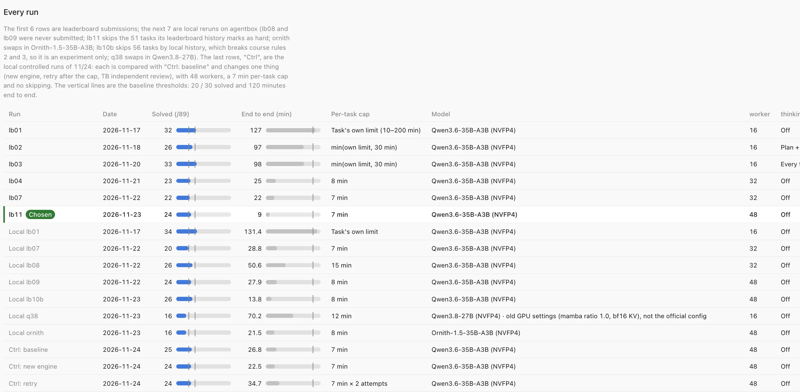
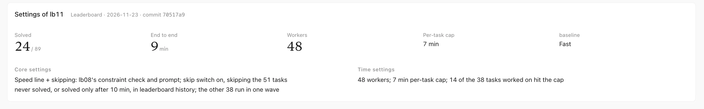
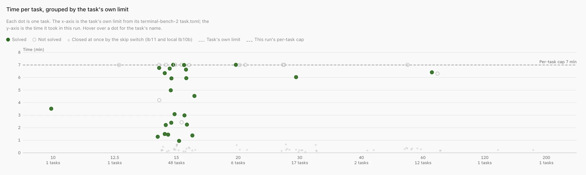
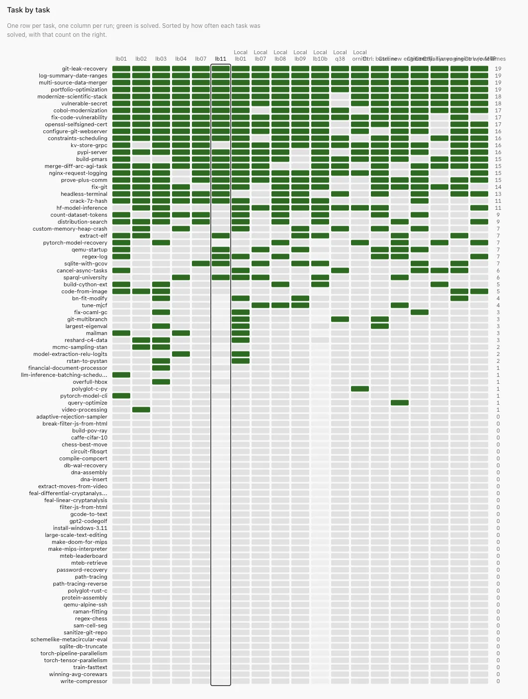
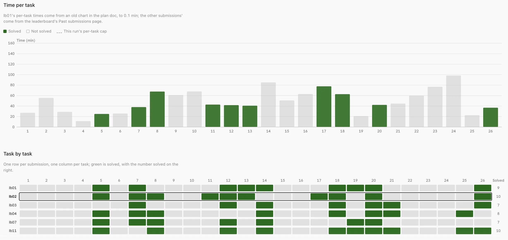
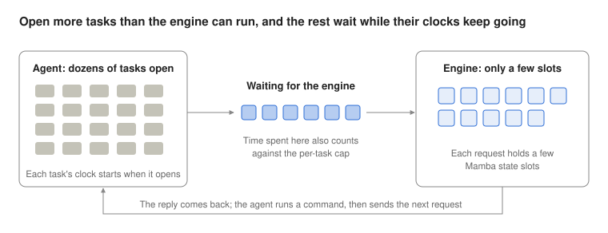
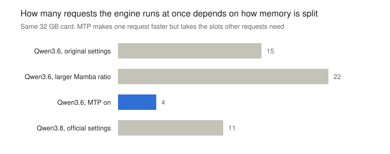
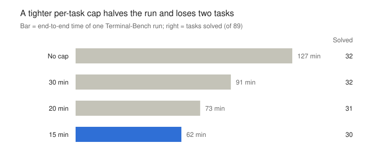

After four assignments, my biggest takeaway is this: the score did not move much with smarter prompts. It moved with how tools, time and budget were allocated, and with how disciplined my experiments were. Measure first, then optimize: find out where the time goes and how each task ends before changing anything.

<!--more-->

**Summary**

1. [How to run experiments](#1-how-to-run-experiments)
    1. Record every change, and look at time per task
    2. Decide the goal first, then list the methods to try
    3. Know what you are comparing
    4. Start from existing references, not from zero
    5. A single result is very noisy
2. [How to design the harness](#2-how-to-design-the-harness)
    1. Put the rules in the harness, not in the model's hands
    2. Keep checks light and hard; retry with a fresh mind
3. [How to make serving keep up with the agent](#3-how-to-make-serving-keep-up-with-the-agent)
    1. Don't open more tasks than the engine can run
    2. How memory is split matters more than advanced options (with the Qwen3.8 settings)
4. [How to make trade-offs](#4-how-to-make-trade-offs)
    1. First look at how each task ended
    2. A per-task cap trades accuracy for speed
    3. A few small lessons on cost and time
    4. A stronger model does not mean a higher score
    5. Changing the harness pays off more than changing serving
    6. The agent, serving and the grading rules are one system

## 1. How to run experiments

**1. Record every change, and look at time per task (measure first, then optimize).** Keep every submission's changes and results in one place. I had Claude build me a dashboard for this (screenshots below). Looking back, it is then clear which changes really helped. The most useful view was the time each task took: the tasks that get solved mostly finish quickly, and a task that runs for a long time is rarely solved. Based on that distribution, I gave every task a time wall (a per-task cap), which saved a lot of time.

: the 32 Terminal-Bench tasks it solved, by time to finish.")

**2. Decide the goal first, then list the methods to try.** Decide up front whether this round is about accuracy or about speed, and list the methods for each. The same method can behave differently on different datasets, such as Terminal-Bench and SWE-bench Pro, so it is best to lay it out as a "method × dataset" table (mine is below) and let Claude try them one by one. This is far clearer than stacking one change on another without a plan; done that way, you soon lose track of what you are doing.

| Method | Goal | Terminal-Bench | 26 repository tasks |
| --- | --- | --- | --- |
| A time cap on every task | Faster | Saves a lot of time, loses only a few hard tasks | Loses too many tasks; not used in the end |
| Skip tasks never solved before | Faster | Helps | Not possible (task names are hidden) |
| Grading rules written in the prompt | More accurate | Helps | Helps; the biggest gain in A3 |
| Heavy checklist verification before done | More accurate | Slows short tasks, so fewer are solved | About the same |
| Retry in a fresh conversation after the cap | More accurate | A few more solved, but twice as slow | Never hits the cap, so no use |
| Higher engine concurrency | Faster | A little faster, no more solved | No change |
| A stronger model (Qwen3.8) | More accurate | Its own "done" calls are more often right, but it is slower | Much slower |

**3. Know what you are comparing.** For every change, know what you are testing and which run you compare it with. Results are random. Judge from one run, and you will easily call a useful change useless, or a useless one useful. For example, with the 26-task settings unchanged, two runs solved 10 and 7. When the gap is one or two tasks, run it a few more times before deciding.

**4. Start from existing references, not from zero.** When I switched the model to Qwen3.8, using the official settings from the SGLang cookbook was far faster than trying flags one at a time. Likewise, reading the test files in the SWE-bench Pro grading script, to see what is checked (test code is reset, and interface names must match exactly), and then writing that into the prompt, clearly raised accuracy. In A3, with these two rules added, two runs solved 15 and 18; without them, 12 to 15.

| Source | What I used it for | Result |
| --- | --- | --- |
| The test files in the grading script | Learn what grading checks, then write it into the prompt | The biggest single gain in A3 |
| The official Qwen3.8 deployment guide (SGLang cookbook) | Copy the engine settings when switching models | Worked on the first try; saved a lot of trial and error |
| A classmate's engine settings | Copied the whole set | Worse: they ran a few tasks at once, I ran many |

**5. A single result is very noisy.**

## 2. How to design the harness

### Put the rules in the harness, not in the model's hands

In A2 I thought the agent failed because the model was not smart enough. Reading the logs one by one, the harness had often set it up to fail: the tools were awkward, it did not know when to stop, and it did not know how it was graded. Handing these to the harness worked much better than repeating them in the prompt.

| Problem | Left to the model | Handled by the harness |
| --- | --- | --- |
| Reading large files | The file tool could not page, so the model burned its turns on one huge file and invented a parameter that does not exist | Add paging; that task then passed |
| When the task is done | A long, truncated reply with no tool call was taken as "done" | On truncation, the harness tells it to keep working |
| How it is graded | The model did not know tests are reset and interface names must match exactly | Put the grading rules in the system prompt |
| How much time is left | The model did not know time was nearly up and started new long jobs | The harness cuts commands to the time left and submits on time |

Terminal-Bench was the same. Once the prompt said that grading looks at the container's final state, that it is all or nothing, and that services must keep running in the background, the model was less likely to hand in a half-finished result.

### Keep checks light and hard; retry with a fresh mind

It feels like more checking before submitting can only help. In practice, heavy checks eat the time needed to solve the task, and a model reviewing its own work rarely finds its own mistakes. What can be trusted are hard checks written in code.

| Approach | What actually happened | My conclusion |
| --- | --- | --- |
| List every requirement and write a check script before submitting | Ate the time of short tasks, so fewer were solved | Only light checks on short tasks |
| The same model reviews the work in a fresh context | Passed almost everything | It is hard to see your own mistakes |
| Hard checks in code (any change at all, all interfaces present, does it build) | Caught real problems | If a check can be code, don't leave it to the model |
| Redo the task in a fresh conversation after hitting the cap | Rescued a few tasks, but doubled the time | On when chasing accuracy, off when chasing speed |
| A third try in the same conversation | Rescued nothing and doubled the time | Don't |

## 3. How to make serving keep up with the agent

### Don't open more tasks than the engine can run

The model I used is half ordinary attention and half Mamba layers. Every running request holds a few slots of Mamba state, and a card has only so many, so the engine can run only a handful of requests at a time. But my agent, chasing speed, opened dozens of tasks at once. The extra tasks could only queue, and since each task's clock starts when it opens, time ran out while they waited.

On the engine side I tried many things, and how memory is split turned out to matter more than any advanced option:

| What I tried | What I wanted | What actually happened |
| --- | --- | --- |
| Tuning engine flags with a standard benchmark | Find the fastest settings | It showed no problem; agent conversations keep growing, so replay real conversations instead |
| MTP (speculative decoding) | Faster single requests | It took memory, fewer requests could run, and most tasks sat in the queue |
| Changing the Mamba / KV memory split | More requests at once | The single most useful knob |

When I switched to Qwen3.8, I mostly followed the official advice:

| Setting | Official advice | What I used |
| --- | --- | --- |
| Mamba state strategy | extra_buffer_lazy | Same |
| KV cache type | fp8 | Same |
| Memory fraction for the model | 0.90 | Same |
| Mamba / KV memory split | Computed from request length | A bit above the formula, for more concurrency |
| Chunked prefill | 2048 | Same |
| MTP | Off when concurrency is saturated | Off |
| Drop the vision encoder | Not mentioned | Dropped, to save memory |
| Scheduling, hierarchical cache | Not mentioned | Longest cached prefix first; hierarchical cache on |

## 4. How to make trade-offs

### Know what you are trading for what

The A5 leaderboard looks at both tasks solved and total time, and it is hard to win on both. In my experience every setting is a trade, so decide first which end you want.

1. **First look at how each task ended.** At first I only looked at the total. Once I sorted every task by how it ended, it was obvious: tasks where the agent called done were mostly right, and tasks that hit the time cap were mostly wrong. Where to work next is wherever the biggest group is.

, counting only the tasks it worked on.")

2. **A per-task cap trades accuracy for speed.** The tighter the cap, the faster the whole run, at the cost of a few hard tasks that would have taken a long time anyway. On Terminal-Bench I went for speed in the end: a very short cap, and all tasks done in one wave.

3. **A few small lessons on cost and time:**

| Lesson | What I saw |
| --- | --- |
| Cache-friendly is cheap | Conversations only append and never rewrite, so most input hits the cache and each task costs very little |
| Spending follows the budget | With review turned off, the money went to retries and the total stayed the same; a lower budget spends less but also solves less |
| Turning off thinking is not the same as faster | Each call got much faster, yet the whole run did not |
| Check what stopped the task | In A4 half the tasks stopped at the turn limit, not the time limit; raising it solved one more |

4. **A stronger model does not mean a higher score.** I switched models once along the way. The new one was more accurate but also slower, and every time setting had to be retuned:

| | Qwen3.6 (MoE) | Qwen3.8 (dense) |
| --- | --- | --- |
| Compute per token | Only a small part of the parameters | All parameters |
| Speed | Fast | Much slower |
| When it says "done" | Often not actually right | Mostly right |
| Good for | Speed | Accuracy, with more time |

**Changing the harness pays off more than changing serving.** Harness changes such as telling the model the grading rules and lightening the checks on short tasks directly solved more tasks; engine tuning mostly saved time and rarely raised the count. So when time is short, I would spend it on the harness first.

**The agent, serving and the grading rules are one system.** Optimize one alone and another will likely hold it back: a faster engine still queues if too many tasks are open, and a more careful agent gets cut off by the per-task cap.

## AI use

Claude Code wrote the harness and engine configuration code, ran the experiments, organized the data and made the figures. Claude also translated this post from my Chinese draft. The lessons and conclusions are my own.
