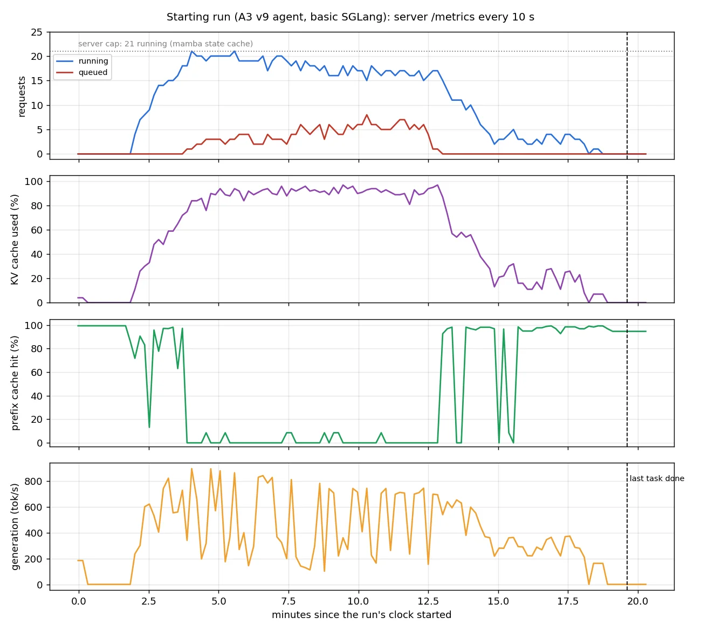
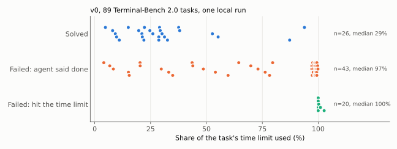

After working all the way across the stack in optimizing the best agent serving and harness, I found
that agent performance depends as much on resource management, ending criteria, and the actual harness
design as it did on model capabilities. Measuring where inference time was spent and simplifying the
harness were often much more effective than adding agents or expanding budgets, especially for these
lightweight models.

<!--more-->

Over the course of Assignments 2-5, I developed different harnesses under varying computational
constraints aimed at competing on different dimensions. In Assignment 2, my coding agent was able to
solve 7 out of 10 SWE-bench Pro tasks. In Assignment 3, working with API-based models of three different
tiers and a $10 budget, my harness was able to solve 19 of 26 tasks at about $0.51 per solve, putting me
on the Pareto frontier of the leaderboard. Assignment 4 involved an additional layer of complexity in that
it asked us to optimize serving the model on a single GPU. My best submission was able to solve 7 of 26
tasks in 28.8 minutes. Finally, in Assignment 5, my initial harness solved 30 of 89 Terminal-Bench 2.0
tasks in 93 minutes. Across all of these assignments, I believe that the following four lessons changed
how I approached agent design depending on the constraints and goals for that agent.

## Lesson 1: Running more agents concurrently can be counterproductive

In Assignment 3, my harness maintained append-only conversations to take advantage of caching.
Approximately 95% of prompt tokens were served from the API provider's prompt cache. When I carried this
harness into Assignment 4, however, I underestimated the implications of having a finite cache on a single
GPU. My initial harness from Assignment 3 solved 7 out of 25 tasks locally but only 1 on the leaderboard.
To understand why this was, I collected server metrics every ten seconds.

During the busiest portions of the run, about 20 requests were running at the same time, with anywhere
between 3 and 8 sitting in the queue. With 25 conversations averaging 17.8k tokens, the aggregate context
footprint was about 445k tokens, which was over the 391k token cache capacity. The resulting pressure on
the cache meant that previously processed context often had to be recomputed, slowing down the run. Only
43% of prompt tokens were cached and the server processed 4.84 million uncached prompt tokens compared
with only 350k output tokens.

To deal with this, I introduced a token-aware admission control, restricting the context footprint of
active conversations to 330k tokens. Between versions 5 and 6, the cached proportion increased from 61%
to 91% and the model call latency fell from 17.1 to 6.2 seconds. Assignment 5 also revealed another
limitation of concurrency.

Aggregate decoding throughput reached about 500 tokens per second at ten concurrent requests. Beyond this
point, additional concurrency provided little throughput improvement while reducing the per-request
decoding speed. My initial harness averaged 15.6 requests at a time, with a mean model latency of 18.6
seconds and a 95th-percentile latency of 60 seconds. Because each task's time budget starts right when it
opens, excessive concurrency can consume individual task budgets without meaningfully increasing system
throughput. I learned that selecting for concurrency should be determined empirically from server
behavior rather than simply maximized.

## Lesson 2: Determining when an agent is done is hard to do

One of the hardest challenges was distinguishing a completed task from an agent that believed it had
completed the task. In Assignment 2, the starter harness terminated when the model returned a response
without a tool call. I modified this behavior to require three consecutive instances and introduced a
completion gate that reviewed syntax, unintended files, test modifications, and task requirements. My best
versions solved 7 of 10 tasks, compared with 6 in earlier iterations. This taught me early on that agents
could stall or falsely claim they were finished without checking their work.

Despite this, my early strategies to address this were not super effective. A model-based reviewer missed
both failing patches it evaluated while flagging a correct one. Another attempt to prevent termination
when regression tests failed resulted in the agent arguing that the failures were unrelated to its
changes.

In this assignment, verification was hard because of the underspecified benchmark requirements. One
SWE-bench Pro task expected a particular string representation involving `odict_values`, which was not
explicitly specified. My agent consistently passed 27 of 28 tests. Another task passed all 149 regression
tests but failed because its error message differed from the expected wording. Both tasks were
subsequently removed from the revised benchmarks by Scale AI.

The problem of verification persisted. In Assignment 5, of the 63 failed tasks in my initial local run, 43
ended with the agent declaring they were done rather than reaching the time limit. Eighteen of those
agents still had at least a quarter of their time budget remaining. One specific example is when my agent
added database indexes in `query-optimize` despite instructions not to modify the database. In
`overfull-hbox`, it left an unintended backup file and modified more of the input than allowed to do so.

These failures across assignments taught me that verification should explicitly address both what a task
requires and what it also doesn't allow. Asking an agent to reconsider its solution is not the same as
independently checking its correctness.

## Lesson 3: Time is money and was often wasted

One of the initial assumptions that I had was that allowing agents to reason longer would improve their
chances of solving difficult tasks. My Assignment 5 results suggested that this was not the key.

The median successful task was easy and only used up about 29% of its time budget, compared with 97% for
unsuccessful tasks where the agent declared completion. Examining the traces showed that 76% of overall
task time was spent on model calls. The issue was that 34 reasoning responses reached the token generation
limit without producing any output. These responses used up 9,916 seconds or a significant 14% of total
model-call time. Every single time this happened, we had an unsuccessful attempt.

I encountered a similar issue in Assignment 2. The harness interpreted truncated reasoning responses as
completed turns. As a result, one task terminated after three of these responses at turn nine (because of
my stopping criteria). Once I distinguished truncation from intentional completion, the agent was able to
reach turn 26 and solved the task.

Additional verification could also become super expensive. In Assignment 4, grading rounds accounted for
40% of the generated tokens. Removing them reduced output from 500k to 290k tokens, while retaining seven
solves and reducing runtime by 10 minutes. Conversely, removing the internal agent limits in Assignment 5
produced the same leaderboard score of 30 solves but increased runtime by ~20 minutes. Rather than just
expanding budgets, I learned to look at what the agents were doing in their existing time.

## Lesson 4: Architectural complexity needs to justify itself

In Assignment 3, I experimented a lot with multi-agent architectures. My intuition was that cheaper models
could perform repository exploration, multiple workers could develop competing solutions, and a stronger
model could synthesize their findings. In practice, the stronger model frequently repeated the
exploration that was already done by the cheaper models. The additional handoffs only introduced
interference costs and latency.

My first multi-model submission solved 9 of 26 tasks in 218 minutes. Subsequent iterations improved to 15
solves in 182 minutes using three parallel workers. However, replacing this architecture with a single
Expert model and a scripted repository survey produced 17 solves in only 64 minutes. My best rerun of this
architecture solved 19 tasks. I continued this approach into Assignment 5 by scripting an initial
environment survey that identified relevant files, operating-system details, available programs, and
package managers before the first model call. What I came to appreciate was the difference between work
requiring reasoning and work that could be performed deterministically. Repository exploration and
environment discovery can often be partially automated without additional model calls. A more complicated
harness is only worthwhile when its components address identifiable failure modes.

## What I would like to do differently

If I were starting these assignments again, I would probably address all of these lessons. I would
establish the relationship between server concurrency and throughput before selecting scheduling
parameters, really focus on developing precise checks for task constraints, and analyze unsuccessful
execution traces before adding more architectural complexity. Overall, I learned that agent design is a
systems problem as much as it is a problem that involves much iteration and learning. The model's
reasoning capabilities are important but a harness can substantially influence how effectively those
capabilities translate into successful task completion.

## AI use

As the [course policy](https://cs2680.com/policy.html#ai-policy) requires: I used Claude Code throughout
Assignments 2-5 to help write and debug my harness and serving code and to write scripts that analyzed my
run logs. For this post, Claude Code gathered the numbers from my notes and logs into an outline, made the
figures from my run data with those scripts, wrote the figure alt text, and converted my draft to Markdown
with small typo fixes. The text of the post is my own.
