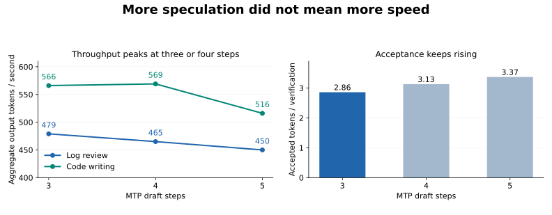
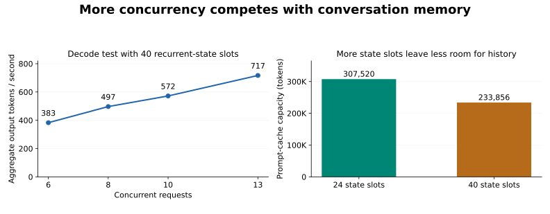

Across the assignments, the main thing I learned is that the harness has to fit both the model and the work you want it to do. Early on I focused on making it expressive. I'd watched a Y Combinator paper club video about giving the agent as much freedom as possible, and that appealed to me, so I kept adding capabilities and letting the model decide how to use them.

The smaller model, Qwen, often didn't have the judgment to use that freedom well. It would read a requirement slightly wrong, carry that reading through the implementation, and then test whether the code did what it had written. When it ran into evidence that it had misread something, it would sometimes explain the evidence away. Giving it more ways to work didn't change that.

Switching to DaisyRose, a more capable model, made things much easier. Adding machinery to make up for poor judgment becomes a project of its own. What I wanted was a system whose behavior I could understand and whose workflow I could trust.

Getting the initial direction right mattered more than adding instructions. Once Qwen committed to the wrong interpretation, most of its later work reinforced that decision. It could write reasonable-looking code and get passing tests while still missing the requirement.

In Assignment 3, I brought in DeepSeek as an expert model, but the design treated it as a reviewer who could rescue the work after the smaller model had already locked in its approach. The expert is more useful earlier, when it can interpret the task, flag the assumptions that matter, and lay out a procedure for the smaller model to follow. The smaller model handles implementation fine. Where it goes wrong is deciding what the implementation is supposed to accomplish.

Prompting has diminishing returns here. Telling the model to be careful, question its assumptions, or act as an adversarial reviewer doesn't produce a different interpretation. It usually walks through the same reasoning again, with more explanation.

A review process needs to challenge the original approach. I tried mapping each requirement to the code that implemented it and the tests that checked it, so the agent could revisit the mapping after a grading failure. But the mapping depends on the model understanding the requirement in the first place. If it misunderstands something, it documents, implements, and tests that misunderstanding consistently. The process looks more disciplined without being more reliable.

The harness can make the model run tests. It can't make the model choose meaningful ones. Passing tests don't mean much when the implementation and the tests come from the same wrong assumption.

With DaisyRose, I used a solver followed by a fresh reviewer in the same environment that could inspect the work, fix things, and finish it. Making the reviewer responsible for the result works better than having it write criticism for another agent to interpret. Review only ran when there was enough time left for it to be useful.

The harness should express the workflow I actually want. My earlier design kept adding ways for the agent to plan, delegate, review, and recover, assuming more flexibility would let better behavior emerge. In practice it handed more decisions to a model that was already struggling with the important ones. The later version had a clear path: implement, check, review, finish. I wrote prompts around failures I'd seen repeatedly and paired them with behavior the harness could enforce.

Small wording choices mattered. Telling an agent to keep improving its work while time remained pushed it into polishing things that already worked. I shifted the emphasis toward finishing once the relevant checks passed.

Keeping the GPU busy meant controlling what got into the system. The main engine lesson was to admit enough conversations to use the GPU well, but not so many that they kept pushing each other's cached work out. In Assignment 4, the cache got thrashed as conversations competed for memory. In Assignment 5, I was deliberate about what could fit, including how much each conversation might grow during its next response.

An earlier configuration averaged about 190 aggregate tokens per second during an agent run. Later configurations reached 450–480 tokens per second on agent workloads, and my log-review and code-writing tests hit 479 and 566. Getting there took changes to the model configuration, multi-token prediction, recurrent-state allocation, and scheduling.

Removing vision freed up memory. The work was text-only coding, so I switched to the text-only model configuration. Model memory dropped from 20.14 GiB to 19.25 GiB, and prompt-cache capacity grew about 14%, from roughly 392,000 to 446,000 tokens.

Multi-token prediction got more output out of each verification pass. I turned on DaisyRose's own prediction head and changed the attention implementation so speculative verification worked with the four-bit cache on my GPU. The faster setup also exposed memory pressure as conversations grew, so I started accounting for the memory used by drafting and verification alongside the conversation itself.

More speculation wasn't always better. Going from three to five draft steps raised accepted tokens per verification from 2.86 to 3.37, but log-review throughput dropped from 479 to 450, and code writing fell from 566 to 516. I kept three.

Recurrent states were another memory trade-off. DaisyRose keeps recurrent state alongside its attention cache. With eight running requests and twenty-four state slots, the engine ran out of slots after about four minutes, since each active request can need up to three. Raising the pool to forty slots let thirteen requests run at once, and decode throughput rose from 383 tokens per second at six requests to 717 at thirteen. But it also cut prompt-cache capacity from about 308,000 to 234,000 tokens. Choosing how many requests to run is really choosing how to split memory between recurrent states and conversation histories.

Admission accounting had to match how the engine actually used memory. The original accounting counted the shared system prompt separately for every conversation, even though the engine caches it once, so the scheduler thought it was out of room too early. I changed it to reserve the shared prefix once. The opposite problem was opening too many conversations: in one run, twenty-four competed for a cache that could hold about eight, and the engine spent its time rereading 4,000–16,000 prompt tokens per second. In one set of runs, accounting for cache capacity helped reduce the share of prompt tokens that had to be reread from 17% to 6%.

Output limits affected both throughput and reasoning. Reserving a full 32,768 output tokens per request left room for only three requests, even though the engine could handle six and most responses were a few hundred tokens. But limits that are too tight cut off useful reasoning. The limit has to reflect the work I want the model to do.

Throughput also isn't the goal on its own. One configuration raised throughput from 159 to 270 tokens per second and produced twice as many turns, but the agents kept revisiting work and produced worse results.

The harness has to be designed around the task and the model. The engine determines how much the system can get done with the available hardware. Whether the agent actually solves the problem comes down to the model and the harness, and those aren't separate decisions. The harness is there to cover the gap between what the task demands and what the model can reliably do.

With a small model, that gap is large, and the harness ends up being designed around the model's specific failures. Qwen misread requirements early and didn't revisit them, wrote tests that confirmed its own assumptions, reasoned for long stretches without acting, and kept polishing finished work. Each of those needs its own answer from the harness: an earlier interpretation step, a structured path through the work, review that can change the approach, output limits, and clear criteria for finishing.

A useful dividing line is between what the harness can enforce and what depends on the model's judgment. The harness can require tests, cap output, set budgets, and define when the work is done. It can't make the model interpret a requirement correctly or pick the right test. With a small model, I got the most from moving as much as possible into the first category.

That also gives a simple way to diagnose problems. If rewording an instruction changes the behavior, it's a harness problem. If the model keeps reproducing the same reasoning however the instruction is phrased, it's a model limit, and the answer is structure, a different division of labor, or a more capable model, not more prompting.

With a more capable model, the gap shrinks, and the harness stops compensating for failures and just lays out the workflow I want. That was the shift for me. I stopped asking how much freedom to give the agent and started asking what this particular model needs in order to do this particular task well.
