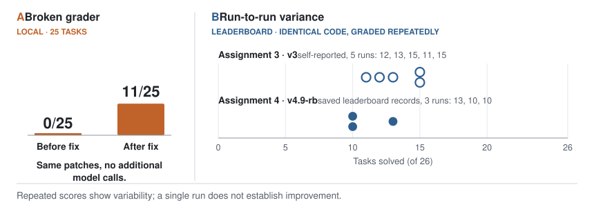

## Introduction: From Building an Agent to Optimizing a System

Over nearly two months in CS2680, my work evolved from building a minimal coding-agent harness from scratch to optimizing an end-to-end system involving agent design, inference serving, and task scheduling. Assignments 3–5 shared an evolving codebase, with the agentic loop growing from 353 lines in its initial Assignment 3 version to 1,868 lines by Assignment 4, before being adapted to Terminal-Bench in Assignment 5. However, the optimization problem changed substantially across assignments, as the available resources, evaluation mechanisms, and scoring objectives continued to shift.

| Assignment | What I Built | Main Constraint | Optimization Objective |
|---|---|---|---|
| **Assignment&nbsp;2** | `madsLoop`: a minimal coding-agent harness built from scratch using Qwen3.6-35B-A3B through the course API, plus four custom tasks | Per-task iteration limits and local runtime | Reliable task completion |
| **Assignment&nbsp;3** | A dispatcher-based agent using `standard` and `expert` model tiers, with parallel workers and mid-run `evaluate()` feedback | API cost: $10 per submission, $30 daily budget | Balance solved tasks, cost, and runtime |
| **Assignment&nbsp;4** | Adapted the Assignment 3 agent to a self-hosted Qwen3.6-35B-A3B model using SGLang on a single 32 GB GPU | GPU throughput, memory capacity, and concurrent requests | Maximize solved tasks while controlling runtime |
| **Assignment&nbsp;5** | Generalized the Assignment 4 agent to Terminal-Bench 2.0 without the `evaluate()` oracle, while optimizing the inference and scheduling stack | Single-GPU throughput and increasingly competitive leaderboard time thresholds | Balance task-solving accuracy and end-to-end speed |

At the beginning, I approached agent engineering primarily as a prompt-and-tool design problem. When the agent failed a task, my instinct was to add more instructions, checklists, or review mechanisms. However, as I experimented with different architectures and optimization strategies, I found that many of these additions produced little measurable improvement. Some of the largest performance gains instead came from addressing practical bottlenecks in resource allocation, concurrency, and evaluation.

By the end of Assignment 5, my perspective had shifted from trying to make the agent reason better in isolation to understanding how its performance depended on the entire system around it. The following lessons reflect what I learned about resource constraints, measurement reliability, inference efficiency, and the limitations of agent self-verification.

## Lesson 1: Identify the Real Bottleneck Before Optimizing

One of the most important lessons I learned across these assignments was that **an agent's performance is not determined by model capability alone**. In many cases, the agent was prevented from completing tasks by constraints in the surrounding system: iteration limits, API budgets, GPU contention, or the scoring clock. Some of my largest improvements came from identifying and addressing these bottlenecks rather than adding more sophisticated prompts or review mechanisms.

### How the Bottleneck Changed Across Assignments

| Assignment | Main Bottleneck | Key Intervention |
|---|---|---|
| **Assignment 2** | Insufficient iteration budget | Increased the iteration limit for tasks that were being terminated prematurely |
| **Assignment 3** | Sequential execution and rigid API budgets | Introduced parallel workers, expert-first scheduling, and flexible budget allocation |
| **Assignment 4** | GPU contention from excessive concurrency | Introduced a live-task concurrency cap and removed obsolete dollar limits |
| **Assignment 5** | Increasingly competitive wall-clock thresholds | Experimented with a short, speed-oriented execution strategy |

Although the underlying coding-agent problem remained similar, the resources limiting performance changed substantially between assignments.

### From Iteration Limits to API Budgets

In Assignment 2, I initially identified Task 4 as a potentially unsolvable problem because the agent failed to pass any of its 66 fail-to-pass tests. However, the execution trace revealed a different explanation. At iteration 39, the agent was still modifying a function, and the default 40-iteration limit interrupted its work before it could finish. Increasing the cap to 80 allowed the agent to complete the task at iteration 77, passing all 66 fail-to-pass and 48 pass-to-pass tests.

The failure did not necessarily reflect the agent's inability to solve the task. It had simply been stopped too early.

In Assignment 3, the limiting resource shifted from iterations to **API cost and scheduling**. My initial sequential, standard-first agent left several tasks unopened before running out of time. Moving to an expert-first architecture with three concurrent workers and shared budget tracking improved the leaderboard result from 3/26 to 9/26. A later version replaced rigid per-task budget allocation with a flexible policy, reaching 12/26 in its first recorded grading. These improvements involved multiple architectural changes, so I cannot attribute them to any single parameter. Nevertheless, they showed that **how resources were allocated across tasks could matter as much as how the agent approached each individual task**.

### Why More Concurrency Hurt on a Single GPU

Assignment 4 provided my clearest example of a system bottleneck. Unlike Assignment 3, where model requests were handled through the course API, Assignment 4 required serving the model on a single 32 GB GPU. My early local evaluations appeared promising, but the corresponding leaderboard submission performed substantially worse.

The crucial difference was the execution environment. My local tests involved relatively few simultaneous model requests, whereas the leaderboard attempted to run all 26 tasks against the same GPU. A serving benchmark revealed that increasing concurrency beyond approximately eight active requests caused substantial latency inflation. At 26 concurrent requests, the system suffered from severe contention and much slower individual responses. Introducing a live-task concurrency cap increased aggregate throughput from approximately 20 to 41 turns per minute. The subsequent leaderboard result improved from 1/26 to 9/26 solved tasks. Other harness changes accompanied the concurrency adjustment, so the improvement in solved tasks was not a strictly controlled single-variable experiment. Nevertheless, the serving measurements directly demonstrated the throughput bottleneck.

This challenged my initial intuition that more parallelism should always produce faster execution. **Optimal concurrency depends on the shared resources and workload characteristics, not simply on the number of available tasks.**

### When a Previous Optimization Became a Liability

Another mistake was carrying Assignment 3's budget constraints into Assignment 4. In Assignment 3, the $10-per-submission limit made strict dollar budgeting necessary. My agent enforced per-task and per-run spending caps to prevent difficult tasks from exhausting the available budget. When I migrated the same agent to Assignment 4, I initially left those limits active. But the environment had fundamentally changed: inference now ran on an allocated GPU, and dollar spending was no longer the relevant runtime constraint. Trace inspection showed that 15 of 25 local tasks had been stopped after only 4–15 model calls because of these inherited limits. Removing the obsolete restrictions, together with basic tool fixes, improved local results from 11/25 to 18/25 and eventually 20/25.

A policy designed to prevent resource starvation in one assignment had become a source of starvation in the next.

### Assignment 5: When Runtime Became the Main Bottleneck

By Assignment 5, the optimization objective had shifted again. The migrated Assignment 4 agent already met the required Terminal-Bench baseline, so I initially focused on improving task-solving accuracy through additional verification, model alternatives, and inference optimizations.

However, as the leaderboard evolved, the runtime thresholds required for bonus points became increasingly competitive. Small improvements in the number of solved tasks over a long run were no longer sufficient to improve the position. I therefore explored a different operating regime: disabling thinking, allowing 25 live tasks, imposing a 20-call limit per task, and targeting a run of under 29 minutes. One resulting submission completed in 25.3 minutes and solved 25 of 89 tasks.

This configuration did not maximize the absolute number of solved tasks. Instead, it represented a different trade-off between accuracy and runtime, better aligned with the leaderboard's increasingly demanding time thresholds. I discuss this trade-off in greater detail in Lesson 3.

### Takeaway

Across Assignments 2–5, the binding constraint shifted from **iterations to dollars, then GPU throughput, and finally wall-clock competitiveness**. The optimization strategies that were useful changed along with those constraints. My main takeaway is to diagnose what is actually preventing tasks from succeeding before modifying the model or adding new agent features. Equally importantly, when moving an agent into a new environment, I should reconsider whether previously successful optimization policies still address the relevant bottleneck.

## Lesson 2: A Better Score Is Not Always a Better Agent

Throughout these assignments, I experimented with many changes to my agent and evaluated whether they improved its performance. However, I gradually realized that **an increase in the evaluation score does not necessarily mean that the agent itself has improved**. Even when a modified version performed better, it was not always clear whether the difference came from the optimization or from other factors.

Across Assignments 2–5, I encountered three main challenges in evaluating agent performance: errors in the evaluation process, variability between repeated runs of the same agent, and differences between local testing and the official leaderboard environment. These experiences taught me to look beyond individual scores and pay more attention to how experiments were conducted and whether the observed improvements were reliable.

### When the Agent Failed Because the Grader Was Broken

My clearest example came at the beginning of Assignment 4. After migrating my Assignment 3 agent to the self-hosted inference system, I ran it on 25 local tasks and received a score of **0/25**. Initially, this suggested that the migration had completely broken the agent. However, inspecting the evaluation logs revealed that the tests had not actually run. The local grading scripts were failing because of two macOS compatibility problems:

- GNU `timeout` was unavailable.
- The default bash 3.2 encountered an empty-array expansion error under `set -u`.

After correcting the grading environment, I regraded the **exact same 25 patches without making any new model calls**. The result changed from **0/25 to 11/25**. This was not an improvement in the agent. It was a correction to the measurement process.

More surprisingly, similar problems appeared across multiple assignments. In Assignment 3, a missing `timeout` command caused grading attempts to fail immediately, and the agent spent additional time trying to repair patches based on incorrect feedback. In Assignment 5, another copy of the bash compatibility issue caused a local comparison to report 0/8, which became 4/8 when the saved patches were regraded correctly.

Assignment 2 had different evaluation problems. For example, setting `CI=1` caused 137 test setup errors in one repository, while a patch-export issue omitted a file deletion. My offline testing workflow also accidentally removed some earlier run traces. These incidents taught me that **evaluation infrastructure is itself a component that needs testing**. Before interpreting a low score as an agent failure, I need to verify that the grader actually ran, the patch was applied correctly, and the reported result reflects the intended experiment.

### Identical Code Can Produce Very Different Scores

Even after fixing the evaluation pipeline, I faced a different problem: run-to-run variability. Because coding agents make many sequential model decisions, small differences early in a run can lead to substantially different final outcomes. Repeated leaderboard submissions of the same frozen code often produced differences larger than the improvements I was trying to measure.

| Assignment | Repeated Submission | Recorded Scores |
|---|---|---|
| **Assignment 3** | Same `v3` ZIP, five runs | 12, 13, 15, 11, 15 out of 26 |
| **Assignment 4** | Same `v4.9` ZIP, three runs | 12, 10, 10 out of 26 |
| **Assignment 4** | Same `v4.9-rb` ZIP, three runs | 13, 10, 10 out of 26 |
| **Assignment 5** | Repeated 26-task evaluation path using identical code | 5–11 out of 26 across 13 runs |

In Assignment 3, many small modifications to the `v3` architecture produced scores between 10 and 14 out of 26, while the unchanged baseline itself ranged from 11 to 15. It was therefore difficult to determine whether any individual change had genuinely improved the agent. A similar situation occurred in Assignment 4. One modified version achieved 13/26, which initially looked promising. However, two additional evaluations of the exact same submission returned 10/26 and 10/26. The apparent improvement was not reproducible in those runs. Assignment 5 showed substantial variability as well. Across full-agent Terminal-Bench submissions using several related configurations, solved counts ranged from 25 to 40 out of 89. Because these runs did not all use identical code, this range should not be interpreted entirely as random variation. Nevertheless, repeated evaluations of identical submission artifacts also showed considerable disagreement in which tasks were solved.

The practical consequence was that **a one- or two-task improvement in a single run was usually insufficient evidence of a better agent**.

This became especially important because the leaderboard considered each student's best submission. Repeating an unchanged version could occasionally produce a better recorded score without any engineering improvement. I gradually became more cautious about interpreting individual leaderboard results and more interested in reproducible changes supported by additional measurements.

### When Local Evaluation Did Not Match the Leaderboard

A third difficulty was that local evaluations sometimes measured a different operating regime from the official leaderboard. The most dramatic example came in Assignment 4. An early version solved 18/25 tasks locally but only 1/26 on the leaderboard. The local setup could run only a few tasks concurrently because of my Mac's Docker memory limitations. In contrast, the official environment attempted to serve all 26 tasks through a single GPU. The resulting GPU contention caused much higher inference latency and exposed a bottleneck that local solve counts had not captured.

A smaller but equally instructive example involved context retention. Increasing the retained context from 140k to 220k characters appeared promising in one local comparison, scoring 6/8 against 3/8 for the baseline. However, the modified version later scored only 7/26 on the leaderboard. The local comparison also had ordering and runtime differences, so the apparent gain was not strong evidence of improvement.

Assignment 5 revealed another kind of environment mismatch. I developed a speed-oriented execution strategy that selected different configurations based on the task time limits. It passed local tests, but its first leaderboard submission silently failed to activate the intended fast mode. The problem was that the run-type detection logic examined only the first task. Local tests used a fixed task ordering, whereas the leaderboard could present tasks in a different order. When the first official task had a longer time limit, the agent incorrectly selected its normal operating mode. The intended fast submission therefore ran for approximately 177 minutes rather than following the planned short-runtime configuration. This failure was not primarily about model capability. It came from an assumption in the harness that local testing had never challenged.

Together, these examples showed that **a local benchmark must reproduce the relevant conditions of the official environment to predict end-to-end performance reliably**. Matching the task interface alone is not enough; concurrency, resource contention, task ordering, and execution limits can all affect the outcome.

### What I Changed About My Evaluation Process

These experiences led me to adopt a more disciplined approach to experimentation. First, I began validating the evaluation pipeline itself before trusting its results. This included checking whether tests actually executed, confirming that patches were exported correctly, and preventing evaluation scripts from modifying important experiment artifacts.

Second, I became more careful about distinguishing **mechanism-level improvements from actual task-solving improvements**. Local tests could reliably show whether a specific mechanism worked, for example, whether a repository map reduced tool calls, a retry policy eliminated duplicate operations, or a runtime limit stopped tasks as intended. But those results did not automatically imply a higher leaderboard solve count.

Finally, I increasingly used frozen baselines, controlled configuration changes, explicit acceptance criteria, and separate evaluation sets. These practices did not guarantee better performance, but they helped me reject weak or unreliable optimization ideas before spending additional GPU time or leaderboard submissions.

### Takeaway

My main lesson was that improving an agent requires more than designing a better harness. It also requires a trustworthy way to measure whether that harness is actually better. **A higher score may reflect a genuine improvement, random variation, or a difference in the evaluation environment.** Without checking these possibilities, it is easy to spend time optimizing the wrong thing—or to mistake a lucky run for meaningful progress.

## Lesson 3: Faster Inference Does Not Necessarily Mean Better Performance

In Assignments 4 and 5, I began serving the language model on a single 32 GB GPU, which introduced a new set of performance challenges. Initially, I expected that making model inference faster would naturally reduce overall execution time and allow the agent to solve more tasks. However, my experiments showed that **faster inference does not always translate into better end-to-end agent performance**. Improvements in individual request latency or token throughput could be offset by additional model calls, resource contention, or reduced task-solving effectiveness. Moreover, whether a faster configuration was actually preferable depended on the evaluation objective.

### Turning Thinking OFF: Faster Requests, but Not More Solves

In Assignment 4, local profiling indicated that token generation accounted for approximately 94% of request latency. This suggested that disabling the model's thinking mode could substantially improve performance by reducing the number of generated tokens. The initial results were promising. On an eight-task local evaluation, turning thinking OFF reduced the average response length from **530 to 183 tokens** and decreased average request latency from **5.95 to 1.94 seconds**. Both configurations solved 5/8 tasks, although the thinking-OFF version required approximately 21% more model requests.

However, the official leaderboard results did not show an end-to-end improvement.

| Configuration | Throughput | Tasks Solved | Total Runtime |
|---|---|---|---|
| Thinking ON, 8 live tasks | 37.8 turns/min | 12/26 | 74.5 min |
| Thinking OFF, 8 live tasks | 54.0 turns/min | 11/26 | 76.9 min |
| Thinking OFF, 12 live tasks | 54.7 turns/min | 10/26 | 75.8 min |

Although disabling thinking increased turn throughput by more than 40%, the agent did not finish significantly faster or solve more tasks. The thinking-OFF configuration also required substantially more turns, with many first attempts reaching the 140-call limit. These results suggested that the faster model responses did not necessarily lead to more efficient problem solving. Without extended reasoning, the agent sometimes needed additional attempts or exploration steps, offsetting the reduction in latency per request.

Given the considerable run-to-run variability discussed in Lesson 2, the small differences in solved tasks were not sufficient to conclude that thinking OFF consistently reduced accuracy. Nevertheless, **the expected end-to-end performance improvement was not observed**.

### Assignment 5: When a Faster Strategy Became More Competitive

In Assignment 5, I encountered a different trade-off. My original thinking-ON agent could solve relatively many Terminal-Bench tasks, reaching **40/89 in approximately 180 minutes**. However, as the leaderboard evolved, competitive solutions increasingly combined high solve counts with much shorter runtimes. At that point, continuing to optimize only for the number of solved tasks was unlikely to produce meaningful progress in the ranking. I therefore experimented with a speed-oriented configuration that used a different operating strategy.

The new configuration disabled thinking, increased the number of simultaneously active tasks from approximately 8 to 25, limited each task to 20 model calls, and imposed a short overall runtime limit.

| Metric | Accuracy-Oriented Configuration | Speed-Oriented Configuration |
|---|---|---|
| Thinking mode | ON | OFF |
| Concurrent tasks | Approximately 8 | 25 |
| Per-task call budget | 140 or more | 20 |
| Tasks solved | 40/89 | 25/89 |
| Total runtime | 180.0 min | 25.3 min |

The speed-oriented configuration solved fewer tasks, but completed the run more than seven times faster. This substantially changed its position in the leaderboard's speed–accuracy trade-off. The shorter responses were an important part of this design. With thinking disabled, typical response lengths decreased from approximately 580 tokens to 100–120 tokens. This reduced the inference workload per request and made higher concurrency more practical. Meanwhile, the 20-call limit prevented individual tasks from consuming excessive time. Importantly, this was not a controlled experiment isolating the thinking mode. The configuration simultaneously changed concurrency, reasoning, and per-task budgets, so the improvement in runtime cannot be attributed to any one factor alone. Comparing Assignments 4 and 5 helped me recognize a more general lesson: **the value of an optimization depends on what the system is trying to achieve**.

### Speculative Decoding: When Higher Throughput Was Not Enough

Another important experiment involved **speculative decoding using Multi-Token Prediction (MTP)**. Since decoding dominated inference latency, I explored whether generating and verifying multiple tokens per step could improve throughput without sacrificing the model's reasoning capabilities.

My first attempt in Assignment 4 was unsuccessful. Enabling speculative decoding reduced the available KV-cache capacity from approximately 391k to 211k tokens, while measured throughput fell to **54% of the original configuration**. Instead of accelerating inference, it increased total benchmark runtime. I revisited this approach in Assignment 5 with different SGLang memory and cache configurations. This time, an eight-stream benchmark showed a genuine improvement:

| Metric | Standard Decoding | MTP |
|---|---|---|
| Output throughput | 259.7 tokens/s | 380.9 tokens/s |
| Decode latency | 15.1 ms/token | 8.9 ms/token |
| Request rate | 20.0 requests/min | 30.8 requests/min |

The **1.47× throughput increase** initially appeared promising. However, further testing exposed serious limitations. At higher concurrency, the prefix-cache hit rate dropped substantially, reducing the throughput advantage. Some configurations encountered CUDA out-of-memory errors, while others required reducing cache capacity to maintain sufficient GPU memory headroom. This created a difficult trade-off. Speculative decoding improved the speed of generating tokens, but consumed additional memory resources that were also needed for caching and serving multiple agent conversations. Since the system was already operating close to the GPU's memory limits, I could not establish that the MTP configuration would run reliably under full leaderboard workloads. I therefore decided not to deploy it.

This experiment showed that **a successful inference microbenchmark does not necessarily imply a successful system-level optimization**. Throughput improvements must be evaluated alongside memory usage, caching behavior, and operational reliability.

### Takeaway

These experiments changed how I evaluated inference optimizations. Rather than focusing only on tokens per second or latency per request, I learned to consider their effects on the entire agent workflow. Three considerations became particularly important: whether faster inference actually reduced the number of seconds needed to complete tasks, whether the configuration remained reliable under realistic concurrency and memory constraints, and whether the resulting speed–accuracy trade-off aligned with the evaluation objective.

Ultimately, **the goal is not simply to make the model faster, but to make the entire agent system more effective under its actual constraints**.

## Lesson 4: Self-Verification Is Harder Than It Looks

Another challenge I encountered throughout these assignments was that **agents often finished tasks confidently even when their solutions were incorrect**. In Assignment 4, an analysis of my local execution traces showed that 74 of 80 failed attempts ended with a confirmed `finish` call. Many of these failures involved missing or misinterpreting specific requirements rather than failing to produce code. This led me to explore different ways of helping the agent verify its own work, including completion reviews, requirement checklists, fresh-context reviewers, and independently generated tests. However, these mechanisms proved much less reliable than I initially expected.

### Reading the Requirements Does Not Guarantee Following Them

I first noticed this problem in Assignment 2. In one TypeScript task, the agent implemented named exports even though the existing code expected a default export. This caused a compilation error, and the solution failed the required tests. I then modified the agent's prompt to encourage it to inspect neighboring files and follow existing interface conventions. During the next attempt, the agent did read the relevant files, including examples of the expected default-import pattern, but still produced the same incorrect implementation.

I subsequently introduced a completion-review mechanism that required the agent to verify its changes before finishing. However, the agent skipped the interface comparison during its review and repeated the same mistake. This revealed an important distinction: **adding verification instructions does not necessarily improve the agent's ability to recognize its own errors**. The agent could appear to follow a more careful workflow while still misunderstanding the underlying requirement.

### External Feedback vs. Self-Review

Assignments 3 and 4 provided a useful comparison because the course dispatcher included an `evaluate()` function. This allowed the agent to submit an intermediate patch to an external grader, receive feedback about failed tests, and continue working. In Assignment 3, one diagnostic experiment showed that same-conversation repair converted **3 of 4 initially failed evaluations into successful solutions**. Fresh-context retries were less effective in that particular comparison. Assignment 4 also benefited from grader-guided retries. In contrast, several attempts to verify solutions without using the external grader produced limited results. For example, a fresh-context audit using the same model identified only **32% of failed attempts**, while incorrectly flagging **36% of successful attempts**. Adding a requirement contract to the agent's workflow also failed to produce a reliable improvement in leaderboard performance.

These results suggested that **external feedback provided information the agent could not reliably recover simply by reconsidering its own output**. A model reviewing its own implementation may repeat the same misunderstanding that caused the original error. Giving it a fresh context can reduce dependence on its previous conversation, but does not necessarily improve its understanding of the task specification.

### Assignment 5: Verifying Without an External Grader

Assignment 5 made this problem more challenging because the Terminal-Bench environment did not provide the same intermediate `evaluate()` feedback. To compensate, I experimented with several verification mechanisms that attempted to assess whether the agent's final solution satisfied the task requirements.

| Verification Approach | Main Result | Observation |
|---|---|---|
| **Fresh-context acceptance reviewer** | 12/28 solved before and after; all 6 failed finishes marked VERIFIED | Failed to identify incorrect solutions |
| **Evidence-based reviewer** | Precision 0.43, recall 0.09 | Poor failure detection |
| **Independent acceptance tests** | Recall 0.95, false-positive rate 0.32 | Detected many failures but also accepted too many incorrect solutions |
| **Qwen-generated checks for ranking attempts** | AUC 0.603 | Weak discrimination between correct and incorrect attempts |
| **Claude-generated checks (offline diagnostic)** | AUC approximately 0.88–0.91 | Stronger discrimination in the offline evaluations |

The first approach asked the same model, in a fresh context, to review the agent's completed work. However, it failed to flag any of the six incorrect finishes in the evaluated set and did not improve the solved-task count. I then experimented with stricter evidence requirements and independent acceptance tests generated from the task instructions. Although the independent tests detected many incorrect solutions, their false-positive rate was still too high for reliable use as a final acceptance gate.

Another approach was to generate tests that could help distinguish correct solutions from incorrect ones. I evaluated whether these tests could rank multiple candidate solutions based on their likelihood of being correct. However, tests generated by our Qwen model achieved an AUC of only 0.603, where 0.5 corresponds to random ranking. In comparison, Claude-generated tests achieved an AUC of approximately 0.88–0.91 in separate offline experiments. This suggested that the quality of the model generating the tests could be an important factor. However, because the experiments used somewhat different evaluation procedures, I could not conclude that model capability alone explained the difference. The Claude-based tests were used only for offline analysis, not in the submitted agent.

Overall, none of the verification strategies I tested with the available serving setup produced a sufficiently reliable improvement to justify deployment.

### Takeaway

These experiments highlighted a limitation of using an LLM to verify its own work. When an agent misunderstands a requirement during implementation, it may carry the same misunderstanding into its review or test generation. As a result, the verification process can confirm that the solution is consistent with the model's interpretation without establishing that it satisfies the actual task. I would not conclude that LLM-based self-verification is fundamentally ineffective. Rather, **for the model, tasks, and verification mechanisms I tested, self-review did not provide a reliable substitute for external feedback**.

In future agent systems, I would place greater emphasis on independent evidence, such as executable tests, compiler and runtime checks, and verification methods that do not simply repeat the assumptions used to generate the solution.

---

## Conclusion: What I Would Do Differently

Looking back across Assignments 2–5, my understanding of agent engineering changed substantially. I initially focused on improving the agent's behavior through prompts, tools, and additional workflow mechanisms. Over time, I realized that many of the most important challenges involved the surrounding system: resource allocation, evaluation reliability, inference efficiency, and the availability of trustworthy feedback.

If I were starting a similar project again, there are three things I would approach differently.

### Maintain a Simple Baseline

As my agent evolved, I continually added mechanisms for budget management, context handling, retries, and verification. The agentic loop grew from **353 lines in the initial Assignment 3 implementation to 1,868 lines by Assignment 4**. Although each addition had a reasonable motivation, I did not consistently evaluate whether the added complexity produced a meaningful improvement over a simpler agent. In Assignment 3, I eventually built a more minimal alternative to investigate this question, but I ran out of evaluation budget before testing it with the model. Next time, I would maintain a simple reference implementation alongside the main agent and compare major architectural changes against it. This would help distinguish genuinely useful features from complexity accumulated through successive experiments.

### Build a More Reliable Evaluation Process Early

A significant amount of my development time went into investigating misleading evaluation results, dealing with run-to-run variability, and interpreting differences between local and official performance. In future projects, I would validate the evaluation environment before optimizing the agent, run repeated tests when possible, and design local experiments that better reproduce realistic resource constraints. I would also place greater emphasis on using independent holdout evaluations. In Assignment 5, I prepared separate holdout sets but ultimately did not use them, while spending considerable effort on repeated leaderboard submissions.

### Reconsider Assumptions When the Environment Changes

Perhaps the most important lesson was that a successful optimization in one setting may become ineffective, or even harmful, in another. The dollar-budget restrictions that were necessary in Assignment 3 became unnecessary constraints when I moved to self-hosted inference in Assignment 4. Similarly, my initial focus on maximizing solved tasks in Assignment 5 became less useful as leaderboard performance increasingly depended on shorter runtimes. Rather than carrying optimization strategies forward automatically, I would begin each new environment by identifying its actual resource limitations, evaluation conditions, and performance objectives.

### Final Reflection

These assignments helped me see LLM agent engineering as a broader systems problem rather than primarily a prompt-design problem.

Improving an agent requires understanding not only what the model can do, but also how the serving infrastructure, scheduling decisions, verification mechanisms, and evaluation objectives interact.

**The most important skill I developed was learning to question what was actually limiting the system before deciding what to optimize next.**

## AI use

As the [course policy](https://cs2680.com/policy.html#ai-policy) requires: I wrote the text by myself. And I used Claude to help generate the figure based on experimental data from my assignments. The analysis and interpretation of the results are my own.