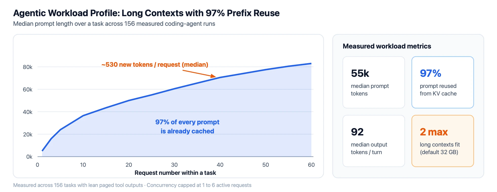
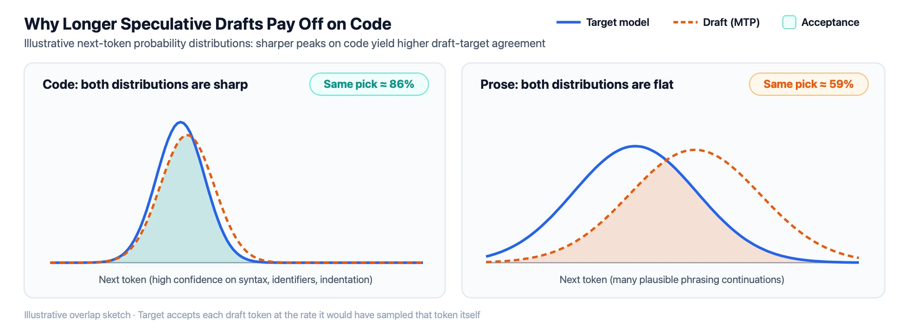
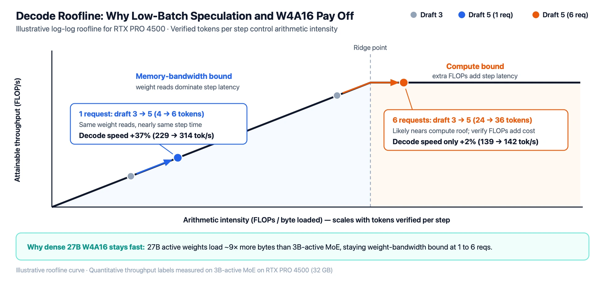
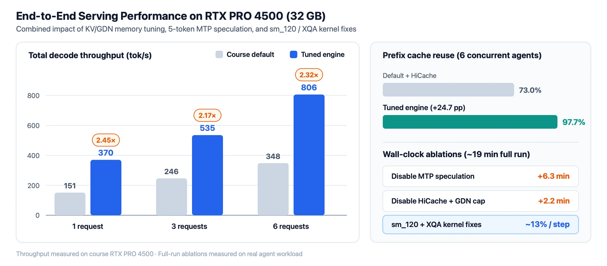

Serving a coding agent on a single 32 GB RTX PRO 4500 runs into bottlenecks that rarely appear in synthetic chat benchmarks. Across CS2680, I worked down the full stack, from the agent loop and tool design to hybrid KV/GDN memory management, `sm_120` low-batch kernels, dense 27B serving, and W4A16 quantization on Terminal-Bench 2.0.

<!--more-->

Tuning memory, speculation, and `sm_120` kernels for a low-concurrency, prefix-heavy agent workload more than doubled decode throughput, reaching up to 2.45x over the course default while lifting prefix cache reuse from 73.0% to 97.7%. On the 89-task Terminal-Bench 2.0 suite, moving from the course default 35B MoE at 31 of 89 to a Qwen3.8-27B checkpoint post-trained with SFT and PPO in [Harbor's Terminus-2](https://github.com/harbor-framework/harbor) harness, quantizing it to NVFP4 with W4A16, and adding an 1800 s task cap pushed solved tasks to 72 of 89 in 87.4 minutes on one 32 GB card.

## 1. Close the verification loop and audit what actually reaches the model

My first agent, `madsLoop`, stopped as soon as the model called `done`. Models routinely declare victory on patches that break existing tests or leak resources, so I changed `done` to run a verification command and return any failure output to the loop. Pairing that check with an independent diff-and-test reviewer and a clean baseline checkout caught regressions the agent missed on its own, such as a broken ORM join on Peewee and a file-handle leak on fsspec. On the official ten-task evaluation batch, the agent solved 6 of 10.

Reading failing tests before tuning the agent mattered just as much. Three tasks had test suites that contradicted their own descriptions. Teleport expected the same read call to return both `nil` and `ErrLimitReached`, while qutebrowser and Ansible checked exact strings the prompt never asked for. Inspecting the failing test first kept me from tuning against broken specs.

Once the basic loop held up, silent truncation showed up as the next hidden bug. Long tool outputs were getting clipped before reaching the model, dropping tracebacks and test failures without warning. Saving full outputs to disk, returning head and tail previews, and adding a `tool_output` paging tool cut out a whole class of blind retries.

Extra prompt text rarely helped once the model had committed to a plan. When I replayed real requests from live runs, appending a skill or a rewritten skill to a tool result changed the model's next action 0 of 3 times. A short computed note naming the exact field and one next step changed it 3 of 3 times. Conflicting instructions hurt directly: pairing a skill that pushed for extra local testing with a prompt pushing for speed caused a sharp drop in solved tasks.

Repair branches also had steep failure-rate odds. Across 228 repair attempts after an initial grading failure, a branch succeeded 36% of the time when 1 graded test failed, 17% at 2, and only 7% at 5 or more. I started skipping repairs whenever more than half of the graded tests failed. Below that cutoff, repairs solved 33 of 164 cases. Above it, they solved only 6 of 68. With these changes, my best dev run solved 13 of 23 tasks in 117.8 minutes, or 9.1 minutes per solved task.

## 2. Reclaim unused VRAM and co-design eviction with the agent

A coding agent workload behaves very differently from high-batch chat. Agents spend much of their time waiting on shell commands and test runners, sending nothing while blocked. Capping engine concurrency at six meant the server usually saw only 1 to 6 active requests in flight. Even with paged tool outputs, multi-turn runs grow into long contexts where almost the entire prompt is a cached prefix. Across 156 measured tasks, the median prompt crossed 80k tokens by request 60 while adding only ~530 new tokens per turn, with 97% prefix reuse and a median reply length of 92 tokens.

On a 32 GB GPU with default memory settings and multi-token prediction enabled, only two of these long contexts fit in VRAM at once, leaving ready requests stalled waiting for cache space. The served model is hybrid, with 30 Gated DeltaNet linear-attention layers interleaved with 10 full-attention layers, and that layout shaped three memory fixes.

### Fix 1: reclaim unused static VRAM for the KV pool

Because the coding agent is text-only, I dropped the unused 27-block ViT vision encoder. The MTP draft head was also holding its own 1.41 GB copy of the embedding table and LM head, so I shared both tensors with the target model. Since KV pool sizing runs before that duplicate copy is freed, I raised the memory utilization cap from 90% to 93%. Together, usable KV capacity grew from an estimated ~245k tokens to a measured 444k tokens.

, and resulting KV pool growth.")

### Fix 2: cap GDN checkpoints to match recurrent-state semantics

Full-attention KV caches allow random-access prefix reuse from any cached token `tk`. A GDN layer compresses history into a single running recurrent state `S_t` that cannot be rewound backwards, so resuming a paused request requires a saved checkpoint `S_k` in the state pool. By default, keeping too many stale checkpoints per conversation filled the pool, evicted the newest checkpoint of an active task blocked on a slow tool, and forced a full prefill recompute from `S_0`. Capping retention to the two newest checkpoints per conversation cut large prefill redos from 18 of 31 requests to 2 of 30 on a course-GPU-sized test.

.")

### Fix 3: break the black-box boundary for eviction

When task A submits a patch, the harness immediately starts task B while A runs hidden grading tests in the background for minutes with zero model calls. Under standard LRU eviction, VRAM pressure often kicked out an active task waiting on a slow tool instead of A, triggering a 50k to 120k token prefill redo. Having the agent notify the engine as soon as a task finished let finished sessions get evicted first, dropping those 50k to 120k token redos from 6 to 0 on a replayed trace.

.")

## 3. Speculative decoding scales with distribution sharpness and the roofline

With MTP on, a single-layer draft head proposes `k` tokens ahead and the target model verifies them in one batched forward pass. On code, next-token distributions are much sharper than on open-ended prose, so the draft and target models agree far more often and justify longer draft lengths.

The throughput gain from drafting 5 tokens instead of 3 still depends heavily on concurrency:

| Concurrency (RTX PRO 4500) | Draft 3 tokens (tok/s/req) | Draft 5 tokens (tok/s/req) | Speedup |
|---|---:|---:|---:|
| 1 request | 229 | 314 | +37% |
| 3 requests | 159 | 174 | +9% |
| 6 requests | 139 | 142 | +2% |

On this 3B-active MoE model, batch size 1 decode is memory-bandwidth bound. Reading model weights dominates step latency, so verifying 6 tokens instead of 4 moves nearly the same weights while accepting more tokens per step, giving a 37% speedup. At 6 requests, verifying 36 tokens in one forward pass likely pushes this 3B-active MoE toward compute limits, where the extra verify FLOPs eat almost all of the acceptance gain and leave only a 2% speedup.

## 4. Tune low-batch kernels for `sm_120` and eliminate redundant mask work

At 1 to 5 active requests with MTP on, each decode step passes only 6 to 30 tokens into projection GEMMs. This `sm_120` RTX PRO 4500 has 82 SMs with 48 warp slots each, yet default dispatch fell back to older `sm_89` kernels for FP8 and `sm_80` kernels for BF16. That left ~90% of warp slots idle for FP8 and lit up only 4 SMs for BF16 at batch size 1.

Re-tiling both projections for `sm_120` improved occupancy and cut kernel latency. On the FP8 projection, re-splitting the tiles lifted warp-slot occupancy from ~10% to ~52% and lowered latency from 15.2 µs to 12.5 µs. Latency did not scale 5x because the kernel was already moving weights at roughly 60% of peak memory bandwidth. On the BF16 projection, keeping exact numerical equivalence with the original kernel was mandatory so floating-point drift would not hurt task accuracy. Keeping the same 4 SMs preserved the reduction order while quadrupling threads per SM, cutting latency from 16.9 µs to 6.5 µs. At batch size 1, these two projection fixes cut per-step decode latency by 2% and 4%.

.")

On the attention side, verifying 5 drafted tokens checks 6 tokens against ~55k cached prefix tokens. The default path rebuilt the full 6 by ~55k attention mask on every decode step, even though every earlier prefix token is always visible and only the 6 by 6 causal corner changes. Building that 6 by 6 corner once and routing verification directly through NVIDIA's XQA decode kernel sped up each decode step by 7% to 12% across 1 to 6 requests.

.")

Putting KV/GDN memory tuning, 5-token MTP speculation, and `sm_120`/XQA kernels together more than doubled total decode throughput over the course default engine at every batch size: 2.45x at 1 request, 2.17x at 3, and 2.32x at 6. Prefix reuse rose from 73.0% to 97.7%, bringing a full evaluation run down to about 19 minutes.

## 5. Active parameter capacity matters on long-horizon terminal tasks

Once serving speed was fast enough, model choice moved the score on the 89-task Terminal-Bench 2.0 suite more than engine tuning. Early dev runs compared three NVFP4-quantized models using the same agent generation. The MoE runs used my tuned engine on a local RTX PRO 6000, while the dense runs used the course RTX PRO 4500, so compare solved counts below rather than runtimes:

| Model | Architecture | GPU | Solved / 89 | Time (min) |
|---|---|---|---:|---:|
| Qwen3.6-35B-A3B NVFP4 (course default) | MoE, 3B active | PRO 6000 | 31 | 198 |
| Ornith-1.5-35B-A3B NVFP4 | MoE, 3B active | PRO 6000 | 41, 38 | 204, 219 |
| Qwen3.8-27B NVFP4 | Dense, 27B active | PRO 4500 | 42, 41, 48, 41, 44 | 194 to 252 |

The dense 27B model solved 41 to 48 tasks, well ahead of the course default MoE at 31. Ornith-1.5-35B-A3B solved 38 and 41, which sits close once you account for the 7-task spread across my own 27B runs and the different GPUs and engines. My guess is that activating 27B parameters per token rather than routing through 3B active parameters helps keep state tracking and code reasoning steady across dozens of tool calls, where one small mistake reading a log or editing a config can derail a run. In NVFP4, the dense 27B model also has smaller total weights than the 35B MoE and fits comfortably inside 32 GB.

To push past the 41 to 48 range of base Qwen3.8-27B in my own tool-calling harness, I moved to a Qwen3.8-27B checkpoint post-trained with SFT and PPO and ported [Harbor's Terminus-2](https://github.com/harbor-framework/harbor) loop, a JSON-keystroke terminal harness. Those two changes account for most of the roughly 20-task jump to the 65 to 74 dev range and 67 to 72 leaderboard scores in Section 6, and matching the harness turned out to be essential: on a 24-task subset, the exact same post-trained 27B checkpoint solved only 5 and 8 of 24 in my own tool-calling harness, then jumped to 22 of 24 once ported to Terminus-2.

## 6. Quantize weights to NVFP4, and watch activation precision at low batch

To fit the post-trained 27B BF16 weights on a single 32 GB card without modifying SGLang's loader, I quantized them with NVIDIA ModelOpt 0.48.0 to match the exact layout of `nvidia/Qwen3.8-27B-NVFP4`, including tensor names, dtypes, shapes, scale tensors, and `quantization_config`. A tensor-by-tensor diff script confirmed `NO LAYOUT DIFFERENCES vs NV`, so SGLang loaded the checkpoint directly.

| Model component | Precision format |
|---|---|
| MLP `gate`/`up`/`down` (64 layers), `lm_head` | NVFP4 (E2M1, one E4M3 block scale per 16 values + one FP32 global scale) |
| Full attention `q`/`k`/`v`/`o` (16 layers); GDN `in_proj_qkv`, `in_proj_z`, `out_proj` (48 layers) | FP8 E4M3, per-tensor, W8A8 |
| `embedding`, norms, `in_proj_a`/`b`, `conv1d`, vision, MTP head | BF16 (MTP head copied byte-for-byte from the original weights) |

For NVFP4 weight block scales, instead of taking a max-abs scale, I ran an MSE sweep over all 128 E4M3 block-scale candidates using `method: mse` and `fp8_scale_sweep: true`, picking the lowest-error scale. That is where the `qmse` tag in the checkpoint name comes from. Activation scales and FP8 weight scales used max calibration. The calibration set used 512 examples from HumanEval and MBPP, with zero Terminal-Bench data.

 and W4A4 vs. W4A16 execution paths.")

Holding this quantized checkpoint and the Terminus-2 harness fixed, I compared two GEMM execution paths: W4A4, which quantizes activations to 4 bits, and W4A16 via Marlin, which keeps activations in BF16:

| Leaderboard submission | GEMM path | Solved / 89 | End-to-end time |
|---|---|---:|---:|
| v18 (134) | W4A4 | 67 | 95.8 min |
| v19 (143) | W4A16 | 71 | 92.7 min |
| v20 (168) | W4A16, task cap 1800 s | 72 | 87.4 min |

On the leaderboard, switching from W4A4 to W4A16 at the same task cap moved the score from 67 to 71 and finished 3.1 minutes faster, though each submission is a single run within run-to-run variance. Adding an 1800 s task cap in v20 brought the run to 72 of 89 in 87.4 minutes. On course-GPU dev runs, individual scores overlap across the two paths: W4A4 solved 67, 69, and 67 at a 2400 s cap and 69, 66, and 67 at an 1800 s cap, averaging 67.5 across six runs. W4A16 solved 66, 70, and 72 at 2400 s and 74, 71, 68, and 65 at 1800 s, averaging 69.4 across seven runs, while full BF16 weights solved 72 and 75. While the individual runs overlap, W4A16 is slightly higher on average under both caps, though that gap is within the observed run-to-run spread.

.")

Unlike the 3B-active MoE in Section 3, a dense 27B model loads roughly nine times as many active weights per step, so at 1 to 6 requests decode stays weight-bandwidth bound. Because both W4A4 and W4A16 load identical 4-bit weights, keeping activations in BF16 costs almost no speed while avoiding 4-bit activation rounding over long runs. My guess is that cleaner activations also led to fewer bad edits and detours, though I did not count turns or edit errors directly.

## AI use

Claude helped run the experiments and collect measurements, and AI tools helped generate the figures. I wrote the blog post myself. Claude did not write the text.
