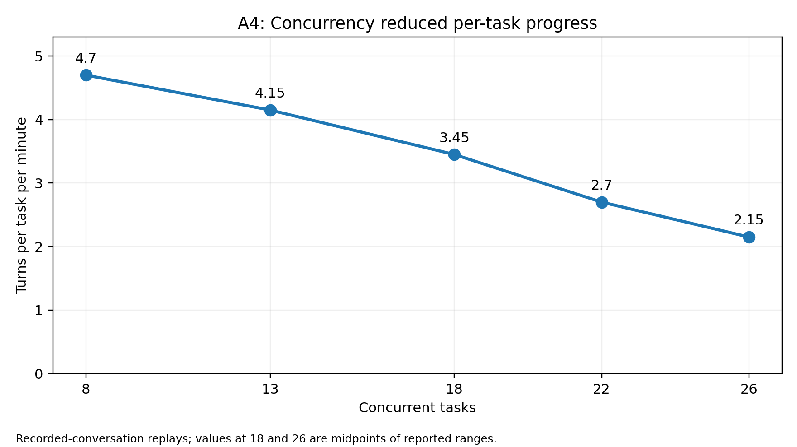
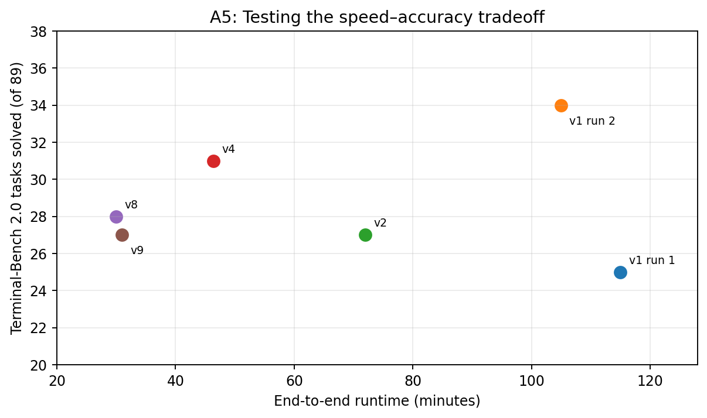
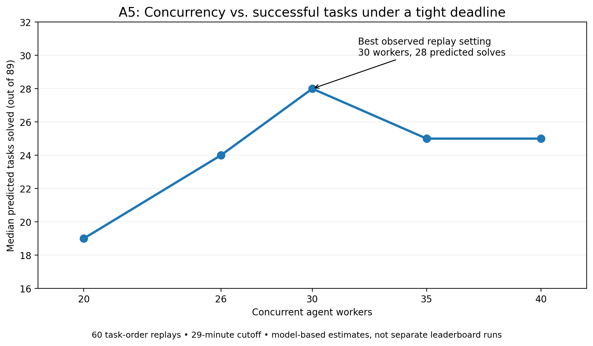

Designing a harness is a complicated and often overwhelming task. There are many layers across the stack that one can optimise: starting from how to serve the LLM, defining tools for the agent, choosing the right model settings, and giving it the right environment to thrive in. However, my key learning from the assignments was that we are not just trying to make the best coding agent—Anthropic and OpenAI can handle that—but instead trying to make an AI agent that performs well on the assignment benchmarks. While the hidden tests don't let you overfit to the tasks themselves, looking at the broader picture—balancing the number of tasks solved with latency, finding the right gaps, and making small wins—was often what gave me the biggest gains.

## Less is more

One of my biggest learnings across all assignments was that making the agent more complicated didn't necessarily make it more effective. The course has given me the opportunity to learn from some of the smartest faculty and students building AI agents, but taking everyone's advice can be overwhelming. There is a sense of fear of missing out when looking at the novel solutions that students come up with when designing their harnesses, but it is pertinent to separate the noise from what truly matters.

For assignment 2, I initially tried over-engineering and creating tools for specific operations the agent might need. However, I soon realised that keeping the collection of tools as lean as possible was the right move given the scope and structure of the problems. In one of the experimental runs, a simple harness solved 6/10 tasks using 386 LLM calls, while a more complicated version solved the same 6/10 tasks but made 570 calls, substantially more, increasing the total time spent on the tasks. While assignment 2 did not grade on time to solve a task, making the harness more complicated gave little to no gain but added to the end-to-end agent runtime.

For assignment 3, I tried giving failing tasks to the Expert model with access to all tool calls, but I soon realised that it only gave marginal returns on the number of tasks solved while costing significantly more and giving higher latency. For example, in one of the local runs, having the Expert model handle retries for failing tasks solved only 1/5 tasks while costing 1.96 dollars in Expert spending. Once I replaced this
with a lightweight, tool-free diagnosis, it required just four
Expert requests and 0.07 dollars in Expert spending, while still solving 1/5 tasks on the same local set.

For assignment 4, the learning became even clearer. For most of the assignment, I was using the same harness as assignment 3 with a scout–planner–coder–reviewer agent pipeline and was primarily focused on making serving more efficient. However, what finally gave me the biggest gain was to make the harness more lightweight: using a simple scout + coder agent pipeline with no Expert model and thinking turned off. This was primarily due to the fact that with 26 tasks running concurrently and each turn taking longer than in assignment 3, the goal was to terminate in as few turns as possible and make each turn cheaper. As a result, the core optimisation had to be done at the harness level by making it a lot simpler.

Lastly, for assignment 5, I realised the existing harness structure was enough and further improvements to the inference or agent architecture would only complicate and potentially break what was already working. As a result, I focused primarily on solving tasks as fast as possible: tightening the turn limits for each phase, pipelining the 89 tasks through 26 workers at a time, and setting concrete time limits to ensure the working harness was as efficient as possible. I tried adding an independent reviewer stage since the time limit for Terminal-Bench allowed it. However, the addition deteriorated my score on both Terminal-Bench and the 26-task benchmark, reinforcing the idea that simpler is better.

Therefore, the biggest takeaway from these experiences was that we're not trying to make the most technically sophisticated harness, but rather one that maintains simplicity while achieving the goal.

## Experiment, evaluate, refine, repeat

One of the core learnings across the assignments was that designing the harness without constantly evaluating is like making the world's best shooter shoot in the dark. No matter how powerful or sophisticated the harness might seem, it needs to be tested against real tasks. This is especially helpful because the benchmark tests are deterministic and verifiable. For me, one of the core parts of working on each assignment was to build a research loop where I could use AI assistants to come up with hypotheses, make changes, evaluate, diagnose, and repeat the process.

For assignment 3, I tried multiple configurations for the agent architecture before landing on the final one. I tried giving the Expert model the entire task from the beginning, using only the Standard model, having multiple agents work on a single task in parallel, retrying failing tasks, etc. However, having a research loop that allowed me to constantly test and evaluate these ideas was crucial to helping me narrow down my search. Running the local test suite was the fastest and most effective way of testing hypotheses without exhausting the leaderboard budget. Here are some examples of different architectures I experimented with and evaluated to arrive at the final one.

| A3 architecture experiment | Tasks solved (out of 26) |
|---|---:|
| Standard coder | 11 |
| Added requirement tests, `run_tests`, and repository memory | 9 |
| Added independent second candidate | 10 |
| Expert architect + Standard coder + Expert review | **15** |

For assignment 4, I tried running 5–26 workers in parallel and evaluated metrics like throughput, KV cache utilisation, and idle server time to understand the limits of the serving infrastructure. One finding during these experiments was that increasing concurrency didn't always improve server throughput. For example, when the number of concurrent workers increased from 8 to 26, the number of turns each agent could complete per minute dropped from 4.7 to 2.1–2.2, while prefix cache hit rates fell from around 91% to 30–34%. Looking at aggregate throughput, I found that it initially increased with concurrency but peaked around 18 workers before finally declining. This helped me identify KV cache pressure and inference contention as important bottlenecks rather than simply assuming that running more agents would be better. I also experimented with other hypotheses like turning thinking off and making the harness leaner and was able to constantly evaluate those hypotheses through running the benchmarks (either locally or on the leaderboard).

Finally, for assignment 5, only after running the harness on the leaderboard a few times did I realise that most successful tasks actually terminated in under 15 minutes and that additional time mostly produced diminishing returns. As a result, I was able to experiment with tighter per-task budgets, higher concurrency, and earlier stopping conditions rather than continuously modifying the agent architecture to make sure we didn't unnecessarily waste time on tasks that gave minimal returns. For example, looking at the leaderboard runs, I recognised that my Terminal-Bench run that lasted 46.4 minutes was able to solve 31 tasks on the leaderboard, which was only round 3 at the time. After finding gaps in the frontier and looking at my own run, I realised cutting the end-to-end runtime down to around 30 minutes would cost me only 2–3 tasks but would push me up to round 2.

## Optimisations must happen across the stack

While I had built AI agents before, most of my experience was with designing harnesses around production LLMs. I had never really explored what goes into serving an LLM myself. Assignment 4 gave me the opportunity to understand that side of the stack, and I realised how much more you can get out of an agent when you have control over the underlying inference infrastructure.

For assignment 4, I started by learning how to access the Harvard-provided cluster, connect to it from my local machine, and finally host the open-source model on a single RTX PRO 4500 GPU. Since the hardware resources were constrained, this really pushed me to think about how to effectively utilise the resources that serve the LLM. I started off with my harness from assignment 3 but soon realised that only running 5 workers at a time underutilised the server, which mostly sat idle for 90% of the run. I then pressure-tested the inference infrastructure by running all 26 tasks at once, at which point the prefix-cache pressure became a real bottleneck. Hence, I soon realised this was an optimization problem, where, given the constraints and my current harness, I had to experiment and figure out the right amount of concurrency that would serve the LLM best.

Balancing concurrency with per-agent progress, I arrived at 16 workers being the best-performing configuration under my initial serving setup. I then tackled the prefix-cache bottlenecks further by introducing longest-prefix-match (LPM) scheduling and hierarchical caching, which increased my cache hit rate from **84.5% to 90.9%** and decreased my uncached prefill by **38%**. These gains then trickled up the stack: my agent progress increased from **3.69 to 3.88 turns/task/min**, which allowed the agent to make more progress in the same amount of time.

I saw this effect further in assignment 5, where I learned that agent concurrency and inference concurrency are not necessarily the same thing. Initially, I did not want to exceed the concurrency of 16 workers from assignment 4 since I did not want to overload the GPU. However, after analysing the agent runs, I soon realised that we could increase the worker concurrency with the GPU still being able to effectively serve each agent. I found 30 workers to be the sweet spot for my existing harness, which, based on measured model-versus-tool time, would create approximately 13 simultaneous inference requests on average, below the server’s capacity of about 21 active requests. This was primarily due to the fact that these requests were interleaved and most agents spent substantial time executing tool calls, Bash commands, and tests. The 30-worker sweet spot was a result of running an ablation experiment across multiple concurrency sizes, where concurrency beyond 30 led to diminishing results as inference requests competed for shared resources. Ultimately, increasing concurrency from 26 to 30 alongside tightening the global runtime cutoff helped reduce my Terminal-Bench execution time from 46.4 to 30.2 minutes, sacrificing only three successful tasks and improving my leaderboard round from 3 to 2 at the time.

## Spend time finding gaps in the frontier

Lastly, one of my biggest learnings from the assignments was learning how to identify bottlenecks in the existing harness and find the next achievable goal on the frontier. Often the biggest changes came from changing what I chose to optimise instead of continuing to make an existing component more sophisticated.

For example, in assignment 3, I was initially using the Expert for the entire run end-to-end, expecting that I could reach the frontier by optimising for the number of tasks I solved. I kept pushing my harness to try to solve more tasks locally, but at some point ended up hitting a wall. It was only after I looked at the frontier and decided to optimise for cost and time that I realised I could use the Expert to act as the planner and reviewer, which could maintain the number of tasks solved while making each run much cheaper. In a separate local experiment, using the Expert for a single lightweight diagnosis reduced its usage to **4 calls and $0.07 in Expert spending**, while still solving 1/5 tasks on that local test set. The final planner-reviewer architecture also went on to solve **15/26 tasks** in its best leaderboard run, which showed that using a stronger model in a more selective manner could be more effective than relying on it throughout the entire run.

This approach was especially useful in assignment 5, where I had to optimise for rankings on two different benchmarks. As a result, I decided to find the frontier gaps in each and tuned my harness to optimise for each one separately. For example, for the 26-task benchmark, I realised reaching the same level of performance as my best submission from assignment 4 would suffice to achieve round 2. In fact, my earlier assignment 4 submission had solved **13/26 tasks in 45 minutes**, while in assignment 5, solving just **8–10 tasks in under 29.5 minutes** was enough to reach round 2 at the time. However, for Terminal-Bench, I needed to fundamentally change my harness: increase concurrency to 30, set a 15-minute time limit for each worker, and experiment with shorter global time limits for the whole run. I arrived at these parameters by running the harness with no time limit, looking at the time taken to successfully solve tasks, and then comparing the time–accuracy tradeoff across the leaderboard to find the task–time combination that would bring me to rounds 1–2. For example, in one of my initial runs, **30 of the 34 successfully solved tasks finished within 11 minutes, and none of the remaining successful tasks took longer than 30 minutes**, suggesting that allowing tasks to run indefinitely was giving me diminishing returns. In my case, I realised that my harness could solve 30+ tasks in under 47 minutes, which could reach round 2 at the time, and that solving more tasks would cost additional time, while giving the harness less time would reduce the number of tasks solved.

Overall, spending a decent amount of time analysing the frontier to evaluate the sweet spot for my harness paid off quiet well since I was able to make targetted improvements to my harness.

## AI use

I used Claude Code to consolidate the context about the key work across all assignments. I used it as a tool to surface patterns across assignments and help me brainstorm key learnings. I also used ChatGPT for wording, grammar, and spelling edits to the blog post.
