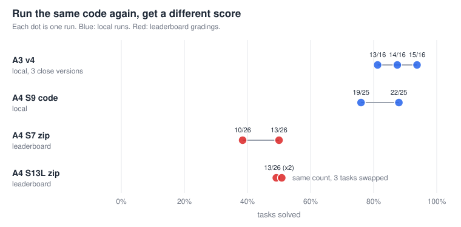
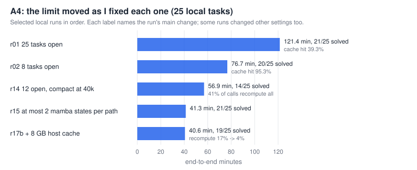
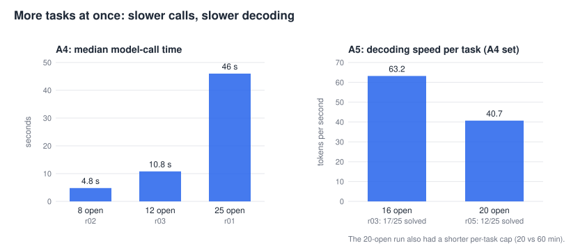
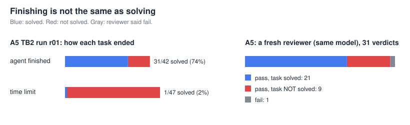

## 1. One run is not enough

At first, it was easy to treat a higher score as proof that a change worked. But the same code could get very different results.

In A3, I ran three close versions of my v4 code locally. It solved 15, 14, and 13 out of 16 tasks. In A4, the same S7 zip scored 13/26 and then 10/26 on the leaderboard. S13L scored 13 twice, but 3 of its 13 solved tasks were different. Even the same total score could hide different behavior.

The noise also appeared locally. The same S9 code solved 22/25 tasks in one run and 19/25 in another.

I learned to ask how much evidence a result really gives me. A gain of one or two tasks may be noise. Before calling a change useful, I should repeat the comparison under similar conditions. I should also check which tasks changed and why they failed. The total score alone tells only part of the story.

## 2. Fixing one bottleneck reveals another

My first A4 run started 25 tasks at once. Their combined context was about 850,000 tokens, while the KV cache could hold only about 391,000. The cache hit rate was 39.3%, the median call took 46 seconds, and the run took 121.4 minutes.

Reducing the number of active tasks to eight raised the cache hit rate to 95.3%. Total time fell to 76.7 minutes. The problem was not simply that the model was slow. I was asking the system to keep too much context at once.

After that, other limits became visible. In A4 r14, 41% of calls recomputed the full context because of limits on Mamba state slots. Limiting each path to two states reduced run time from 56.9 to 41.3 minutes. An 8 GB HiCache later reduced recomputation after idle periods from 17% to 4%.

CPU and tool work also mattered. After a change to how BusyBox grep was used, tool time for one task fell from 26.4 to 8.1 minutes.

The lesson was simple: the bottleneck changes as the system improves. After each useful change, I need to measure again. The next problem may be in a different part of the system.

## 3. More parallel tasks can mean less progress

I expected more parallel tasks to make a run faster. My A4 results showed why that assumption was too simple.

With 25 active tasks, the median call took 46 seconds. With eight, it took 4.8 seconds. Raising the count to 12 increased it to 10.8 seconds. In r03, our predictions missed in the wrong direction. I had underestimated the cost of sharing limited resources.

A5 showed a similar tradeoff. With 20 active tasks, each task decoded at 40.7 tokens per second. With 16, that rose to 63.2. On the A4 task set, the local score also rose from 12/25 to 17/25. Given the noise in scores, this comparison alone does not prove a quality gain. But it showed a clear cost to speed per task.

The harness could also limit parallel work. In A5 r14, about 10 tasks reached their time limit within two seconds and entered grading together. Afterward, about half the workers waited for next_task. Active tasks dropped from 17–18 to 9–11.

I learned to measure how much useful work gets done across the whole run. Worker count by itself is a poor guide. The model, cache, tools, and harness all affect whether another worker helps.

## 4. Asking the model to check itself rarely fixed the problem

I tried several ways to make the agent review its work before finishing. They sounded useful, but the results were weak.

In A3, the agent reviewed its diff 17 times and made no changes. A compile check before submission ran 45 times and blocked no submissions. In A4, the audit step rejected work 39 times, but only one rejection led to a source change. The evidence gate produced 14 rejections and two source changes. Together, the two A4 checks used about 9% of a run's calls.

In A5, I opened a fresh conversation and used the same model as a reviewer. Of 31 review decisions, 30 were passes. Nine of those passed tasks were actually unsolved. A fresh conversation did not make the reviewer reliable.

The failure logs pointed to a more basic problem. Across the long A5 runs on the 26-task set, 57 of 64 failures were labeled “new tests failed.” In S5, all 26 tasks ended because the agent chose to finish. Twelve were unsolved, yet the agent finished them after only 23–102 minutes. These were false finishes; the agents had not simply run out of time.

There was another useful contrast in A5 TB2 r01. Tasks that ended with the agent choosing to finish solved 31/42, or 74%. Tasks stopped by the time limit solved only 1/47, or 2%. This does not mean forcing an early finish would help. It suggests that tasks still running at the limit were often already stuck.

I learned to separate the agent’s belief that it is done from evidence that the task is solved. A review step should produce a useful test or lead to a concrete change. Repeating “check your work” is not enough.

## 5. Working with Claude Code requires judgment

I also learned about my own role when working with Claude Code. Sometimes a specific instruction helped it find a better approach. Other times, too much direction limited what it could try.

The cache experiments gave me a concrete example of why human judgment still mattered. The important decision was to reduce the number of active tasks. That required looking at the whole run and questioning the setup, rather than focusing only on changes inside the code.

At the same time, I should not assume that my first idea is right. Our wrong predictions in r03 were a reminder of that. Giving Claude a detailed plan does not make the plan correct.

The balance I want is to set a clear goal, state the limits, and ask for a prediction that I can test. I can then give Claude room to work while using logs and measurements to decide what to keep. When results disagree with the plan, I need to change the plan.

Working with an agent does not remove the need for judgment. It gives me more ideas and changes to evaluate.

## AI use

I used Claude Code to help with coding, debugging, and experiment analysis during the assignments. In A5, Claude wrote the code for the agent and the server configuration, and it ran the local experiments and the analysis. I made the major decisions, discussed the work with Claude, and granted permissions. I wrote this post myself. Claude made the four figures and their alt text, checked the numbers and suggested a few corrections, translated this section from my Chinese notes, and set up and pushed the post files.
