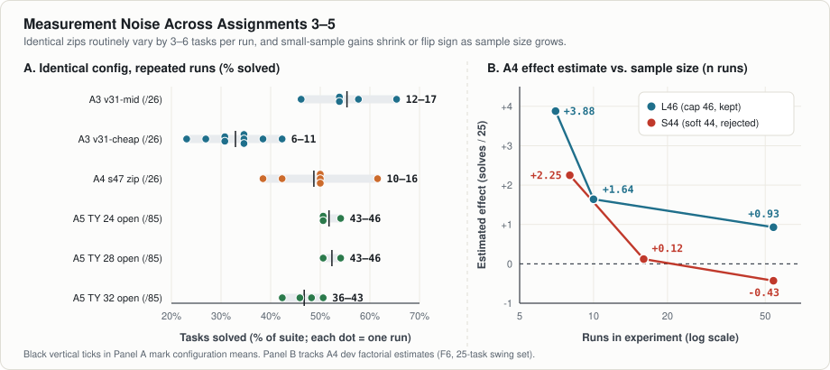
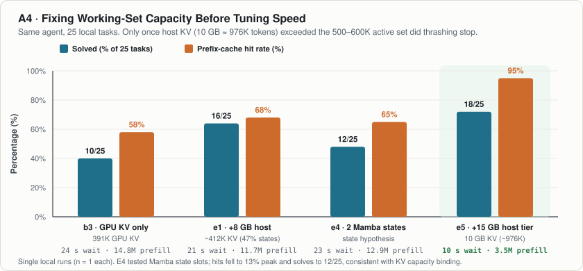
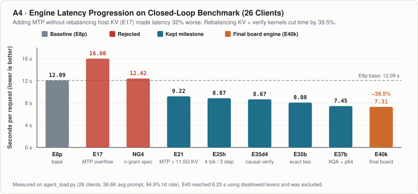
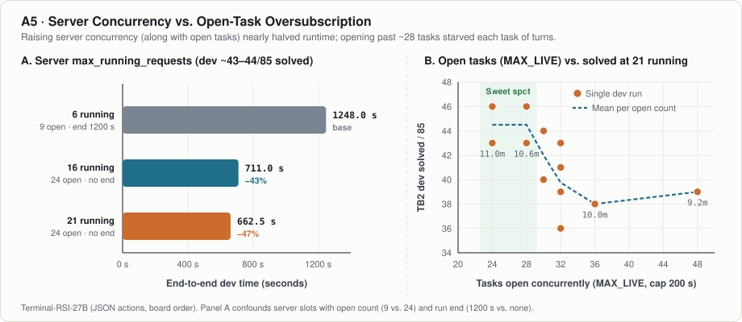
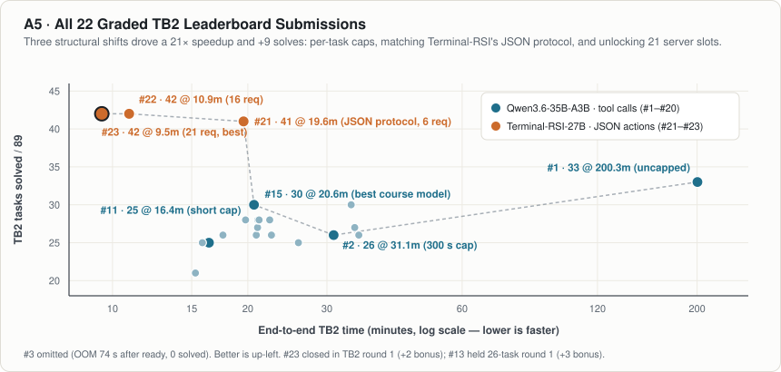
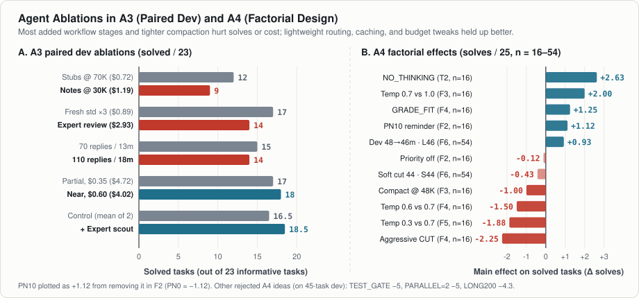

Assignments 2 through 5 in CS 2680 each opened up one more piece of a coding agent. In A2, I wrote a single-agent loop from scratch on SWE-bench Pro behind the course proxy. In A3, I turned it into a multi-attempt harness competing on a three-axis Pareto board (solved tasks, cost per solve, and time per solve) over 26 hidden repair tasks. In A4, I had to host `Qwen3.6-35B-A3B` (NVFP4) myself with SGLang on a single 32 GB RTX PRO 4500 while 26 agents queried it at once. By A5, I controlled the agent, the serving engine, and the model weights, evaluated on both Terminal-Bench 2.0 (89 tasks) and the 26 A4 tasks.

Across the four assignments I ran 150 leaderboard submissions and over 400 dev runs:

| Assignment | Best result | Context |
| --- | --- | --- |
| A2 | 6/7 solvable official tasks per run (7/7 across repeats) | 12-agent 429 burst test went from 9/12 to 12/12 |
| A3 | 17/26 at `$0.329` and 7:17/solve (peak 18/26; cheap corner 11/26 at `$0.083`) | 58 runs (`$277.57`); finished rank 23 (layer 2) after stopping 48 h early |
| A4 | 16/26 in 48.44 min, layer 1 (rank 1) at close | Prefix cache hit 58% → 95%; closed-loop latency 12.1 s → 7.3 s/req |
| A5 | TB2 42/89 in 9.5 min; 26-task 10/26 in 20.9 min | Score 50/50 plus both round-1 bonuses (+2 and +3) |

Looking back over the semester, most of what actually stuck with me wasn't tied to one specific assignment. The same mistakes kept coming back at different layers of the stack.

## Why I stopped trusting single runs

Early on, I kept treating a single run as proof that a change worked or broke something. It took a while to accept how wide the noise floor really is on 25 to 89 coding tasks.

In A2, every harness version solved 5 or 6 of the 7 solvable official tasks, and each version missed a different one. When my final version missed `openlibrary` in 10 iterations (the model guessed a Wikidata field name instead of the one written in the prompt), I assumed I had broken something. Running three repeats of the exact same code solved it 3 out of 3 times.

In A3 and A4 the swings were much bigger. Submitting the exact same zip twice on the A3 board dropped my scout configuration from 18/26 to 12/26. Across 29 runs, roughly 12 of the 26 tasks behaved like coin flips. In A4, six board submissions of my best 48-minute zip scored anywhere from 10 to 16 (averaging 12.7). Getting 16/26 in 48.44 minutes kept me in layer 1 until the deadline, which was great, but I had predicted 13 before submitting it and knew not to treat 16 as what that zip normally does.

On A5's 85-task dev split (TB2 part A) with the baseline `Qwen3.6-35B-A3B` model around a 27% pass rate (~23/85), binomial variance alone gives $\sigma = \sqrt{85 \cdot 0.27 \cdot 0.73} \approx 4.1$ tasks per run (and around 4.6 tasks on the later `Terminal-RSI-27B` runs at 43-46/85). For the difference between two independent runs, the standard deviation scales by $\sqrt{2}$ to roughly 5.8 tasks (6.5 near 50%), so a 4-task jump on a single A/B comparison is well inside one standard deviation.


*Repeated runs of identical configs routinely span 3 to 7 tasks (left). In A4 dev sweeps, early small-sample gains shrank sharply or flipped sign as I collected more runs (right).*

Once I actually started repeating experiments, several ideas I had felt excited about vanished. In A3, comparing a refinement branch against a baseline from two days earlier looked like a clear win, until a paired run in the same hour came back slightly worse. In A4, moving the soft cutoff to 44 minutes looked like +2.25 solves after 8 runs, shrank to +0.12 at 16 runs, and ended at −0.43 after 54 runs. Even my local serving benchmark had ~2% run-to-run drift, enough to make a prefill tuning patch look fast on its first test and slower on a paired repeat.

Eventually I forced myself into a habit that saved a lot of churn: write down a numeric prediction before launching any run, pair controls in the same hour so cluster slowdowns don't look like regressions, and use multi-factor sweeps when testing small agent flags.

## When the benchmark or the container is the bug

Repeats help with variance, but they don't catch a broken test environment. Several times I was about to rewrite the agent when the actual bug sat underneath it.

Early in A4, my first local 25-task run solved 10/25 in 39 minutes and my first board run got 1/26. Before touching any server flags, I ran SGLang's built-in serving benchmark two ways: once with random prompts, and once replaying my agent's actual conversations. Then I compared both against `/metrics` from the live run:

| Workload | Mean TTFT | Mean end-to-end | Prefix-cache hit | Mean queue |
| --- | ---: | ---: | ---: | ---: |
| Random serving benchmark (~12K avg prompt) | 6.5 s | 23.3 s | 0% | 5.2 |
| Back-to-back agent conversation replay | 23.2 s | 39.6 s | 23% | 11.9 |
| Live agent run (`/metrics`, ~25.6K avg prompt) | 9.95 s | 23.8 s | 58% | 3.6 |

This genuinely confused me at first. The random benchmark landed right next to the live end-to-end latency (23.3 s vs. 23.8 s), while replaying real conversations was way off. Looking at the cache hit rates (0%, 23%, 58%) explained both. Random prompts only matched latency by accident because they were half as long, roughly cancelling out having zero cache reuse. Replaying conversations back-to-back removed the tool and grading pauses between turns, piling requests up and trashing the cache down to 23%. I ended up writing a small closed-loop load generator (26 clients, growing prompts, ~10 s think time) that matched live prompt lengths and cache hit rates (~95% after the host-cache fix), and used that for all later engine work.

Containers caught me off guard twice too. In A2, running the upstream gold patches through the official evaluator only passed 8 of 10 tasks: one image shipped incompatible newer Go files that broke compilation before any test ran, and another had an untracked conflicting file. One Ansible task also failed only 1 of 150 tests because the hidden test checked for the literal string `--api-key` while the prompt asked for `--token`. On top of that, my own cluster container stand-in accidentally skipped paths containing `dev/`, deleting a needed module inside `openlibrary` until I caught the `ImportError` and threw out earlier runs.

In A5, my first TB2 dev run started on all 89 tasks, and I stopped it after 49 tasks were graded: only 5/49 passed, and none of the 44 failures even had a `pytest` summary line. Under rootless Podman on the dev cluster, `apt-get` was dying with `setgroups 65534 failed - Operation not permitted` before installing test dependencies. Fixing that with an `APT` sandbox config uncovered a second failure, so I stopped the next run after 12 graded tasks (0/12 solved because `tar` and `uv` failed trying to `chown` files to another UID). Adding a tiny dev-only `LD_PRELOAD` shim let a full 89-task run jump to 36/89 without changing the agent at all (later dev sweeps used the 85-task part-A split, which is where the `/85` denominators elsewhere come from).

Dev environments can also invert your bottleneck. In A4, I initially chose an early speculative decoding setup based on Mac dev runs, and it ran ~35% slower per turn on the board: my laptop was slow at executing tools (keeping only 2 to 5 GPU requests busy), whereas the board was GPU-bound across 26 workers. In A3, optimizing on a 23-task subset of "informative" tasks overfit because fixed per-task overhead like a `$0.10` scout still had to be paid on easy and unsolvable tasks on the real board. And in A5, running TB2 dev in random order made me underpredict the board (35-37 vs. 41) until I matched the board's alphabetical task order, where earlier tasks happened to be slightly easier.

## Running out of KV cache before running out of compute

When my first A4 board run got 1/26 with 10 tasks producing no patch, my obvious guess was that A3's 13-minute attempt timer was too short for one local GPU. Raising the limits dropped no-patch tasks to 3, yet the score only crept to 2/26 in 82 minutes, about one reply per task per minute.

Logging SGLang's `/metrics` every 10 seconds showed what was actually happening. Across 1,362 calls, the 25 agents sent 34.9M prompt tokens and generated only 0.38M output tokens, a 92:1 ratio. Agents spent 70% of their wall-clock time waiting on the model (mean wait 24 s), while GPU KV stayed 90-95% full with 5 to 13 requests queued and only 58% prefix-cache hits. The GPU held ~391K KV tokens, while 25 growing conversations needed 500-600K at once. Every time a worker went off to run bash commands and came back, part of its history had already been evicted, so the GPU spent its time recomputing old prompts instead of decoding. Near the end of the run, once fewer agents were left, cache hits jumped to 99%, which convinced me it was pure capacity rather than an agent bug breaking prefixes.

I still guessed wrong once before fixing it. An 8 GB host cache (`--hicache-size 8`) only gave ~412K host KV tokens because SGLang allocated 47% of that pool to Mamba states, and under write-through caching the host tier mirrored the 391K-token GPU pool, adding almost no extra capacity. Seeing low peak-load hits there, I first wondered if hybrid Mamba state slots were the limiter and tried keeping two states per radix path. That actually hurt (local solves dropped from 16/25 to 12/25), and traces later confirmed KV capacity was binding almost every time requests queued. Patching the host tier to 15 GB with a full 10 GB reserved for KV (~976K tokens) finally put cache capacity above the working set. Hit rate jumped from 58% to 95%, recomputed prefill dropped from 14.8M to 3.5M tokens, mean wait fell from 24 s to 10 s, and local solves went from 10/25 to 18/25.


*Same agent on 25 local A4 tasks. Sizing host KV above the 500-600K working set cured thrashing and more than halved wait time; doubling Mamba states made it worse.*

Only after that did speculative decoding have a real shot, and memory interactions still bit me twice. When I first turned on multi-token prediction (MTP) in A4 without rebalancing the host tier, it looked fast for two minutes and then collapsed to 16 s/request, 32% slower than baseline, because its extra footprint squeezed host KV just below the active set and restarted thrashing. Once I moved the host split to 11.5 GB KV, MTP held 94% cache hits and dropped latency from 12.1 s to 9.2 s/request. Verification and attention kernel improvements brought closed-loop time the rest of the way down to 7.3 s/request, where I stopped (the GPU was 93% busy and MoE GEMM was already at 96% of optimal; I also dropped two faster levers after a rule check showed they weren't allowed).

I hit a rougher version of the same memory wall in A5 when I tried DFlash, a 0.4B draft model with strong published B200 numbers. Over 7 server starts in an hour it OOM'd four times because Qwen3.6's GDN linear layers couldn't use `ReplaySSM`, forcing ~3 GB of extra verify scratch alongside a heavy draft KV pool. When it finally started, KV had shrunk from 343K to 138K tokens, acceptance was worse than built-in MTP (1.93 vs. ~3.2), and tool calls broke completely (0/85 solved).


*Closed-loop benchmark (26 clients) across A4 engine versions. Adding MTP without resizing host KV (E17) made latency worse; rebalancing host KV and tuning verify kernels cut request time nearly 40%.*

In A5, a different memory pool quietly throttled concurrency. After switching to the dense 27B model (20 GB of weights), I spent a full day wondering why 89 tasks still took 20 minutes until I noticed one line in the SGLang startup log:

```text
max_running_requests is capped to 6 by the mamba state cache (max_mamba_cache_size=33, 5 state slots per request)
```

Disabling the 1.85 GB prefill CUDA graph, switching to lazy state buffers, and skipping the decode lock reduced state slots per request from 5 to 3 and lifted server concurrency from 6 to 21 running requests. Once the server could handle that, I also raised open tasks from 9 (with a 1,200 s run end) to 24-28 (with no run end). Because those changed together and I didn't run a 6-running / 24-open control, the nearly 2× speedup in dev (1,248 s down to 662.5 s) and on the board (19.6 minutes down to 9.5 minutes at 42/89 solves) reflects both higher server concurrency and keeping the larger batch fed.

The opposite extreme hurt just as quickly. Pushing static memory fraction too high (`0.945`) passed the launch check and a 25-minute dev run while leaving only 0.26 GiB free, then died with `torch.OutOfMemoryError` 74 seconds into board grading and wasted a daily slot. On the client side, opening all 26 A4 tasks at once stretched turns to 25-36 s and cut solves in half (5/26 vs. 10/26 at 12 open), and opening more than ~28 TB2 tasks against 21 server slots starved each task of turns inside its 200-second cap.


*Raising server concurrency from 6 to 21 alongside opening 24 tasks instead of 9 (and removing the 1,200 s run end) nearly halved runtime (left). Opening more than ~28 concurrent tasks on 21 server slots starved tasks inside their 200 s cap (right).*

## Switching models and forgetting to match the format

My first runs with `Terminal-RSI-27B` in A5 were discouraging: 19/85 and 22/85 on TB2 dev, worse than the baseline `Qwen3.6-35B-A3B` (24.5-28/85). (`Terminal-RSI-27B` is a different base model family from the course's `Qwen3.6-35B-A3B` MoE: it is a fine-tune of the dense `Qwen3.8-27B` model, quantized to NVFP4.) I was close to dropping it until I opened a single transcript and noticed that every task ended with `no_tool_calls`.

The model had been trained on Terminus-2's plain-text JSON format, not OpenAI tool schemas. It kept printing JSON actions like `{"plan": [...], "commands": [...]}` as normal assistant text, and my harness assumed it was done. I added a tolerant JSON action mode with an `EXIT` trap so `cwd` and exported environment variables carried over between `/exec` calls like a real shell. On the very next dev run, TB2 jumped to 48/85, and on the board it jumped from a 30/89 ceiling with the baseline model to 41/89 and then 42/89 in 9.5 minutes.


*All 22 graded A5 TB2 submissions on log time vs. solved. Per-task caps, matching Terminal-RSI-27B's JSON action format, and raising server concurrency from 6 to 21 drove the progression from 33@200.3m to 42@9.5m.*

Swapping weights also had an engine side effect I hadn't anticipated. Two `Qwen3.6` fine-tunes I tested in A5 (`Ornith-1.5` and `Sage-A1.5`) not only scored lower on TB2, their fine-tuned weights drifted away from the frozen MTP draft head, cutting acceptance from 3.42 down to 2.95 and 2.30 and dragging generation throughput from 653 tok/s to 424 tok/s.

I also had to stop assuming faster requests automatically mean more solves. Making A4's engine ~40% faster didn't clearly raise board scores (12-13 solves vs. 14 on an earlier engine), and aggressively trimming prompt history sped turns up 22% while dropping board solves to 8/26 because the model lost context it needed.

Where cutting output tokens seemed more useful was stopping runaway chain-of-thought loops under tight time limits. In A2, one task burned over 250K completion tokens and blew past the 1-hour limit; in early A5, 17 of 49 tasks hit the 16K-token cutoff repeating the same lines over and over. Turning thinking off (`enable_thinking: False`) came out ahead on both speed and solves in my two paired A5 dev comparisons (29 and 27 in ~32 min vs. 27 and 25 in ~35 min), though `n = 2` pairs is only suggestive on solves. In A4 dev (`n = 16`), disabling thinking halved request time and estimated +2.6 solves, but on the leaderboard the solve gain flattened out (13 and 13 solves vs. 12 on the comparable thinking-on run). Temperature in A4 (`n = 16` per sweep) showed a similar directional signal: 0.7 came in +2.0 solves above 1.0 (SE 1.13), while 0.3 came in −1.9 solves below 0.7 (SE 1.01) despite higher draft acceptance (3.73).

## Why most of my extra agent steps didn't help

Across all four assignments, the agent changes that actually moved scores were usually plain reliability fixes:

- In A2, passing `requirements` and `interface` alongside `problem_statement` moved a 3-task ablation from 0/3 to 3/3 because required function names didn't appear in `problem_statement`. Giving HTTP 429 its own 60-retry counter lifted a 12-agent burst test from 9/12 to 12/12. Committing dirty baseline images with `git commit --no-verify` bypassed ProtonMail's Husky ESLint hook (which had been running Node out of memory over 600 files) and took `webclients` from failing across three versions to 4/4 passes.
- In A4, stripping an unnecessary `--no-cache` flag from Jest commands cut median Jest time from 62 s to 6 s with zero change in test results.
- In A5, sending context compaction as a separate request *without* tool definitions fixed 13 of 19 empty summaries where the model kept trying to call tools even when told `tool_choice="none"`.

Almost every structured workflow or extra check I added to make the agent "smarter" lost once I ran paired tests.


*Paired A3 dev ablations (left) and A4 factorial main effects on the 25-task dev set (right). Heavier workflows and tighter compaction mostly lost.*

In A3, summarizing history at 30K tokens dropped dev solves from 12/23 to 9/23 and cost more (`$1.19` vs. `$0.72`): the agent kept re-reading files it had dropped and lost prompt caching (across ~120M prompt tokens in a run, cached input cost roughly `$0.50` instead of `$10` uncached). Adding an expert review pass before refining dropped solves from 17/23 to 14/23 at more than triple the cost (`$2.93` vs. `$0.89`). Raising the turn limit from 70 to 110 replies cut cap hits from 11 to 3, yet solves still slipped from 15 to 14.

In A4, a requirements gate, a check-first workflow, running two parallel attempts per task (which thrashed 60 to 84 git working-tree swaps per task), and replacing multiple attempts with one 200-turn attempt all lost on dev. The one that stuck with me most was `TEST_GATE`. I had seen 16 failed runs where nothing ran the repo's own test runner, so I forced local verification before submission. Dev dropped from 19/45 to 14/45 because local tests ate the clock, and when I looked closer afterward, 8 of 9 near misses had actually been running their own tests anyway. Even in A5, a bundle of six genuine log-driven fixes (including fixing a wrap-up prompt whose `0.85 * 300 = 255 s` trigger landed right on the loop's hard stop and had fired 0 out of 1,101 times) averaged 25.0 vs. 26.4 baseline, so I turned it back off.

The few agent ideas that survived were lightweight: a read-only expert scout brief in A3 (which raised cheap-attempt pass rates and helped hit 18/26), escalating to the expert only on near misses with a `$0.60` cap instead of `$0.35`, and in A4 keeping larger tool outputs, resuming the best partial patch, and reminding the model which tests had already passed. I also learned the hard way in A3 to keep prompts strictly repository-agnostic after submission `#16` was flagged for restoring hints derived from benchmark failures.

## Cutting off the tail, watching the board, and small infra bugs

A surprising share of my A4 and A5 score came simply from cutting off doomed tasks early.

In A4, I didn't read the Pareto rules carefully until late October and spent two days chasing raw solves in the slow corner. My 4-hour run solved 16/26 in 217 minutes, and all 16 solves finished before minute 120; the last 97 minutes did nothing. Cutting the hard cap to 48 minutes (with a 40-minute soft cut) landed 16/26 in 48.44 minutes, which held rank 1 through the deadline. A later 54-run dev sweep tested nudging that cap from 48 down to 46 minutes (+0.93 solves, SE 0.54, plotted as `L46` above) for subsequent shorter submissions, while dropping further to 40 or 42 minutes on the board lost too many tasks (9-11 solves). I also noticed late that displayed times overshot my cap by 2 to 4 minutes because in-flight gradings ran to completion, so adding a check to only start gradings that fit before the cap cleaned up the overrun.

In A5, the uncapped TB2 baseline took 3 hours 20 minutes for 33/89. Looking at dev logs, solved tasks used 3.8 task-hours combined while failed tasks hitting their time limits burned 13.8 task-hours. Adding a 300-second per-task cap cut board time 6.5× to 31 minutes (26/89, TB2 round 1), and giving long-limit tasks an even shorter 200-second cap got the baseline model to 30/89 in 20.6 minutes. Two things caught me off guard here. First, that 300-second cap accidentally hit the 26-task A4 suite too (dropping it to 3/26) until I gave long-limit runs their own config, which hit 10/26 in 20.9 minutes (+3 bonus). Second, per-task caps aren't linear when the server is queued: trying a 200-second cap to throttle the 27B model down to ~34 solves actually gave 46/85 because cutting long tasks cleared the server queue and let every remaining task finish faster.

My most avoidable mistake was stopping early in A3. On October 18 I held rank 1 with five points on the front and decided that cushion was safe enough to stop submitting two days before the close. Over the last 48 hours, every single point was narrowly edged out (the last one 38 minutes before the deadline), dropping me from rank 1 to rank 23. In A4 and A5 I kept submitting through the final day and held layer 1 at close in both.

Finally, plain operational bugs ate real hours in every assignment: waiting until 5 hours before the A2 deadline to get the API key configured (and hitting the `$5` quota mid-experiment), `sbatch --export` splitting commas in A3, overwriting a live shell script on shared storage and leaving GPUs idle in A4. By A5, I wrote a three-layer watchdog and heartbeat guard for the dev cluster. Even that took a few live failures to get right (an empty bash glob, a Slurm `NODE_FAIL` that deadlocked the queue for 8.5 hours, and a worker launching against a server that had exited 12 seconds earlier), after which VPN disconnects and laptop reboots cost only about 2 minutes of idle GPU each.

## AI use

Across Assignments 2-5, I used coding agents (primarily Claude Code, with occasional design reviews from a second model) to write and test harness code, run cluster experiments, manage submission queues, parse traces, compile the evidence fact sheets, and write the Python script (`generate_figures.py`) that plots the SVG figures from my recorded data. All runs, measurements, and session archives are from my own coursework repositories.
