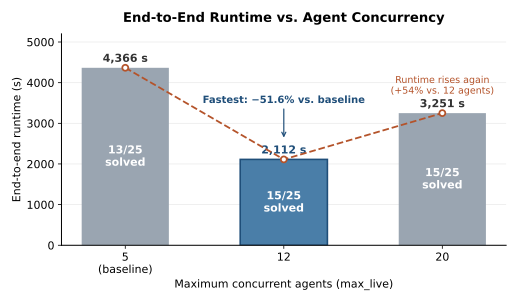
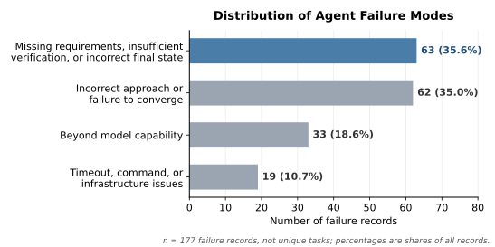
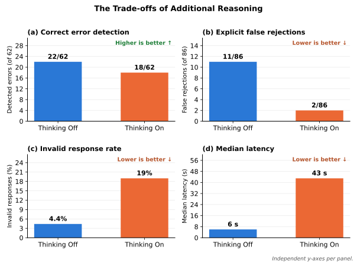

# **How to Think About Agent Optimization?**

## Lesson 1 \- Developing a Taste for AI Agent Optimization Through Controlled Experiments

Since CS2680 Assignment 2, I have been working on optimizing an LLM agent capable of solving tasks autonomously, aiming for both greater speed and higher accuracy. Initially, my focus was primarily on the agent harness itself: crafting better prompts, providing richer context, incorporating validation steps, and introducing more sophisticated planning and error-recovery mechanisms. The logic was straightforward: by offering the agent more guidance, context, and opportunities for self-correction retry times, I should be able to improve its solve rate.

However, as I progressed from A2 to A5, I discovered that many of the experimental results were counterintuitive, or at least counter to my own intuition. In A2, I found that an agent could pass all existing tests while still failing to meet requirements not covered by the test suite. In A3, complex multi-agent planning proved less effective than a simple solver loop. In A4, increasing agent concurrency yielded more significant performance gains than accelerating model inference. By A5, I realized that even improvements to self-checking mechanisms or model serving did not necessarily translate into a higher number of successfully completed tasks.

### **1.1 From Intuition to Evidence**

These experiences taught me to shift my agent optimization approach: instead of intuitively adding new mechanisms, I began analyzing execution logs to identify actual bottlenecks. I started validating hypotheses through single-variable experiments, offline replays, and repeated runs, thereby minimizing the need for costly live evaluations. 

And visualization really matters\! Looking only at the final solve rate and runtime tells us little about why an agent performs the way it does. Visualizing task execution timelines, resource utilization, and time spent on different activities helps reveal where the system is actually spending its time and where optimization might be worthwhile. Here are two plotting examples that show how to analyze through visualization.

![][image1]

*Figure 1. Baseline execution and resource utilization. (a) Task-level execution timelines (bold labels: solved; hatching: recovery). (b) Agent concurrency and model requests in flight. (c) SGLang KV-cache usage and running requests. Despite reaching the five-task concurrency cap for 75% of the run, the clock-corrected average number of in-flight model requests was only approximately 1.9, with peak KV usage of 32%. The final 1,486 s formed the long tail. (The average in-flight request count (approximately 1.9) is clock-corrected; the plotted request timeline is based on original client logs.)*

![][image2]

*Figure 2. Baseline performance breakdown. (a)Cumulative task time by activity (18,495 task-seconds). (b) SGLang decode batch-size distribution (mean 1.97). (c) Solve rates across successive attempts (10/25, 3/15, and 0/12). Sandbox commands consumed more task time than model inference, while the final recovery attempt yielded no additional solves.* 

### **1.2 One Experiment Full-Run Is Not Enough**

I also came to understand that the results of a single experiment full-run are insufficient to prove the effectiveness of an optimization. For instance, in the A4 leaderboard, I ran five separate evaluations using the same configuration—each consisting of 26 tasks—and the agent solved 10, 7, 7, 8, and 9 tasks, respectively. Relying on just one of these runs could have led to a completely different conclusion about the system's performance.

![][image3]

*Figure 3. Variability in solved tasks and end-to-end runtime across five leaderboard evaluations using the same Agent configuration. Each run evaluates 26 tasks.* 

### **1.3 Optimize the System, Not Just Its Components**

Another key finding is that system bottlenecks are not static; they shift depending on the model, benchmark, architecture, and runtime environment. For example, while a "done gate" mechanism in an evaluation harness might detect errors, this does not guarantee that an agent can successfully fix them. Even if a model’s token generation speed increases, an agent may still be constrained by factors like tool execution, task scheduling, or resource contention—meaning the overall runtime may not necessarily decrease.

In a word, before attempting any optimization, first identify what is actually limiting system performance. Developing a "taste" for agent optimization isn’t about knowing the best design from the outset; rather, it’s about learning through continuous experimentation, to discern what is worth optimizing and how to make the right trade-offs based on your specific goals.
  

# **How to Design an Agent Harness?**

## Lesson 2 \- A Simple Done Gate Can Make a Difference

In Assignment 2, I initially attempted to improve the agent’s solve rate by refining prompts and file-handling procedures. However, an analysis of failed tasks revealed that some implementations were nearly correct, only to fail due to a missed requirement, an incorrect output format, or a failure to adhere to codebase conventions.

One example came from NeuroScape, my research project that uses EEG signals to adapt spatial audio soundscapes. The updated specification required an adaptation to be considered "experienced" only when the audio actually started playing (`AUDIO_STARTED`), while legacy tests still accepted the earlier planning stage (`PLAN_APPLIED`). In attempting to pass these stale tests, the agent produced code that violated the new requirements. I therefore added a general principle to the verification prompt: when legacy tests explicitly conflict with the new specification, prioritize the new requirements. This change improved the task's F2P (Fail-to-Pass) test results from 8/14 to 14/14.

This approach informed the design of the "Done Gate" in Assignment 4, a lightweight code-based programmatic check performed before submission without requiring any additional LLM calls. This gate verifies that requirements are met, reviews test results, and examines code diffs, ensuring that the agent has implemented substantive changes while catching any overlooked details.

This reinforces a key point from Lesson 1: before attempting to optimize an agent, one must first understand the root cause of its failures. An agent’s failure does not necessarily stem from a lack of model capability; it can also result from incomplete task descriptions, conflicts between existing tests and new requirements, or inadequate verification methods. This further underscores the necessity of a robust harness to address such issues.

## Lesson 3 \- Less Is More (Simpler Architecture Works Better)

In Assignment 3, I sought to improve the agent's performance by refining the harness architecture itself by developing three successive iterations.

![][image4]

*Figure 4. Evolution of agent harness architectures in Assignment 3, from modular control to multi-agent planning and a simplified solver loop.*

The first version adopted a "modular control" approach, decomposing functions—such as task routing, context management, monitoring, and termination—into distinct modules. The goal was to exert more precise control over the agent’s behavior at various stages.

The second version introduced multi-agent planning, incorporating sub-agents, reflection, adaptive execution, and recovery mechanisms. My hypothesis was that by delegating planning, execution, and reflection to specialized components, the agent would be better equipped to make informed decisions before committing to code changes, and could more effectively pivot when encountering failures.

In practice, however, this added complexity failed to yield the expected benefits. For instance, "architect" calls occasionally failed due to input capacity constraints, and the additional LLM invocations did not consistently translate into meaningful code improvements. While the system gained more planning and reflection steps, these steps merely consumed extra time and computational resources.

Ultimately, for V3, I shifted toward a simpler design which is a modified "mini-SWE-agent" that retains a straightforward "Inspect → Edit → Test → Feedback" loop. Compared to the more elaborate multi-agent architecture, this version delivered the best performance with more solve rate and higher speed.

![][image5]

*Figure 5. Final agent harness architecture selected for Assignment 3 (V3), featuring a simplified solver loop with context compaction and recovery mechanisms. Drawn by the author.*

## Lesson 4 \- Keep Complexity Where It Matters (Compaction & Retry Mechanism)

However, the simplified architecture mentioned in Lesson 3 does not imply the complete removal of context management and recovery. I have retained two mechanisms designed to address specific challenges.

The first is "Hybrid Context Compaction." When the context reaches a configured threshold (defaulting to 60%), the system compresses older interaction records. In this process, the LLM summarizes previous debugging discussions, while deterministic Python code separately logs Git changes and tool execution history as well as preserving the most recent interactions.

![][image6]

*Figure 6. Context compaction mechanism. Earlier conversation turns are consolidated into a structured checkpoint containing Git state, action history, and summary notes, while the system prompt, task specification, and recent turns are preserved.*

The second is "Fresh-conversation Recovery." If a task fails and requires a retry, the system initiates a new "solver conversation" that inherits key information from the previous attempt, such as error reports, previously attempted modifications, and test results.

| Configs | Main | Recovery 1 | Recovery 2 |
| ----- | ----- | ----- | ----- |
| Model | STANDARD | STANDARD | EXPERT Plan \+ STANDARD Solve |
| Time Limit | 45 min | 15 min | 15 min |
| Request Limit | 300 turns | additional 100 turns | additional 100 turns |
| Cost Budget | $0.25 | additional $0.20 | additional $0.30 |
| Conversation | Fresh | Fresh | Fresh |
| Workspace | Initial | Preserve changes | Preserve changes |

This design stems from an observation: retaining the full historical context increases the token burden and may even cause an agent to become fixated on an ineffective problem-solving approach; conversely, clearing the history entirely results in the loss of critical debugging evidence. My goal, therefore, is to strike a balance: preserving essential information while stripping away as much redundant or irrelevant context as possible.

Combined with Lesson 3, we can see that more complex or comprehensive mechanisms do not necessarily lead to better agent performance. Additional processes for planning, reflection, and error correction come at a cost; such complexity is only meaningful when it effectively addresses specific, tangible problems.

## Lesson 5 \- Stop Overfitting, More Prompt Rules Don't Always Help

### **5.1 Optimizing for Known Tasks Does Not Guarantee Generalization**

Assignment 3 highlighted an issue: over-optimizing the evaluation harness for specific local development tasks can lead to overfitting. Initially, my harness performed well across five local tasks; whenever a failure occurred, I would analyze the cause and add a targeted rule to the prompt. While these adjustments improved results for the known tasks, they failed to generalize effectively to the course evaluator.

### **5.2 More Prompt Rules Can Backfire**

I encountered a similar issue during the experiments in Assignment 5\. Initially, I hypothesized that model responses were being truncated because the agent was attempting to write too much code at once. To address this, I introduced a prompt rule A to limit each code-writing chunk to 150 lines, and write in batches if too long. After this, the number of truncations dropped from the original 27/81 to 12/81.

But further analysis revealed that some truncations were not caused by excessive code length, but by the model embedding lengthy reasoning in its code comments. I therefore introduced another prompt rule B to discourage verbose analysis in code comments.

| Metric | Prompt Rule A | Prompt Rule B |
| ----- | ----: | ----: |
| Truncated responses | 12/81 | 16/81 |
| Total output tokens | Baseline | \+16% |
| Model latency | Baseline | \+16% |

However, the results went against my expectations. In the controlled comparison, truncations increased from 12/81 to 16/81, while both output tokens and model latency increased by approximately 16%. The additional rule, intended to reduce unnecessary output, ended up producing the opposite effect. I therefore rolled back the change.

### **5.3 Design for Generalization, Not Individual Failures**

These experiments changed how I approach prompt engineering. Adding more instructions does not always improve an agent's general problem-solving ability, and even seemingly reasonable constraints can introduce unexpected overhead. Rather than treating every failure as a reason to add another prompt rule, I then focus on identifying recurring failure patterns, designing more general-purpose mechanisms, and validating their effectiveness through controlled experiments.
  

# **How to Optimize System Performance?**

## Lesson 6 \- The Biggest Speedup Came from Agent Task Scheduling, Then Comes With Harness–Server Co-design

### **6.1 Improving Performance Through Agent Concurrency**

In Assignment 4, I analyzed agent execution performance using Qwen3.6-35B-A3B-NVFP4 and SGLang 0.5.20. Baseline logs indicate that the system reached its maximum task concurrency limit for 75% of the total runtime; however, the peak KV cache utilization was only 32%, and the average model queue time was a mere 3.9 ms. Furthermore, the cumulative task time was distributed as follows: 45.2% spent on sandbox commands and 40.1% on model inference.

These findings suggest that increasing agent concurrency, rather than further accelerating model inference, might be a more effective optimization strategy. Raising `max_live` (the maximum number of concurrently running tasks) from 5 to 12 reduced the total runtime by 51.6%. However, increasing it further to 20 actually resulted in a longer runtime, while the bulk-phase completion rate remained nearly identical (0.0141 vs. 0.0140 tasks/s). A higher number of concurrent tasks does not necessarily translate to higher task throughput; therefore, we must determine an optimal concurrency level based on the specific workload and resource constraints.

*Figure 7. End-to-end runtime vs. agent concurrency. Raising `max_live` from 5 to 12 cut runtime by 51.6%, but 20 agents ran slower than 12 with the same solve count.*

### **6.2 Why Faster Inference Didn't Mean End-to-End Faster Agents**

Since agents alternate between model inference and tool execution, task concurrency, model request concurrency, and serving throughput are not equivalent.

In Assignment 4, the serving benchmark achieved 328 tok/s with 12 concurrent sessions, while the actual agent workload averaged 204 tok/s over the full run. However, when 12 tasks were open simultaneously, the agent reached 314 tok/s. The request timelines illustrate how intermittent model requests contribute to the gap between benchmark and actual agent performance.

![][image7]

*Figure 8. Comparison of model serving throughput and request activity between a controlled serving benchmark, which replays model requests without executing agent tools, and an actual agent workload. Unlike the benchmark, agents alternate between model inference and tool execution, resulting in intermittent model requests. Timelines represent selected execution windows.*

I also experimented with NGRAM speculative decoding. Although per-token latency decreased by 8.8%, total runtime increased, with only 0.03 GiB of GPU VRAM remaining.

| Metric | Baseline | NGRAM Speculative Decoding |
| ----- | ----: | ----: |
| Per-token latency | Baseline | −8.8% |
| Total runtime | 2,112 s | 2,223 s |
| Solved tasks | 15/25 | 14/25 |

### **6.3 From Agent Scheduling to Model Serving Optimization**

As agent concurrency increases or the underlying model changes, model serving can become a new performance bottleneck.

In Assignment 5, I switched to Qwen3.8-27B-NVFP4, which uses both conventional KV cache and Mamba state cache to reuse previous computations.

![][image8]

*Figure 9. Comparison of Transformer KV Cache and Mamba Recurrent State. In conventional Transformers, generating a new token requires accessing the keys and values of previous tokens through the attention mechanism. As a result, the KV cache grows with the sequence length. In contrast, Mamba is based on a State Space Model (SSM) architecture that encodes historical sequence information into a fixed-size internal state. This state is continuously updated and used to process subsequent tokens, without maintaining a separate key-value entry for each previous token. Hybrid architectures can incorporate both caching mechanisms.*

Under the initial serving configuration (M-G23), increasing simulated concurrency from six to eight agents reduced cache share from 88.9% to 44.1% and increased average latency from 7.95 s to 16.3 s. To improve cache reuse under higher concurrency, I developed a new serving configuration (E-A).

I then combined the optimized serving configuration with `max_live=8` (E-A \+ ML8) and tested it on an actual agent workload. Although end-to-end runtime decreased by 21.9%, one fewer task was solved, and the worst 10-minute cache share dropped to 27%. Serving optimization alone did not simultaneously meet the objectives of speed, solve rate, and stability.

### **6.4 Co-optimizing Agent Concurrency and Context Management**

Agent scheduling and model serving are interconnected. Higher concurrency can reduce overall runtime, but the growing contexts of multiple agents can also increase KV cache pressure and reduce cache reuse.

Toward the end of Assignment 5, I developed a pressure-aware concurrency configuration (E36 Variant P) combining two mechanisms:

* Higher Agent Concurrency: Increasing `max_live` from 6 to 8\.  
* KV-Pressure-Aware Compaction: Triggering early context compaction based on the combined context length of all active tasks.

Unlike the individual context-based compaction introduced in Lesson 4, this mechanism uses aggregate context length as a proxy for overall cache pressure. Rather than expanding GPU KV cache capacity, this mechanism aims to reduce cache demand by shortening subsequent model requests.

| Compaction Condition | Threshold |
| ----- | ----- |
| Combined live context | \>130k tokens |
| Individual task context | ≥28k tokens |
| Remaining task time | ≥40% |
| Compaction cooldown | 4 turns |
| No new summary near deadline | Last 60 seconds |

However, compaction requires additional model requests and may lose historical information. I therefore conducted an offline experiment (E37) to evaluate whether the 40% Time Guard was necessary. Removing the Time Guard reduced the proportion of requests exceeding the threshold but provided no meaningful runtime improvement and potentially introduced unnecessary compaction near task completion. I therefore retained the 40% Time Guard.

Rather than optimizing the harness or model server in isolation, I began approaching agent optimization as a system-level design problem, coordinating task scheduling, context management, and GPU resource constraints.
  

# **How to Make the Right Trade-offs?**

## Lesson 7 \- Optimize for Your Goals

### **7.1 Recovery Is a Trade-off, Not a Free Improvement**

Recovery allows agents to retry failed tasks using previous errors and test results, potentially improving solve rate at the cost of additional runtime. In an earlier experiment, none of the 29 recovery attempts initiated after all tasks had been assigned succeeded. Based on this observation, I introduced Tail-Aware Recovery (TAR), which skips new recovery attempts once the pending task queue is empty. Then, later experiments showed that disabling TAR yielded three additional tail solves (one unstable) but increased runtime by approximately 1,015 s. So skipping low-yield recovery may be preferable when prioritizing speed, while additional attempts may be worthwhile when prioritizing solve rate.

### **7.2 A New Benchmark Changes What the Agent Needs to Do**

Assignment 5 introduced Terminal-Bench 2.0, with 89 tasks spanning software development, system administration, and data processing. Without `evaluate()`, agents must independently determine task completion before calling `done(k)`, with evaluation based on the final container state.

| A4 Design Assumptions | A5 Requirements |
| ----- | ----- |
| Repository-based tasks | Tasks may not involve Git |
| Evaluator feedback | Independent verification |
| Patch submission | Correct final environment state |
| Synchronous shell commands | Background execution and polling |
| Code-editing prompts | General-purpose terminal tasks |

These changes required me to rethink tool interfaces, autonomous verification, time-budget management, and termination conditions rather than directly reuse the previous harness.

### **7.3 Different Failures Require Different Optimizations**

The initial baseline solved 28/89 tasks in 6,767 s.

| Termination Type | Tasks | Solved |
| ----- | ----- | ----- |
| Agent called `done()` | 62 | 28 |
| Harness time limit reached | 27 | 0 |
| Total | 89 | 28 |

Incorrect submissions motivated further investigation into requirement verification and final-state correctness, while timed-out tasks raised questions about long-running commands, repeated tool calls, recovery strategies, and time budgets.

To identify potential optimization directions, I classified 177 failure records:

*Figure 10. Distribution of agent failure modes across 177 failure records (not unique tasks). The verification-related category is highlighted.*

The 63 verification-related failures motivated a testable hypothesis: could adding a review before `done()` reduce these errors? However, as discussed in Lesson 8, review itself introduces missed detections, false judgments, and execution costs. Failure analysis helps identify what is worth optimizing, but does not guarantee that a proposed solution will work.

### **7.4 Optimize for the Actual Objective**

Across Assignments 4 and 5, I realized that no optimization strategy is universally optimal. TAR trades potential solves for shorter runtime, while the transition to Terminal-Bench requires reconsidering existing harness designs as task requirements and failure patterns change.

## Lesson 8 \- More Self-Checking and Thinking Did Not Reliably Fix Incorrect Solutions

### **8.1 Early Success Requirement Audit Mechanism Did Not Generalize**

In Assignment 4, I introduced Requirement Audit, an additional LLM review that checks whether the solution satisfies all task requirements before submission.

| Experiment | Solved Tasks | Key Observation |
| ----- | ----- | ----- |
| Exp 14 — Requirement Audit | 16/25 | Review directly helped fix 3 tasks |
| Exp 15 — Repeat Run | 15/25 | Initial benefits were not reproduced |
| Exp 17 — Stricter Audit | 15/25 | Falsely rejected 4/15 correct patches |

Although Exp 14 showed promising results, subsequent experiments failed to reproduce the same benefits. An additional verifier can both overlook genuine errors and incorrectly reject valid solutions, interfering with the agent's decisions.

### **8.2 Self-Checking Does Not Guarantee Error Detection**

Without `evaluate()` in Assignment 5, agents relied more heavily on autonomous verification. I conducted an offline replay (E4) using historical finish states from Test0 to evaluate whether review could detect missing requirements.

| E4 Offline Replay | Result |
| ----- | ----- |
| Historical finish cases | 56 |
| Valid cases | 52 |
| Samples per case | 3 |
| Total model requests | 156 |
| Known failures with missing requirements | 13 |
| Consistently detected failures | 3/13 |
| Responses directly resubmitting | 29/156 |

The model sometimes repeated previous tests or accepted its existing implementation without reconsidering the requirements. Asking an agent to check again does not guarantee that it will examine its work from a different perspective.

### **8.3 More Thinking Reduced False Rejections, but Increased Cost**

I then compared Thinking Off and Thinking On to investigate whether additional reasoning could improve review performance.

*Figure 11. Trade-offs of additional reasoning in review. Thinking On reduced false rejections but did not improve error detection, and increased invalid responses and latency. Each panel uses its own y-axis.*

Thinking On reduced false rejections but did not improve error detection. It also increased invalid responses and latency. More reasoning introduced another trade-off: fewer false rejections at the cost of higher latency and more invalid responses.

### **8.4 Same-Model Expert Review Is Not Independent Verification**

I further investigated the limitations of Expert Review. Since all three model tiers used the same 27B model, the Expert effectively performed another round of self-critique rather than independent verification by a stronger model.

| Expert Review Analysis | Result |
| ----- | ----- |
| Pre-submission reviews | 30 |
| Errors detected | 0 |
| Ultimately failed submissions among reviewed cases | 6 |
| Solved runs with insufficient review time | 6 |
| Estimated upper bound with ideal triggering | \+1.65 solves/run |

None of the 30 reviews detected errors, including six submissions that ultimately failed. Even with an ideal triggering strategy, the estimated improvement remained far below the target.

Additional reasoning is not equivalent to independent verification. When the reviewer and solver share the same model, they may also share failure patterns. Additional review calls can therefore repeat existing mistakes, incorrectly reject valid solutions, and consume time otherwise available for problem-solving. This suggests that using a different model for Expert plan, supervision, review and verification process may be a more promising direction for reducing shared failure patterns.

## AI Usage Disclosure

AI tools were used to assist with organizing experimental data and generating some figures based on actual experimental results. The agent harness architecture shown in Figure 5 and used as the cover image was designed and illustrated by the author.

[image1]: fig1_analysisexample1_baseline_timeline.webp

[image2]: fig2_analysisexample2_baseline_breakdown.webp

[image3]: fig3_a4_leaderboard_run_variability.webp

[image4]: fig4_agent_harness_v1_v2_v3_comparison.webp

[image5]: fig5_agent_harness_architecture.webp

[image6]: fig6_context_compaction.svg

[image7]: fig8_bench_vs_agent_concurrency.webp

[image8]: fig9_transformer_mamba_cache.svg